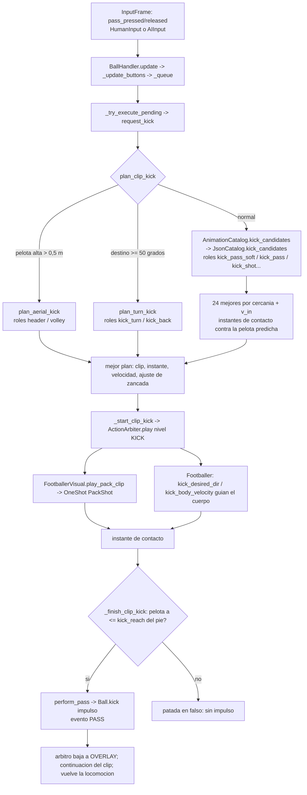
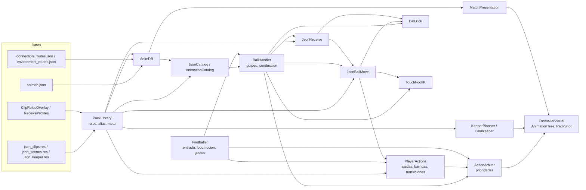

# Auditoría técnica del sistema de animaciones — Fútbol 5

- **Fecha:** 2026-11-07 · **Rama:** `integracion-openai` · **Commit auditado:** `5fb4f27` · **Motor:** Godot 4.7.2 oficial.
- **Alcance:** fotografía del estado actual. **No se modificó ningún archivo del proyecto** salvo la creación de este informe.
- **Método:** lectura del código; extracción de los metadatos reales de las 3.223 variantes; inventarios históricos del
  repositorio; ejecución de pruebas y de partidos completos en una **copia aislada** (`git worktree` fuera del repositorio,
  descartada al terminar) con una instrumentación mínima que solo **registra** (no cambia decisiones): cada clip que pasa
  por `FootballerVisual.play_pack_clip`, los clips que forman los espacios de mezcla de locomoción, y las estadísticas
  internas de golpeo (`BallHandler.kick_stats`, `kick_log`), recepción (`JsonReceive.stats`) y movimiento con pelota
  (`JsonBallMove.stats`). El código de la instrumentación está en el anexo A para que la medición se pueda repetir.

**Cómo leer las cifras.** Se distinguen cuatro niveles que no deben confundirse:

1. **Registrado / importado:** el clip existe en la librería y se carga.
2. **Conectado:** algún sistema del juego tiene código que puede pedirlo (un selector lo incluye en su grupo).
3. **Invocable:** además pasa los filtros de ese selector (puede salir elegido en alguna situación).
4. **Reproducido en juego:** se observó saliendo elegido durante partidos reales IA contra IA (medición propia), y,
   aparte, **contacto/sincronía medidos** solo donde una prueba con el esqueleto animado lo mide.

---

## Resumen ejecutivo

- Existe una **arquitectura real y bastante completa**: catálogo único por **rol** (111 roles), selección por
  **planificadores físicos** (golpeo, recepción, movimiento con pelota, atajada, caídas, transiciones) que prueban los
  candidatos contra la trayectoria predicha de la pelota, un **árbitro de prioridades** único por jugador
  (`ActionArbiter`) y una **ranura única de acción** en el `AnimationTree` que impide dos acciones a la vez.
- **No hay un selector central único** de "situación → animación": hay un registro central (`PackLibrary`/`AnimDB`) y
  una autoridad central de ejecución (`ActionArbiter` + `FootballerVisual`), pero la **elección** está repartida en
  ~10 planificadores especializados.
- **Cobertura medida en juego real:** en 6 partidos IA contra IA (5 de 10 min sin render y 1 de 3 min con render:
  53 min de juego) salieron **702 de 2.024 tramos (34,7 %)**, 888 variantes, de **90 de 111 roles**. **21 roles nunca
  salieron en partido**, entre ellos **cabezazo (95 clips) y volea (54 clips): 0 reproducciones**, porque la IA nunca pide
  un golpeo con la pelota en el aire. Sumando las pruebas automáticas (sin la galería), 967 tramos (47,8 %) salieron
  elegidos por un consumidor real al menos una vez.
- **Conexión declarada vs. invocable:** 1.948 tramos tienen un sistema consumidor (1.686 históricos + 262 de Codex), pero
  **322 de los "conectados" históricos nunca pueden salir elegidos**: los excluye el filtro de su propio selector
  (176 por recorrido de raíz o duración, 121 golpeos con contacto "no limpio", 13 sin toques medidos, 12 con el pie alto).
- **Contacto pie–pelota:** en escenarios controlados con esqueleto animado el contacto es preciso (50 de 50 golpeos con
  la punta visible a ~0,125 m del centro de la pelota = su radio visual). En partido, la tolerancia del modo 4 es amplia:
  un golpeo cuenta si la pelota está a **≤ 0,65 m** del punto de contacto previsto (`PlayerTuning.json_kick_reach`).
  Medido en partido (distancia entre la pelota y el punto de contacto del clip en el instante del golpe, golpeos
  aceptados): sin render mediana 0,16 m, p90 0,35 m, máx. 0,64 m, 21 % por encima de 0,30 m (114 golpeos); con render
  mediana 0,24 m, p90 0,44 m, máx. 0,59 m, 29 % por encima de 0,30 m (38 golpeos).
- **Recepción con clip:** de 475 primeros toques en 4 partidos, solo 124 intentaron un clip de recepción y 82 lo
  completaron (~17 %); el resto lo resuelve el control físico sin clip específico.

---

## 1. Arquitectura del sistema

### 1.1 Carga e importación

| Paso | Dónde | Qué hace |
|---|---|---|
| Fuentes | `animaciones_futbol5_JSON` (no está en el repositorio) | 2.022 archivos JSON con posiciones de 19 articulaciones |
| Conversión (herramienta, fuera de juego) | `tools/json_anim/build_json_library.gd`, `JsonRig`, `JsonRetarget` | Convierte posiciones a rotaciones sobre el esqueleto canónico; mide metadatos (raíz, rumbo, contactos, velocidades) y los guarda en `Animation.set_meta("pack", {...})` |
| Recursos versionados | `assets/animations/json_clips.res` (campo), `json_scenes.res` (escenas), `json_keeper.res` (arquero) | `AnimationLibrary` con 2.747 animaciones de campo (incluye 622 de escenas) y 476 de arquero |
| Carga en juego | `PackLibrary._ensure()` (`scripts/animation/pack_library.gd`) | Si `Tuning.gameplay_mode == 4`, carga las tres librerías (une escenas con campo), aplica las reasignaciones de rol de `ClipRolesOverlay.ROLE`, construye el índice **rol → ids** (`_roles`) y el índice **alias** (nombre del pack de Mixamo → id JSON) |
| Inventario consultable | `assets/animations/animdb.json` vía `AnimDB` (`scripts/animation/anim_db.gd`) | 2.022 fuentes con acción, sistema, conexión histórica y datos de UCS (cuadro y pie del toque, ventana de joystick, destino) |
| Conexiones nuevas | `resources/animation/connection_routes.json`, `environment_routes.json` vía `AnimDB.connection()` / `presentation_routes()` | 338 tramos de la cohorte pendiente (262 conectados por Codex) y 204 rutas de presentación |

Las librerías se cargan **completas** al iniciar el modo 4 (no hay carga por clip). La auditoría individual mide
~207 MB de memoria estática en escritorio con las librerías cargadas.

### 1.2 Identificación de los clips

- **Fuente:** índice de 4 dígitos `NNNN` del archivo JSON original (2.022 índices).
- **Tramo:** id del juego `jn_<rol>_<NNNN>` (2.024 tramos: las fuentes `0362` y `0364` se dividen en dos tramos cada una).
- **Variante:** el tramo o su espejo `jn_<rol>_<NNNN>_mirror` (pierna/lado contrario). 1.199 tramos tienen espejo:
  **3.223 variantes** en total.
- **"Segmento"** en los documentos de Codex = tramo (la "cohorte de 338 segmentos pendientes" son tramos).
- El rol del id es el rol de **conversión**; el rol **efectivo** puede cambiar por `ClipRolesOverlay.ROLE`
  (p. ej. muchos `jn_ball_dribble_*` pasan a `ball_skill`). `AnimDB.index_of()` extrae el índice para consultar UCS.
- **Alias:** el código heredado pide clips por nombres del pack de Mixamo (`Soccer_Pass`, `goalkeeper_catch`...);
  `PackLibrary.resolve()` los traduce al id JSON. Si no hay alias, `has_clip()` es falso y **la acción simplemente no se
  anima** (sin error). Medido en la copia aislada:

| Nombre pedido por el código | Resuelve a | Observación |
|---|---|---|
| `Soccer_Spin` (regate `PlayerActions.try_skill`) | — | **sin clip**: esa acción no se anima en el modo 4 |
| `Sprint_Turn` (capa de giro en sprint) | — | **sin clip** |
| `Defender` (barrida larga) | — | **sin clip** |
| `Writhing_In_Pain` (dolor tras zancadilla) | — | **sin clip** (la cadena se salta) |
| `Sprint_To_Backslide_inplace` | — | **sin clip** |
| `Defender_2` (salto de bloqueo) | `jn_wall_0538` (rol `wall`) | aproximación: un clip de barrera hace de salto de bloqueo |
| `Running_Tired` | `jn_nis_idle_0954` (rol `nis_idle`) | aproximación |
| `Jumping_Up`, `Jump_2`, `Jump_4` | `jn_jump_0336` | tres nombres → un solo clip de salto |
| `Sprint_To_Backslide` y `Shoulder_Hit_And_Fall` | `jn_fall_hit_2352` | dos caídas distintas → el mismo clip |
| `Idle_To_Sprint` | `jn_start_0494` | correcto |
| `soccer_tackle(_2/_3)` | `jn_slide_0220/0086/3542` | correcto |

### 1.3 Consulta y selección

No existe una tabla única "situación → clip". La selección se hace en tres capas:

1. **Índice por rol**: `PackLibrary.by_role(rol)` y `AnimDB.candidates(rol, contexto)` (filtros genéricos: espejos,
   recorrido de raíz máximo, duración mínima, contacto, arquero).
2. **Grupos por sistema**: `JsonCatalog.kick_candidates()` (golpeos por tipo y carga), `JsonCatalog.situation_clip()`
   (festejos, lamentos, gestos, barrera), `JsonCatalog.gait_points()`/`dir_points()` (locomoción), `JsonReceive.ROLES`,
   `JsonBallMove.ROLES_*`/`STEER_ROLES`, `KeeperPlanner.JSON_ROLE_RADIUS`, roles de caída en `PlayerActions._json_fall`,
   `PlayerActions.LOCOMOTION_TRANSITIONS`, `Goalkeeper._try_turn` (`gk_turn`), `MatchPresentation` (rutas por actor/contexto).
3. **Planificadores físicos** que eligen **un** clip y su instante comparando metadatos medidos con el estado real:
   `BallHandler.plan_clip_kick()` / `plan_turn_kick()` / `plan_aerial_kick()`, `JsonReceive.plan()`,
   `JsonBallMove.plan_*`, `KeeperPlanner.plan_save()`, `PlayerActions.transition_score()`, `_directed_pick()`,
   `Footballer._json_turn_move()`.

`AnimationCatalog.resolve()` se describe como "catálogo único", pero en el modo 4 solo resuelve **situaciones de
presentación** (festejos, enojo, recepción-gesto, salto...) y delega golpeos en `JsonCatalog`.

### 1.4 Relación con acciones y estados del jugador

- **Acción → rol:** cada sistema conoce los roles que le corresponden (tabla de la sección 2).
- **Estado → nivel de prioridad:** `ActionArbiter.Level` = `GESTURE 10 < OVERLAY 20 < BALL_MOVE 40 < KICK 50 < BODY 60 <
  SET_PIECE 70 < FALL 80`. `ActionArbiter.ACTION_LEVELS` asigna el nivel por tipo (`turn`, `slide`, `fall`, `ball_move`...).
- **Locomoción** no pide nivel: es la capa base del `AnimationTree`, gobernada por `Locomotion` (velocidad, giro, sprint)
  y `FootballerVisual.drive_motion()`.

### 1.5 Transiciones entre animaciones

- **Locomoción continua:** `AnimationNodeBlendSpace1D` sincronizado (`sync = true`) para la marcha (10 clips en el
  árbol), otro para la marcha con pelota (13 clips) y un `BlendSpace2D` direccional para marcaje/arquero (21 clips).
  Los ciclos JSON se reproducen con una línea de tiempo común (`use_custom_timeline`) para que las fases coincidan.
  La cadencia se escala con la velocidad real (`gait_time_scale`, `carry_scale_for`).
- **Acciones:** una sola capa `AnimationNodeOneShot` (`PackShot`) con fundido de entrada 0,12 s y de salida 0,2 s; el
  clip de la capa se reasigna en cada disparo (`play_pack_clip`). Mezcla direccional con rampa 7/s y marcha con pelota con
  rampa 4/s.
- **Transiciones de locomoción con clip** (Codex): roles `start`, `step_stand`, `run_change`, `turn_stop` elegidos por
  `PlayerActions.transition_score()` (velocidad de entrada ±1 m/s, dirección de la raíz, rumbo medido ±25°, aterriza
  dentro de la cancha y, con pelota muerta, fuera de la zona del saque).
- **Al terminar** una acción con raíz, `PlayerActions.tick()` devuelve el cuerpo a la locomoción con la velocidad de
  salida del clip (giros y movimientos con pelota) o parado (caídas), y libera el árbitro.

### 1.6 Sincronización con la física

- **Raíz:** las acciones con desplazamiento (`ActionMotion`) mueven el `CharacterBody3D` con la curva `root_path` del
  clip (y el rumbo `heading_path` si `heading_mode == "turn"`); mientras tanto la locomoción queda en pausa.
- **Pelota:** solo cambia por impulsos `Ball.kick()` en el instante de contacto medido; nunca se fija su posición.
- **Golpeo:** `plan_clip_kick` prueba, por clip candidato, varios instantes de su trayectoria de contacto
  (`contact_samples_cached`) contra la pelota predicha tras la latencia, permite un ajuste de zancada acotado
  (`kick_adjust_max`) y penaliza la diferencia entre la carrera del clip (`v_in`/pie de apoyo) y la del jugador
  (`JSON_PLANT_MISMATCH_COST`). El impulso sale en `_finish_clip_kick()` si la pelota está a `kick_reach()` del pie
  (0,65 m en modo 4); con esqueleto vivo se espera, como mucho 0,1 s, el paso en que la punta animada está más cerca.
- **Conducción:** con esqueleto animado (`feet_live`), el toque lo da la punta del pie que llega a la pelota
  (`_foot_strike`); sin esqueleto (headless) se usa la punta medida en los datos. `TouchFootIK` corrige el pie hasta
  0,16 m hacia la pelota real.
- **Movimiento con pelota** (`JsonBallMove`): cada toque del clip (`ball_touches`) da el impulso que lleva la pelota a
  donde estará la punta en el toque siguiente; IK hasta 0,32 m.
- **Recepción** (`JsonReceive`): el clip se elige **antes** de que llegue la pelota para que la parte del cuerpo de su
  primer contacto esté en la trayectoria prevista; un impulso único en el contacto según la parte (pie, muslo, pecho...).
- **Arquero:** `KeeperPlanner.plan_save()` usa la trayectoria de las manos de cada clip (con raíz) contra la trayectoria
  predicha (con efecto Magnus); el contacto se evalúa con las manos reales.

### 1.7 Prioridades, interrupciones y exclusión mutua

- `ActionArbiter.request()`: solo un nivel **estrictamente mayor** interrumpe; con igual o menor nivel se rechaza
  (la acción en curso termina). La interrumpida se corta entera (raíz, encadenados, golpeo, pose). Testigos (`token`)
  invalidan liberaciones viejas. Una acción cuyo dueño ya no la sostiene caduca sola.
- **Poses en el sitio** (gestos) solo empiezan si el cuerpo no corre más que el clip + 1,8 m/s (`IN_PLACE_SLACK`) y se
  cortan si el cuerpo acelera (`Footballer._json_clip_slides`).
- **Exclusión física:** `FootballerVisual` tiene **una sola** ranura de acción; `play_pack_clip()` llama a
  `stop_current_action()` antes de disparar otra. No pueden sonar dos acciones a la vez en un jugador.
- Medido en 4 partidos: 6.847 solicitudes aceptadas, 2.244 rechazadas por prioridad, 207 interrupciones,
  2.696 acciones caducadas por fin de su dueño (estadísticas `ActionArbiter.stats`).

### 1.8 Recorrido técnico de una acción (ejemplo: pase pedido con el botón)

---

## 2. Conexión con el gameplay, situación por situación

"Partido" = reproducciones medidas en los 4 primeros partidos IA contra IA de 10 min (headless, 40 min de juego); los
roles que salieron solo en los partidos 5 y 6 se indican en la tabla por rol (3.3).
"Clips" = tramos del rol (sin contar espejos).

| Situación | Roles / clips | Quién selecciona y cómo | Condiciones de activación | Reproducciones en partido |
|---|---|---|---|---|
| Quieto / idle | `jn_idle_0520` (+ `idle`, `idle_ball`), gestos `idle_fidget`, `nis_idle`, `idle_ready` | `JsonCatalog.GAIT[0]` en el BlendSpace; `Footballer._json_idle` → `JsonCatalog.situation_clip(&"idle_fidget")` | Velocidad 0; gesto tras 3,5 s quieto sin la pelota a < 7 m | Idle en el árbol; `idle_fidget` **0** en partido; `nis_idle` 1 clip |
| Caminar / trotar / correr / sprint | 5 escalones `GAIT` + `loco_walk/jog/sprint` (10 en el árbol) | `FootballerVisual._setup_animation_tree` (BlendSpace1D por velocidad) | Velocidad de `Locomotion` | Siempre activos (mezcla) |
| Aceleración / desaceleración | transiciones `start` (6), `run_change` (1), `step_stand` (3), `turn_stop` (4); capa `Idle_To_Sprint` | `PlayerActions.try_locomotion_transition`, `Footballer._gait_overlays` | Joystick firme desde parado, cambio de ritmo, frenada; lejos de la pelota | `start` 1.762, `run_change` 1.463 (un solo clip), `step_stand` 460, `turn_stop` 110 (4 partidos) |
| Frenadas y giros sin pelota | `turn_start` (63), `turn_run` (22) | `Footballer._json_turn_move` (giro ≥ 100°, tolerancia 35°, v_in ±1,6) | Lejos de la pelota (> 6 m), sin posesión; la IA solo `turn_start` | `turn_start` 88 / 29 clips; `turn_run` **0** (excluido para la IA por diseño) |
| Marcaje / desplazamiento lateral | `dir_*`, `loco_side`, `gk_loco` (21 en el BlendSpace2D) | `FootballerVisual` (ModeMix) cuando `locomotion.jockeying` | Presión cerca del portador; arquero en posición | Siempre en el árbol cuando marca |
| Conducción (ambos pies) | marcha con pelota `CARRY` + `dribble_*` (13 en el árbol) | BlendSpace1D `Carry`; toques en `BallHandler._try_dribble_touch` | Posesión; el toque lo da el pie que llega (con render) | Siempre que conduce; pie izquierdo/derecho medidos en `live_feet` |
| Giros con pelota | `ball_turn` (51), `ball_turn_stop` (20), `ball_skill` (55), `ball_stop` (7), `ball_start` (7) | `JsonBallMove.plan_*` (giro ≥ 50°, IA ≥ 110°), `BallTurn` y `DragBack` si no hay clip | El primer toque del clip tiene que llegar a la pelota (ajuste ≤ 0,4 m, espera ≤ 0,4 s) | `ball_turn` 314, `ball_skill` 110; `ball_turn_stop` y `ball_stop`/`stop` **0** |
| Toque orientado (cortos/largos) | clips de `STEER_ROLES` (41 en el grupo) | `JsonBallMove` (joystick a 14–50°, 0,6–5 m/s, solo la persona) | Jugador humano | No aplica a IA |
| Protección de pelota | sin clip propio: `BallHandler._shield_dir` + `plan_carry` (orientación); `jostle` (17) como gesto de presión | Física + mezcla direccional; `JsonCatalog.SITUATION_ROLES[&"press_duel"]` | Rival a `shield_radius` | `jostle` 159 (como gesto del defensor) |
| Recepción / control orientado | `receive` (57), `receive_turn` (29), `control_stand` (24), `ball_start`, `jostle_ball` (4), `receive_foot` (3); `receive_chest` como gesto | `JsonReceive.plan` (perfil usable/conditional, parte del cuerpo, instante, v_in ±1,2, dirección ±60°) | Pelota que se acerca a > 1 m/s, < 12 m, < 2,6 m de alto | 124 recepciones con clip de 475 primeros toques; `receive` 7 clips distintos, `receive_turn` 1, `control_stand` 11 |
| Pases cortos / largos | `kick_pass_soft` (58), `kick_pass` (64), `kick_shot` para pases fuertes | `JsonCatalog.kick_candidates` según carga (<0,35 suave; ≥0,8 incluye tiro) + `plan_clip_kick` | Botón de pase y plan con residuo ≤ `kick_start_residual` | `kick_pass` 170, `kick_pass_soft` 55 |
| Pase de primera | mismos roles; espera de contacto `_ball_still_arriving` | `plan_clip_kick` con la pelota en movimiento | Orden pendiente mientras llega la pelota | Medido solo en `live_kicks` (render) |
| Tiro normal / potente | `kick_shot` (70), `kick_shot_hard` (43, carga ≥ 0,45) | `JsonCatalog.kick_candidates(&"shot")` | Botón de tiro | `kick_shot` 49; `kick_shot_hard` **1** (32 de 43 excluidos por contacto no limpio) |
| Tiro cruzado / golpeo girando | `kick_turn` (71), `kick_back` (21) | `plan_turn_kick` (destino ≥ 50° del frente; tiros solo con pie ≥ 7 m/s) | Joystick lejos del frente | `kick_turn` 140, `kick_back` 18 |
| Volea | `volley` (54) | `plan_aerial_kick` (trayectoria de la punta, pie ≥ 4,5 m/s) | Pedido de golpeo con pelota > 0,5 m | **0** en partido |
| Cabezazo | `header` (95) | `plan_aerial_kick` (trayectoria de la cabeza) | Igual | **0** en partido |
| Centro | `kick_cross` (2), con `kick_lob`/`kick_pass` como respaldo | `JsonCatalog.kick_candidates(&"cross")` | Botón de centro | `kick_cross` **0**; `kick_lob` 2 |
| Entradas / barridas | `slide` (18), `tackle_stand` (16) como gesto | `PlayerActions.try_slide_tackle` (punta del pie a ≤ 0,55 m de la pelota prevista), `tackle_gesture` | Presión de la IA o botón ENTRADA | `slide` 104 / 17 clips |
| Caídas y levantarse | `fall` (26), `fall_hit` (1), `trip` (1), `lie`, `getup` (39), `stumble` (13), `stumble_light`, `shove`, `avoid` (12) | `PlayerActions.suffer_contact` → `_json_fall` (recorrido según velocidad, sitio libre y dirección del empujón) → `_json_getup` (misma postura) | Choque (`_check_player_collisions`), falta, barrida | `getup` 128, `fall` 21, `stumble` 47 |
| Saltos | `jump` (1 clip) | `AnimationCatalog` situación `jump`; salto de bloqueo usa `jn_wall_0538` | Bloqueo de un tiro | `jump` **0** |
| Choques y contactos | colisiones de cápsulas; pelotazo en la cara `jn_nis_misc_0450` | `Footballer._check_player_collisions`, `Ball._on_body_entered → on_ball_impact` | Contacto físico real | caídas/empujones arriba; pelotazo no observado |
| Arquero: movimiento y giros | `gk_loco` (6), `gk_turn` (11), `gk_idle*`, `gk_gesture` (22), `gk_direct` (2) | `Goalkeeper` (posición, `_try_turn`), mezcla direccional | Sin amenaza; pelota a > 6 m | `gk_direct` 183, `gk_gesture` 117, `gk_turn` 10 |
| Arquero: atajadas | `gk_dive` (108), `gk_catch` (47), `gk_scoop` (18), `gk_block` (7), `gk_sidestep`/`sidestep` | `KeeperPlanner.plan_save` (manos del clip contra la trayectoria) | Disparo leído + reacción | `gk_dive` 13 (10 clips), `gk_scoop` 23, `gk_catch` 2, `gk_block` 4; `gk_sidestep`/`sidestep` **0** |
| Saques (banda, arco, libres, córner, penal) | `throw_in` (10), `throw_prep` (1), `setpiece_*`, `gk_place/throw/kick/roll` | `SetPiece` (raíz real, contacto medido), `Goalkeeper` distribución, `PackLibrary.vary_aliases` | Pelota muerta | `throw_in` 5, `setpiece_*` 13, `gk_throw` 12, `gk_kick` 8, `gk_roll` **0** |
| Festejos y lamentos | `celebrate` (64), `celebrate_team` (43), `celebrate_scorer` (20), `dejected` (95), `clap`, `angry`, `thumbs_up` | `JsonCatalog.situation_clip` (raíz ≤ 1 m, duración ≥ 0,6 s) | Gol, fin de partido | `dejected` 120, `celebrate` 71; `angry`, `thumbs_up` **0** |
| Presentación ambiental | `crowd` (48), `manager` (25), `mascot` (38), `nis_*` | `MatchPresentation` (un humanoide por actor y equipo junto a la banda; rota el grupo por cursor) | Inicio, reinicio, gol, falta | `crowd` 1.430, `manager` 1.390, `nis_misc` 1.074 |

---

## 3. Inventario y cobertura

### 3.1 Estadísticas (cifras verificables)

| # | Categoría | Cifra | Fuente de la cifra |
|---|---|---|---|
| 1 | Animaciones encontradas | **2.022 fuentes** → 2.024 tramos → 3.223 variantes | `animdb.json` (`resumen`), volcado de metadatos |
| 2 | Registradas en el catálogo | 2.022 fuentes / 2.024 tramos en `animdb.json`; 3.223 variantes en las librerías; 111 roles indexados | `AnimDB`, `PackLibrary._roles` |
| 3 | Importadas correctamente | **3.223 / 3.223** (0 fallos): invocadas en `AnimationPlayer`, pistas y huesos presentes, pose finita al inicio, mitad y final | `tools/integration/audit_bank.tscn` (ejecutada local y en Actions run 63) |
| 4 | Metadatos válidos | **2.024 / 2.024** con rol, duración, `root_path`, `heading_path`, `v_in/v_out`, `natural_speed`; contacto de golpeo medido en 447; trayectorias de pie/cabeza/manos (`paths`) en 887; suelta de saque en 18; postura tendida (`lie`) en 269 | volcado propio de `meta("pack")` |
| 5 | Asociadas a acciones | **2.024 / 2.024** tienen rol (acción); 111 acciones | `animdb.json` `acciones` |
| 6 | Conectadas a un sistema del jugador/partido | **1.948** (1.686 históricas + 262 de Codex); 76 sin consumidor | `estado_individual.csv`, `connection_routes.json` |
| 7 | Invocables desde el gameplay (pasan el filtro de su selector) | **≈ 1.626** = 1.948 − 322 excluidas por su propio filtro. De ellas, 521 no tienen comprobación individual del filtro dinámico (372 "sin filtro adicional comprobado" y 149 aéreas) | `estado_individual.csv` (`filtro_del_sistema`), recalculado con los metadatos actuales (176 y 121 coinciden) |
| 8a | Reproducción técnica comprobada | **3.223 / 3.223** (auditoría) y 2.024 / 2.024 tramos en la galería (`test_practice`) | ejecuciones |
| 8b | Reproducidas por consumidores reales en pruebas (sin galería) | **873 tramos** (1.090 variantes) | suite instrumentada sin `test_practice` |
| 8c | Reproducidas en partidos reales | **702 tramos (34,7 %)**, 888 variantes, 90 de 111 roles; unión con 8b: 967 tramos (47,8 %) | 6 partidos IA (53 min) |
| 8d | Con contacto/sincronía medidos sobre el esqueleto animado | golpeos: los clips usados en `live_kicks` (50/50 con contacto visible); recepciones: 33 perfiles "usable" y 19 "conditional" verificados visualmente; conducción: `live_feet`, `dribble_reference` | logs de render |
| 9 | Con errores | **0** errores de importación/invocación. En juego: 7,3 % de golpeos sin contacto o fuera de alcance; 33 % de movimientos con pelota cortados; 34 % de recepciones con clip abortadas | sección 5 |
| 10 | Pendientes de integración | **76** sin consumidor (ninguno salió en pruebas sin galería ni en partido) + **322** conectadas pero inalcanzables por filtro; en juego real, **21 roles nunca salen** | sección 3.3 |

**Porcentajes clave sobre 2.024 tramos:** registrado e importado 100 %; con consumidor 96,2 %; invocable por diseño
≈ 80,3 %; elegido por un consumidor real en pruebas o partido 47,8 %; observado en partido real 34,7 %; con contacto verificado individualmente sobre esqueleto animado: una minoría
(decenas de clips; no hay una cifra global medida).

### 3.2 Variantes, tramos y segmentos

- **1.199** tramos tienen espejo (`_mirror`), **825** no (escenas, arquero y otros sin versión espejo generada).
- El espejo no es una animación nueva: es la misma captura con el lado invertido (`AnimDB.ucs` invierte ventana de
  joystick, giro, destino y pie). En partido se reprodujeron 888 variantes de 702 tramos.
- Las 2 fuentes con dos tramos (`0362`, `0364`) explican 2.022 → 2.024.

### 3.3 Cobertura por rol (los de mayor volumen)

Columnas: tramos del rol; conexión histórica del inventario (`estado_individual.csv`); conectados por Codex
(`connection_routes.json`); excluidos por el filtro de su selector; tramos observados en los 6 partidos; tramos observados en
la suite sin galería.

| Rol | Tramos | Conexión histórica (sí/no/pend.) | Conectados por Codex | Excluidos por su filtro | Salen en partido | Salen en pruebas (sin galería) |
|---|---|---|---|---|---|---|
| `gk_dive` | 108 | 108/0/0 | 0 | 0 | 16 | 44 |
| `nis_misc` | 107 | 0/107/0 | 63 | 0 | 37 | 63 |
| `dejected` | 95 | 95/0/0 | 0 | 47 | 46 | 37 |
| `header` | 95 | 95/0/0 | 0 | 0 | 0 | 2 |
| `kick_turn` | 71 | 71/0/0 | 0 | 6 | 38 | 29 |
| `kick_shot` | 70 | 70/0/0 | 0 | 35 | 20 | 20 |
| `celebrate` | 64 | 64/0/0 | 0 | 30 | 32 | 31 |
| `kick_pass` | 64 | 64/0/0 | 0 | 23 | 34 | 32 |
| `turn_start` | 63 | 63/0/0 | 0 | 0 | 16 | 16 |
| `kick_pass_soft` | 58 | 58/0/0 | 0 | 29 | 17 | 21 |
| `receive` | 57 | 45/0/12 | 0 | 0 | 8 | 14 |
| `ball_skill` | 55 | 55/0/0 | 0 | 0 | 26 | 25 |
| `volley` | 54 | 54/0/0 | 0 | 0 | 0 | 2 |
| `ball_turn` | 51 | 51/0/0 | 0 | 4 | 15 | 18 |
| `crowd` | 48 | 0/48/0 | 48 | 0 | 48 | 48 |
| `gk_catch` | 47 | 47/0/0 | 0 | 0 | 5 | 12 |
| `celebrate_team` | 43 | 43/0/0 | 0 | 31 | 10 | 6 |
| `kick_shot_hard` | 43 | 43/0/0 | 0 | 32 | 1 | 2 |
| `getup` | 39 | 39/0/0 | 0 | 0 | 23 | 38 |
| `idle_fidget` | 39 | 39/0/0 | 0 | 3 | 0 | 9 |
| `mascot` | 38 | 0/38/0 | 38 | 0 | 22 | 38 |
| `nis_idle` | 35 | 35/0/0 | 0 | 6 | 1 | 7 |
| `receive_turn` | 29 | 20/0/9 | 0 | 0 | 3 | 2 |
| `nis_walk` | 28 | 0/28/0 | 27 | 0 | 6 | 27 |
| `warmup` | 28 | 28/0/0 | 0 | 7 | 0 | 21 |
| `setpiece_shot` | 27 | 27/0/0 | 0 | 0 | 4 | 1 |
| `fall` | 26 | 26/0/0 | 0 | 0 | 15 | 22 |
| `manager` | 25 | 0/25/0 | 25 | 0 | 25 | 25 |
| `control_stand` | 24 | 20/2/2 | 0 | 0 | 9 | 8 |
| `gk_gesture` | 22 | 22/0/0 | 0 | 0 | 14 | 14 |
| `turn_run` | 22 | 22/0/0 | 0 | 0 | 0 | 3 |
| `gk_getup` | 21 | 21/0/0 | 0 | 0 | 8 | 19 |
| `kick_back` | 21 | 21/0/0 | 0 | 6 | 9 | 8 |
| `ball_turn_stop` | 20 | 20/0/0 | 0 | 7 | 0 | 0 |
| `celebrate_scorer` | 20 | 20/0/0 | 0 | 14 | 2 | 1 |
| `clap` | 18 | 18/0/0 | 0 | 10 | 8 | 8 |
| `gk_scoop` | 18 | 18/0/0 | 0 | 0 | 8 | 13 |
| `slide` | 18 | 18/0/0 | 0 | 0 | 17 | 15 |
| `wall` | 18 | 18/0/0 | 0 | 7 | 4 | 2 |
| `jostle` | 17 | 17/0/0 | 0 | 6 | 11 | 11 |
| `tackle_stand` | 16 | 16/0/0 | 0 | 12 | 4 | 4 |
| `stumble` | 13 | 13/0/0 | 0 | 0 | 12 | 12 |
| `avoid` | 12 | 12/0/0 | 0 | 0 | 5 | 3 |
| `gk_kick` | 12 | 12/0/0 | 0 | 0 | 6 | 2 |
| `gesture` | 11 | 11/0/0 | 0 | 1 | 6 | 5 |
| `gk_turn` | 11 | 0/11/0 | 11 | 0 | 6 | 11 |
| `stop` | 11 | 11/0/0 | 0 | 0 | 0 | 0 |
| `throw_in` | 10 | 10/0/0 | 0 | 0 | 6 | 10 |
| `setpiece_pass` | 9 | 9/0/0 | 0 | 0 | 5 | 2 |
| `idle_ready` | 8 | 8/0/0 | 0 | 0 | 0 | 1 |
| `kick_lob` | 8 | 8/0/0 | 0 | 2 | 2 | 2 |
| `ball_start` | 7 | 7/0/0 | 0 | 1 | 1 | 2 |
| `ball_stop` | 7 | 7/0/0 | 0 | 1 | 1 | 1 |
| `gk_block` | 7 | 7/0/0 | 0 | 0 | 1 | 6 |
| `setpiece_miss` | 7 | 0/7/0 | 5 | 0 | 3 | 5 |
| `angry` | 6 | 6/0/0 | 0 | 2 | 0 | 0 |
| `gk_loco` | 6 | 0/6/0 | 6 | 0 | 6 | 6 |
| `start` | 6 | 1/5/0 | 5 | 0 | 6 | 6 |
| `gk_idle_var` | 5 | 5/0/0 | 0 | 0 | 5 | 5 |
| `loco_sprint` | 5 | 0/5/0 | 5 | 0 | 5 | 5 |
| `sprint` | 5 | 5/0/0 | 0 | 0 | 1 | 1 |
| `gk_throw` | 4 | 4/0/0 | 0 | 0 | 4 | 4 |
| `idle` | 4 | 4/0/0 | 0 | 0 | 1 | 1 |
| `jostle_ball` | 4 | 4/0/0 | 0 | 0 | 2 | 3 |
| `loco_walk` | 4 | 0/4/0 | 4 | 0 | 4 | 4 |
| `nis_sit` | 4 | 0/4/0 | 2 | 0 | 2 | 2 |
| `sidestep` | 4 | 4/0/0 | 0 | 0 | 0 | 0 |
| `turn_stop` | 4 | 0/4/0 | 4 | 0 | 2 | 4 |
| `walk` | 4 | 4/0/0 | 0 | 0 | 1 | 1 |
| `dribble_fast` | 3 | 1/2/0 | 2 | 0 | 3 | 3 |
| `dribble_run` | 3 | 1/2/0 | 2 | 0 | 3 | 3 |
| `dribble_sprint` | 3 | 1/2/0 | 2 | 0 | 3 | 3 |
| `receive_foot` | 3 | 3/0/0 | 0 | 0 | 1 | 1 |
| `referee` | 3 | 2/1/0 | 1 | 0 | 2 | 3 |
| `step_stand` | 3 | 0/3/0 | 3 | 0 | 3 | 3 |
| `dribble_jog` | 2 | 1/1/0 | 1 | 0 | 2 | 2 |
| `gk_direct` | 2 | 2/0/0 | 0 | 0 | 2 | 2 |
| `gk_place` | 2 | 2/0/0 | 0 | 0 | 2 | 2 |
| `gk_roll` | 2 | 2/0/0 | 0 | 0 | 1 | 1 |
| `jog` | 2 | 2/0/0 | 0 | 0 | 2 | 2 |
| `kick_cross` | 2 | 0/2/0 | 2 | 0 | 0 | 2 |
| `loco_jog` | 2 | 0/2/0 | 2 | 0 | 2 | 2 |
| `run` | 2 | 2/0/0 | 0 | 0 | 0 | 0 |
| `setpiece_lob` | 2 | 2/0/0 | 0 | 0 | 2 | 2 |
| `shove` | 2 | 2/0/0 | 0 | 0 | 2 | 2 |
| `ball_sole` | 1 | 0/1/0 | 0 | 0 | 0 | 0 |
| `defeat_end` | 1 | 1/0/0 | 0 | 0 | 0 | 0 |
| `dir_back` | 1 | 1/0/0 | 0 | 0 | 1 | 1 |
| `dir_back_diag` | 1 | 1/0/0 | 0 | 0 | 1 | 1 |
| `dir_back_walk` | 1 | 1/0/0 | 0 | 0 | 0 | 0 |
| `dir_fwd_diag` | 1 | 1/0/0 | 0 | 0 | 1 | 1 |
| `dir_fwd_diag_walk` | 1 | 1/0/0 | 0 | 0 | 0 | 0 |
| `dir_side` | 1 | 1/0/0 | 0 | 0 | 1 | 1 |
| `dribble_walk` | 1 | 1/0/0 | 0 | 0 | 1 | 1 |
| `fall_hit` | 1 | 1/0/0 | 0 | 0 | 1 | 1 |
| `gk_idle` | 1 | 1/0/0 | 0 | 0 | 0 | 0 |
| `gk_idle_ball` | 1 | 1/0/0 | 0 | 0 | 1 | 1 |
| `gk_miss` | 1 | 1/0/0 | 0 | 0 | 1 | 1 |
| `gk_sidestep` | 1 | 1/0/0 | 0 | 0 | 0 | 1 |
| `idle_ball` | 1 | 1/0/0 | 0 | 0 | 1 | 1 |
| `idle_ball_var` | 1 | 0/1/0 | 1 | 0 | 1 | 1 |
| `jump` | 1 | 1/0/0 | 0 | 0 | 0 | 0 |
| `kick_flick` | 1 | 0/1/0 | 0 | 0 | 0 | 0 |
| `lie` | 1 | 1/0/0 | 0 | 0 | 1 | 1 |
| `loco_side` | 1 | 0/1/0 | 1 | 0 | 1 | 1 |
| `receive_chest` | 1 | 1/0/0 | 0 | 0 | 1 | 1 |
| `run_change` | 1 | 0/1/0 | 1 | 0 | 1 | 1 |
| `stumble_light` | 1 | 1/0/0 | 0 | 0 | 1 | 1 |
| `throw_prep` | 1 | 0/1/0 | 1 | 0 | 1 | 1 |
| `thumbs_up` | 1 | 1/0/0 | 0 | 0 | 0 | 0 |
| `trip` | 1 | 1/0/0 | 0 | 0 | 1 | 1 |

Los **21 roles que nunca salieron** en los 6 partidos: `header`, `volley`, `turn_run`, `idle_fidget`, `warmup`,
`ball_turn_stop`, `stop`, `angry`, `thumbs_up`, `defeat_end`, `idle_ready`, `jump`, `kick_cross`, `kick_flick`,
`ball_sole`, `gk_sidestep`, `gk_idle`, `sidestep`, `run`, `dir_back_walk`, `dir_fwd_diag_walk`. De ellos, 13 tampoco
salieron en ninguna prueba salvo la galería: `angry`, `ball_sole`, `ball_turn_stop`, `defeat_end`, `dir_back_walk`,
`dir_fwd_diag_walk`, `gk_idle`, `jump`, `kick_flick`, `run`, `sidestep`, `stop`, `thumbs_up`. Algunos
están reservados a la persona (`turn_run`, toque orientado) o a momentos que la IA no produce (calentamiento, fin de
partido largo); otros son huecos reales (cabezazo y volea).

---

## 4. Sistema de selección y reproducción

| Capacidad | Estado real |
|---|---|
| Selección automática según la situación | **Implementada** por planificadores por sistema (golpeo, recepción, movimiento con pelota, atajada, caída, transición, presentación). No hay un selector único. |
| Variantes por velocidad | **Implementada**: `v_in` frente a la velocidad del jugador en golpeos, recepciones, giros, transiciones y caídas; locomoción por BlendSpace. |
| Variantes por dirección | **Implementada**: giro medido del clip (`heading_path`), dirección de llegada de la pelota (recepción), dirección del empujón (caídas), mezcla 2D. |
| Variantes por pie dominante | **No implementada en la selección**: el pie lo decide la geometría (el que llega). El pie débil solo afecta a error y potencia (`KickModel.is_weak_foot`). |
| Variantes por posición de la pelota | **Implementada**: punto de contacto del clip contra la pelota predicha en todos los planificadores con pelota. |
| Cambios sin cortes artificiales | **Parcial**: fundidos fijos de 0,12/0,2 s en la ranura única; no hay *inertialization* ni emparejamiento de pose de salida/entrada; las acciones con raíz terminan con la velocidad del clip. |
| Continuidad locomoción ↔ acción | **Parcial**: la acción se monta sobre la locomoción (OneShot); el cuerpo pasa a raíz del clip y vuelve; el golpeo comparte el cuerpo con la locomoción (ajuste de zancada). |
| Interrumpir / reemplazar por prioridad | **Implementada y probada** (`ActionArbiter`, `test_action_arbiter` 9/9). |
| Recuperar el estado tras una acción | **Implementada**: liberación por testigo, caducidad automática, `getup` encadenado según postura, velocidad de salida. |
| Evitar deslizamiento de pies | **Parcial**: escala de cadencia, `IN_PLACE_SLACK`, corte de poses que patinan, penalización de pie de apoyo; las pruebas toleran deslizamientos medidos (p. ej. pie de apoyo 0,17–0,21 m/s en pases). |
| Movimientos conectados a la pelota | **Implementada con tolerancias**: IK de pie (0,16 m conducción, 0,32 m movimientos), alcance de golpeo 0,65 m en modo 4. |
| Contacto sincronizado con el movimiento | **Implementada**: impulso en el instante de contacto del clip; con render se espera el paso de menor distancia de la punta animada (≤ 0,1 s). |

---

## 5. Pruebas reales

### 5.1 Ejecutadas en esta auditoría (copia aislada, mismo commit)

| Ejecución | Resultado |
|---|---|
| Suite headless completa instrumentada | 310 pruebas, **1 fallida**, 28 omitidas. La fallida (`test_pack_locomotion::test_actions_never_overlap_and_finish`, modo 1 heredado) la provocó la instrumentación (una llamada extra a `PackLibrary.resolve`); en la copia **sin instrumentar pasa 3 de 3**. Se corrigió la instrumentación para la segunda pasada. |
| Suite sin galería, instrumentada | 306 pruebas, **2 fallidas**, 27 omitidas. `test_pack_locomotion::test_actions_never_overlap_and_finish` (otra vez la instrumentación; limpia 3/3) y `test_ai_match::test_ai_teams_play_a_real_match_without_getting_stuck` («nadie se sale de la cancha más de 1 m», 4 muestras fuera). Esta última **pasó 4 de 4** en la copia limpia y pasó en la suite final y en Actions: es **intermitente** (partido con azar no sembrado); queda como riesgo, no como defecto confirmado. |
| Render: `live_kicks` | 6/0, 50 comprobaciones; batería de 50 golpeos variados: **50 con contacto, 0 inválidos, 0 bloqueos**; punta visible a 0,125–0,133 m del centro (radio visual 0,125 m) |
| Render: `live_feet` | 7/0, 66 (cifras de detalle del log final del repositorio `claude/pruebas/render_final_live_feet.log`); conducción en curva: 29 toques (28 con el pie), mediana punta–pelota 0,27 m; 180°: 19 toques (14 con el pie) |
| Render: `aerial_kicks` | 1/0, 2 comprobaciones; con render la cabeza/pie quedó a **0,38–0,48 m** de la pelota en el golpeo (0,02 m en un caso headless): la prueba **no exige distancia**, solo que haya evento en 3 de 4 alturas |
| Render: `test_receive::test_live_foot_meets_the_ball` | 1/0, 6; pie a 0,001–0,061 m de la pelota en el toque |
| Render: `animation_contact_audit`, `kick_timing` | 1/0 (19), 3/0 (15) |
| 5 partidos IA de 10 min (headless) | sin errores de script; 5 marcadores distintos; datos de la sección 2 |
| 1 partido IA de 3 min con render (Xvfb + OpenGL) | sin errores; 1-1; 31 pases, 9 tiros, 2 goles, 4 golpeos en falso (`KICK_WHIFF`); 39 golpeos iniciados, 38 con contacto (distancias en el resumen); 15 recepciones con clip (10 con contacto) frente a 2.208 evaluaciones sin clip; 36 movimientos con pelota (11 cortados, 10 toques perdidos); 238 tramos distintos reproducidos |

### 5.2 Qué está comprobado y qué no

| Aspecto | Evidencia | Límite |
|---|---|---|
| Reproducción efectiva de clips | Auditoría 3.223/3.223; galería 2.024/2.024; 688 tramos en partido | La reproducción headless no evalúa la pose del esqueleto; solo las baterías con render la miden |
| Selección correcta de variantes | `test_receive` (clip según ritmo, lado, altura, parte), `test_directional_kicks`, `test_falls_direction`, `test_transition_connections`, `test_gait_variants` | Escenarios guionados; no hay métrica de "variante adecuada" en partido |
| Transiciones entre estados | `test_action_arbiter`, `test_transition_connections`, `test_player_actions` | Sin medición visual de la suavidad de los fundidos |
| Contacto real pie–pelota | `live_kicks`, `live_feet`, `test_receive::test_live_foot`, `dribble_reference` (render) | En partido el contacto se acepta hasta 0,65 m; aéreos sin exigencia de distancia |
| Sincronía temporal | `kick_timing`, `test_receive::test_touch_happens_at_the_clip_contact_instant_not_before` | — |
| Ausencia de conflictos | `test_action_arbiter` (orden, niveles, testigos), `test_pack_locomotion` | El árbitro rechaza ~25 % de las solicitudes en partido: no hay medición de si alguna acción importante se pierde por eso |
| Partidos completos | `test_full_match` (3/5/7/10 min), `test_ai_match`, partidos de esta auditoría | Headless salvo el partido con render de 3 min |

---

## 6. Comparación funcional con un sistema avanzado de animación deportiva

| Característica | Estado |
|---|---|
| Biblioteca amplia de movimientos | **Implementada y comprobada** (2.022 fuentes, 111 roles, importación 100 %) |
| Selección contextual | **Implementada parcialmente**: contexto físico rico en golpeo/recepción/atajada; en partido solo el 34,7 % de la biblioteca aparece y 21 roles nunca |
| Variaciones de una misma acción | **Implementada parcialmente**: azar entre planes casi iguales y `vary_aliases`; pero en 4 partidos 2 transiciones suman 3.225 de 12.053 reproducciones (un solo clip `run_change` 1.463 veces) |
| Locomoción continua | **Implementada y comprobada** (BlendSpaces sincronizados; `live_feet`, `dribble_reference`) |
| Transiciones naturales | **Implementada parcialmente**: fundidos fijos; sin emparejamiento de pose ni *motion matching* |
| Control de orientación corporal | **Implementada y comprobada** (`heading_path`, `face_override`, jockey, giros con clip) |
| Contactos precisos con la pelota | **Implementada parcialmente**: precisos en pruebas con render; tolerantes en partido (≤ 0,65 m) y en aéreos |
| Sincronización animación–física | **Implementada y comprobada** para golpeos, conducción y recepción en pruebas con render |
| Respuesta a situaciones dinámicas | **Implementada parcialmente**: re-planificación, cortes por desvío; muchas recepciones caen al control físico; la IA no usa juego aéreo |
| Cobertura de acciones | **Implementada parcialmente**: sin cabezazos ni voleas de la IA, sin regate `Soccer_Spin` en modo 4, sin giro en sprint, sin clip de dolor |

No se puede afirmar equivalencia funcional con un sistema comercial completo: falta evidencia de calidad visual
individual, de transiciones naturales y de cobertura de acciones aéreas en juego.

---

## 7. Mapa de archivos y flujo

| Responsabilidad | Archivos |
|---|---|
| Catálogo e índices | `scripts/animation/anim_db.gd`, `assets/animations/animdb.json`, `scripts/animation/clip_roles_overlay.gd` (generado), `resources/animation/connection_routes.json`, `environment_routes.json`, `scripts/player/receive_profiles.gd` (generado) |
| Carga e importación | `scripts/animation/pack_library.gd`, `assets/animations/json_clips.res`, `json_scenes.res`, `json_keeper.res`; conversión: `tools/json_anim/*`, `scripts/animation/json_rig.gd`, `json_retarget.gd`; auditoría: `tools/integration/audit_bank.gd` |
| Selección | `scripts/animation/json_catalog.gd`, `animation_catalog.gd`, `scripts/player/ball_handler.gd` (golpeos), `json_receive.gd`, `json_ball_move.gd`, `player_actions.gd`, `footballer.gd` (giros, gestos, capas), `scripts/goalkeeper/keeper_planner.gd`, `goalkeeper.gd`, `scripts/gameplay/set_piece.gd`, `match_presentation.gd` |
| Reproducción | `scripts/player/footballer_visual.gd` (AnimationTree, `play_pack_clip`, `drive_motion`), `scripts/player/action_arbiter.gd` |
| Locomoción | `scripts/player/locomotion.gd`, `footballer_visual.gd` (BlendSpaces), `json_catalog.gd` (escalones) |
| Acciones con raíz | `scripts/player/player_actions.gd`, `scripts/animation/action_motion.gd` |
| Sincronía con la pelota | `ball_handler.gd`, `json_ball_move.gd`, `json_receive.gd`, `ball_turn.gd`, `drag_back.gd`, `scripts/animation/touch_foot_ik.gd`, `scripts/ball/ball.gd`, `ball_predictor.gd` |

---

## 8. Problemas detectados

1. **Juego aéreo inexistente en partido.** La IA solo pulsa golpeos en `AIInput._decide_with_ball` (posesión a ras de
   suelo, `ball.y < 0.6`). Resultado medido: 0 cabezazos y 0 voleas en 50 min, aunque hay 149 clips aéreos y el
   planificador funciona (`aerial_kicks`).
2. **Tolerancia de contacto amplia en el modo 4.** `json_kick_reach = 0.65` m: en partido, entre el 21 % (sin render) y el
   29 % (con render) de los golpeos aceptados tienen la pelota a más de 0,30 m del punto de contacto del clip (máximo
   aceptado 0,64 m; los de 0,65–0,95 m se descartan como patada en falso). El IK del pie (`_json_kick_ik`) acorta parte de
   esa distancia, pero en partido no se mide la punta visible. En aéreos con render, cabeza/pie a 0,38–0,48 m.
   Visualmente el pie puede no tocar la pelota.
3. **"Conectado" no significa "alcanzable".** 322 tramos marcados como conectados nunca pasan el filtro de su selector
   (sobre todo 176 festejos/lamentos con raíz > 1 m o < 0,6 s y 121 golpeos "no limpios", entre ellos 32 de 43 tiros potentes).
4. **Recepciones con clip escasas.** ~17 % de los primeros toques usan un clip de recepción completo; 25 perfiles siguen
   `pending` y 4 `not_reception`; en los 4 primeros partidos solo salieron 7 clips de `receive` distintos y 1 de `receive_turn`.
5. **Repetición de transiciones.** `run_change` tiene un solo clip y se reprodujo 1.463 veces en 40 min; `start`
   (6 clips) 1.762 veces. Riesgo visual de repetición evidente.
6. **Alias sin clip o aproximados** (sección 1.2): `Soccer_Spin`, `Sprint_Turn`, `Defender`, `Writhing_In_Pain`
   no se animan; `Defender_2` usa un clip de barrera; tres saltos usan el mismo clip.
7. **Presentación superficial.** Las 204 rutas ambientales se reproducen en un humanoide por actor y equipo junto a la
   banda que rota todo el grupo por cursor: la conexión es real, pero no representa público, banco ni mascota en
   contexto visual.
8. **Sin selector central ni registro de decisiones global.** La lógica de elección está repartida en ~10 sistemas;
   cada uno tiene sus propias tolerancias. Diagnosticar por qué un clip no sale requiere leer cada planificador.
9. **Carga completa de librerías** (~207 MB en escritorio): no hay carga por clip; sin medición en Android.
10. **Muchas acciones abortadas en juego.** Movimientos con pelota: 548 iniciados, 183 cortados, 99 toques perdidos;
    recepciones con clip: 124 iniciadas, 42 abortadas.

---

## 9. Respuestas

**1. ¿Codex consiguió conectar el catálogo con el gameplay real?**
En gran parte sí, y de forma verificable: el catálogo completo se carga, se indexa por rol y lo consumen sistemas reales
del juego; en partidos IA reales salen 702 tramos de 90 roles. Codex añadió 262 conexiones con invocación probada,
aunque 204 de ellas son la presentación ambiental (un humanoide rotando clips) y 25 son variantes de marcha. No está
completo: 76 tramos sin consumidor, 322 conectados pero inalcanzables y 21 roles que nunca salen en partido.

**2. ¿Las animaciones se seleccionan automáticamente según las acciones y situaciones del partido?**
Sí, para la mayoría de las acciones a ras de suelo (locomoción, conducción, giros, pases, tiros, barridas, caídas,
atajadas, saques, festejos): los planificadores eligen clip, instante y espejo según la pelota predicha, la velocidad,
la dirección y la situación. No para el juego aéreo en partido (la IA no lo pide) y solo en una minoría de recepciones.

**3. ¿Existe un sistema centralizado de selección y reproducción?**
Centralizados están el **registro** (`PackLibrary`/`AnimDB`), la **autoridad de ejecución** (`ActionArbiter`) y la
**reproducción** (`FootballerVisual`, una ranura de acción). La **selección no** está centralizada: la hacen ~10
planificadores especializados.

**4. ¿Qué porcentaje de las animaciones está realmente integrado y comprobado?**
Sobre 2.024 tramos: 100 % registrado e importado sin errores; 96 % con consumidor; ≈ 80 % alcanzable por diseño;
**47,8 % elegido al menos una vez por un consumidor real** (pruebas sin galería o partido) y **34,7 % observado en
partidos reales** (53 min de juego, 6 semillas); el contacto o la sincronía medidos sobre
el esqueleto animado cubren solo una fracción pequeña (decenas de clips de golpeo, recepción y conducción en escenarios
de prueba). No hay verificación visual individual ni en Android.

**5. ¿Qué falta para conseguir un sistema completo de animación deportiva?**
Juego aéreo de la IA (cabezazos, voleas, centros que se rematan); contactos visualmente exactos en partido (tolerancia
de 0,65 m a reducir con IK de pie/cabeza); habilitar o reemplazar los 322 clips filtrados; más recepciones verificadas;
variedad en transiciones; transiciones con emparejamiento de pose; clips para las acciones sin alias; un selector o al
menos un registro de decisiones común; carga por demanda y medición en Android; revisión visual individual.

**6. ¿Qué tres problemas deberían corregirse primero?**
1. **Juego aéreo en partido**: que la IA pida cabezazos/voleas cuando la pelota llega alta (hoy 0 de 149 clips).
2. **Precisión de contacto en partido**: reducir `json_kick_reach` (0,65 m) con IK o mejor planificación y exigir
   distancia en la prueba aérea, para que el pie/cabeza toque la pelota visiblemente.
3. **Clips conectados pero inalcanzables y alias vacíos**: revisar los 322 filtrados (en especial los 32 tiros potentes)
   y dar clip a `Soccer_Spin`, `Sprint_Turn`, `Defender` y `Writhing_In_Pain`, o retirar esas ramas del modo 4.

---

## Anexo A — Instrumentación usada (solo en la copia aislada)

Cambios aplicados en la copia, **no** en el repositorio:

- `FootballerVisual`: `static var audit_plays` incrementado en `play_pack_clip` tras disparar (id resuelto en modo 4);
  `audit_tree` con los clips de `gait_points(false/true)` y `dir_points()` al construir el árbol.
- `BallHandler.dispose()`: acumula `kick_stats`, `receive.stats` y `json_move.stats` en contadores estáticos;
  `_log_kick` añade cada golpeo (resultado, distancia pie–pelota, clip) a una lista estática.
- `tests/run_tests.gd`: al terminar, vuelca los contadores a `AUDIT_OUT`.
- Escena `zz_match_run.tscn`: instancia `scenes/main/match.tscn`, pone a la IA en los 10 jugadores (como
  `test_full_match`), siembra `AIInput.rng`, juega `MATCH_MIN` minutos y vuelca contadores, eventos, estadísticas del
  árbitro y de los arqueros.
- Volcado de metadatos: escena que recorre las tres librerías tras `PackLibrary.reload()` en modo 4.

Ejecución: `MATCH_MIN=10 MATCH_SEED=101 AUDIT_OUT=… godot --headless --fixed-fps 60 --path . res://zz_match_run.tscn`
(semillas 101, 202, 303, 404, 606); con render: `xvfb-run -a godot --display-driver x11 --rendering-driver opengl3 …`.
