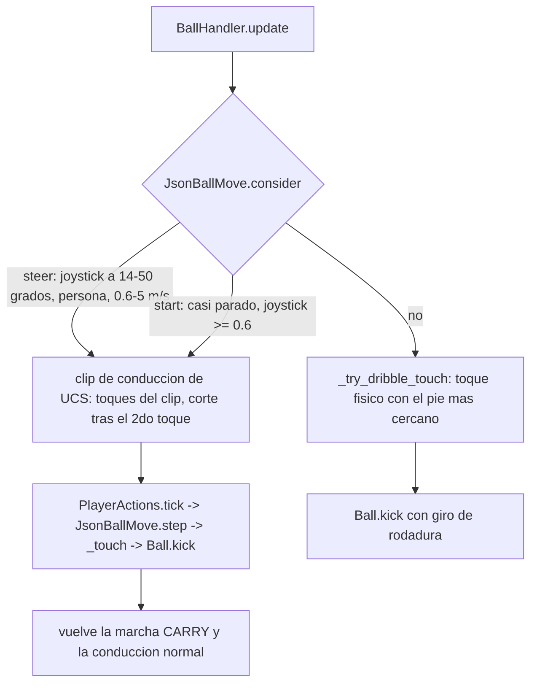
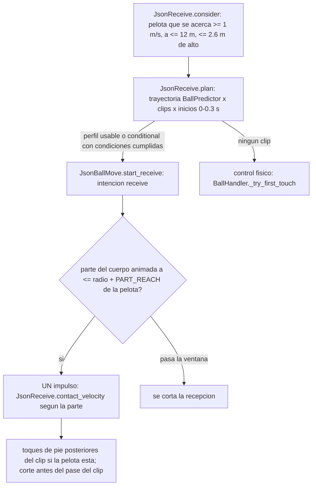
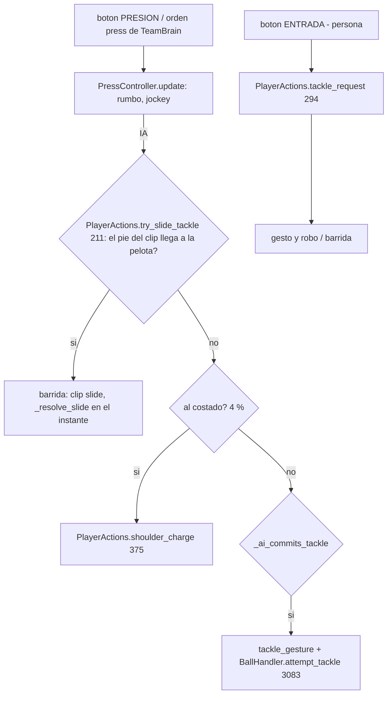
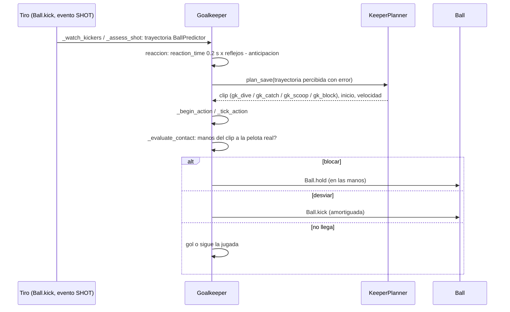

# Cada acción futbolística: cómo se ejecuta

Modo 4 (banco JSON), rama `respaldo-f3`. Cada ficha tiene: **Inicio** (qué evento la dispara), **Selección** (cómo se
elige la animación), **Contacto** (cuándo y cómo se toca la pelota), **Balón** (qué le pasa a la física) y **Fin**.

Todo está **comprobado en el código** (archivo:línea), salvo lo marcado como **[I]** (inferido) o **[?]** (desconocido).

Sistemas que se repiten (ver `MAPA_CODIGO.md`):

- `BallHandler` (`scripts/player/ball_handler.gd`);
- `JsonBallMove` (`scripts/player/json_ball_move.gd`);
- `JsonReceive` (`scripts/player/json_receive.gd`);
- `PlayerActions` (`scripts/player/player_actions.gd`);
- `Goalkeeper` (`scripts/goalkeeper/goalkeeper.gd`).

## Flujo común de un golpeo (pase, pase largo, filtrado, centro, tiro, despeje)

```mermaid
sequenceDiagram
    participant In as Entrada (persona: InputFrame / IA: AIInput._start_button)
    participant BH as BallHandler
    participant PL as plan_clip_kick / plan_turn_kick / plan_aerial_kick
    participant AR as ActionArbiter (nivel KICK)
    participant FV as FootballerVisual (pose del clip)
    participant AS as PassAssist / ShotAssist / CrossAssist
    participant B as Ball
    In->>BH: boton apretado y soltado: carga 0..1 (_update_buttons, 451)
    BH->>BH: _queue (516): orden pendiente (hasta 0.5 s; 1.4 s de primera)
    loop cada paso hasta que haya plan
        BH->>PL: _try_execute_pending (524)
        PL-->>BH: clip, instante de inicio, ajuste de zancada, residuo <= 0.18 m
    end
    BH->>AR: _start_clip_kick (1100)
    AR->>FV: reproduce el clip desde el instante elegido
    loop hasta el contacto del clip (_kick_timer)
        BH->>BH: _steer_clip_kick / _json_kick_ik (pie al punto real)
    end
    BH->>BH: _ball_still_arriving (1161): pelota que llega, espera hasta 0.1 s
    BH->>BH: _finish_clip_kick (1190): pelota a <= 0.65 m de la punta?
    alt contacto valido
        BH->>AS: perform_action (1253): velocidad, giro, error
        AS-->>BH: KickResult
        BH->>B: Ball.kick(velocidad, giro)
    else falla
        BH->>BH: KICK_WHIFF, lockout 0.3 s
    end
```

- **Carga:** pase, filtrado y centro llegan a 1 en 0.8 s. El tiro en `BallTuning.shot_charge_time` 0.9 s
  (`ball_handler.gd:451-501`).
- **Comba:** sale de girar el joystick entre apretar y soltar: `BallHandler.curl_from` (507), ±15° a ±60° → −1…1.
- **Clips por tipo:** `JsonCatalog.kick_candidates` (`scripts/animation/json_catalog.gd:108`):

  | tipo | roles de clip |
  |---|---|
  | `shot` | `kick_shot`, más `kick_shot_hard` con carga ≥ 0.45 |
  | `lob` | `kick_lob` |
  | `cross` | `kick_cross`, `kick_lob`, `kick_pass` |
  | `pass` con carga < 0.35 | `kick_pass_soft`, `kick_pass` |
  | `pass` con carga 0.35-0.8 | `kick_pass` |
  | `pass` con carga ≥ 0.8 | `kick_pass`, `kick_shot` |

  Solo entran contactos «limpios», salvo `kick_cross`.
- **Puntaje del plan:** residuo + 0.35 × ajuste + 0.28 × |v del pie plantado − v del cuerpo|. Entre los planes casi
  iguales (+0.05) se elige uno al azar, para variar (`ball_handler.gd:960-985`).
- **Pelota en el aire** (> 0.5 m): `BallHandler.plan_aerial_kick` (803), con cabezazo o volea (ver Remates).
- **Destino lejos del frente** (≥ 50°): golpeo girando (`BallHandler.plan_turn_kick`, 1013). Con ≥ 100° y sin plan,
  primero gira con la pelota (`JsonBallMove.turn_for_kick`, `json_ball_move.gd:302`).

## 1. Pase corto y largo

- **Inicio:** botón PASE (persona). En la IA, `AIInput._decide_with_ball` (`scripts/ai/ai_input.gd:536-552`) llama a
  `AIInput._start_button(&"pass", ...)` con una carga que crece con la distancia (0.12 + 0.022·d) y globo a veces a más
  de 15 m.
- **Selección:** flujo común, tipo `pass` (`lob` si se mantiene ALTO).
- **Contacto:** en el instante `contact.time` del clip. Válido si la pelota está a ≤ 0.65 m de la punta del pie real
  (`BallHandler._finish_clip_kick`).
- **Balón:** `BallHandler.perform_pass` (1295) → `PassAssist.compute` (`scripts/assistance/pass_assist.gd:53`). Elige el
  receptor por intención (cono del joystick, distancia, línea libre) y fija la velocidad con
  `KickModel.ground_speed_for_distance` (`kick_model.gd:115`), entre 7 y 28 m/s. Agrega un error que depende de la
  postura, el pie y los atributos (`PassAssist._pass_sigma`, 260). En el globo, `KickModel.lob_speed_for_distance` (133),
  a 38°. Después, `Ball.kick` y la física normal.
- **Fin:** `BallHandler._after_kick` (1330) marca el pase, avisa al receptor (`incoming_pass_time`) y emite el evento
  `PASS`. El cuerpo sigue con la velocidad que traía (`_finish_clip_kick`, «after_v»).

## 2. Pase de primera

- **Inicio:** botón de golpeo con la pelota viniendo hacia el jugador (`BallHandler.is_waiting_first_time`, 319). La
  orden espera hasta 1.4 s (`PENDING_FIRST_TIME_MAX`, 69). La persona va a la trayectoria con el joystick como puntería
  (`footballer.gd:257-290`).
- **Selección:** flujo común, con la pelota prevista en movimiento (`BallHandler._fast_prediction`, 735).
- **Contacto:** el impulso sale en el paso en que la punta del pie **animado** está más cerca de la pelota que llega, si
  la pelota viene a > 2 m/s hacia el pie. Espera como mucho 0.1 s (`BallHandler._ball_still_arriving`, 1161-1181;
  E4).
- **Balón:** igual que el pase. `Ball.kick` reemplaza la velocidad que traía la pelota, porque el impulso es
  `(objetivo − actual)·masa` (`ball.gd:156-157`).
- **Fin:** igual que el pase. Durante una recepción con clip, una orden de golpeo antes del toque corta la recepción y
  golpea de primera (`JsonBallMove._receive_step`, `json_ball_move.gd:534`).

## 3. Centros

- **Inicio:** botón CENTRO. En la IA, desde la banda en el último tercio con compañeros llegando al área
  (`ai_input.gd:516-524`).
- **Selección:** tipo `cross`: `kick_cross`, `kick_lob` y `kick_pass`. Los dos clips `kick_cross` tienen el contacto a
  ~0.6 m al costado y entran solo si el pie llega (`json_catalog.gd:117-120`).
- **Contacto:** flujo común.
- **Balón:** `BallHandler.perform_cross` (1281) → `CrossAssist.compute` (`scripts/assistance/cross_assist.gd:32`). Hay
  tres trayectorias:
  - elevado: cae a la altura de la cabeza en la zona elegida;
  - tenso: con carga alta;
  - raso: con ALTO.

  Zonas: `CrossAssist.zone_point` (19), primer palo, segundo palo y punto de penal. Velocidad: `CrossAssist.launch_speed`
  (120).
- **Fin:** `PASS` con `cross: true`. Los compañeros van a las zonas (`TeamBrain._attack`, `team_brain.gd:166-169`).

## 4. Tiros y remates

- **Inicio:** botón TIRO. En la IA, con ángulo útil dentro de 10-15 m (`ai_input.gd:497-514`).
- **Selección:** tipo `shot`: `kick_shot`, más `kick_shot_hard` con carga ≥ 0.45. Con la pelota alta (> 0.5 m),
  `BallHandler.plan_aerial_kick` (803):
  - **cabezazo:** rol `header`, 95 clips. Busca el instante en que la cabeza del clip (`paths.head`, a ≥ 1.6 m/s)
    coincide con la pelota prevista (`BallHandler.AERIAL_SETS`, 794);
  - **volea:** rol `volley`, 54 clips. Igual, con las puntas de los pies a ≥ 4.5 m/s.
- **Contacto:** flujo común (cabeza o pie).
- **Balón:** `BallHandler.perform_shot` (1311) → `ShotAssist.compute` (`scripts/assistance/shot_assist.gd:54`). Calcula
  el punto del arco, la altura (4-22°), la velocidad (12-30 m/s), el error, la comba (`KickModel.curl_spin`) y el
  flotado (`Ball.set_knuckle`, 1317-1318). En el aire actúan Magnus y el flotado (`FISICAS_BALON.md` §3).
- **Fin:** evento `SHOT`. Lo lee el arquero (`Goalkeeper._watch_kickers`, `goalkeeper.gd:321`;
  `Goalkeeper._assess_shot`, 336).

## 5. Conducción



- **Inicio:** tener la pelota (`MatchContext.update_possession`) y moverse con ella.
- **Selección:**
  - **Animación:** la marcha con pelota (`JsonCatalog.CARRY`, BlendSpace por velocidad).
  - **Toque orientado** (joystick a 14-50°, solo la persona, 0.6-5 m/s, 1.2 s después de un golpe propio): un clip de
    conducción de UCS (`JsonBallMove.steer_pool`, `json_ball_move.gd:155`), elegido por:
    - la ventana del joystick de UCS (`AnimDB.joystick_window`);
    - un giro del clip hasta el corte de ±24°;
    - v_in a ±1.6 m/s;
    - la pelota que llega al primer toque (residuo ≤ 0.16 m);
    - preferencia por el pie de afuera.
  - **Arranque:** casi parado y sin sprint: `JsonBallMove.start_pool` (179).
- **Contacto:**
  - **Clip:** en el instante de cada toque (`ball_touches`). Si la pelota está a > 0.5 m del pie, el toque se pierde
    (`JsonBallMove._touch`, 585).
  - **Sin clip:** `BallHandler._try_dribble_touch` (2236) toca con el pie que llega. El intervalo y el adelanto están en
    `PlayerTuning` (`touch_interval_jog` 0.28 s, `touch_lead_jog` 0.70 m, `touch_lead_sprint` 1.20 m).
- **Balón:**
  - **Clip:** `Ball.kick` con `Ball.roll_speed_for` hasta la punta del toque siguiente (`json_ball_move.gd:680-690`).
  - **Sin clip:** un impulso hacia el rumbo con el adelanto que toca.

  El cuerpo es fantasma para su propia pelota a < 1.2 m (`ball_handler.gd:379`).
- **Fin:** el último toque del clip deja la pelota delante del rumbo de salida y sigue la conducción normal
  (`JsonBallMove.finish`, 752). La conducción termina cuando se pierde la posesión.

## 6. Regates

- **Inicio:** botón REGATE (`frame.skill_pressed`, `footballer.gd:235-242`). Con el joystick hacia atrás:
  `DragBack.request` y `JsonBallMove.request_skill`. Si no: `JsonBallMove.request_skill`.
- **Selección:**
  - **Hacia atrás:** intención `drag`: roles `ball_turn`, `ball_turn_stop` y `ball_skill` con un giro de 180° ±55°.
  - **Si no:** intención `skill`: rol `ball_skill` ±70° (sin dirección, cualquiera).
  - **Tolerancia:** v_in a ±3 m/s (`json_ball_move.gd:224-237`).
  - **Si ningún clip llega:** `DragBack` (pisada con la suela, `scripts/player/drag_back.gd:116`).
- **Contacto:** los toques del clip. En `DragBack`, la suela iguala la velocidad de la pelota con un impulso por paso
  (`DragBack._pull`, 290).
- **Balón:** `Ball.kick` en cada toque (`json_ball_move.gd:690`; `drag_back.gd:170-175, 302`).
- **Fin:** igual que la conducción. La IA hace regates a veces con un rival a < 1.9 m (`ai_input.gd:556-558`).

## 7. Giros

| Giro | Inicio | Selección | Contacto / balón | Fin |
|---|---|---|---|---|
| Con pelota, clip | joystick a ≥ 50° (IA ≥ 110°) conduciendo | rol `ball_turn` ±35°, v_in a ±1.5 m/s, la pelota llega al primer toque (`JsonBallMove.plan_move`, 315) | toques del clip (`JsonBallMove._touch`) | marcha con la v_out del clip |
| Con pelota, sin clip | ningún clip llega | `BallTurn` (`scripts/player/ball_turn.gd:117`): rodea la pelota con toques cortos del pie de afuera | `BallTurn._kick_to` (299) → `Ball.kick` | último toque hacia el rumbo nuevo |
| Frenada con pelota | soltar el joystick a 2.6-4.6 m/s conduciendo (en ≤ 0.15 s) | rol `ball_stop` ±60° | toques del clip; la pelota se para con `Ball.roll_speed_to_stop` | pelota quieta delante |
| Para golpear | destino del golpeo a ≥ 100° | `JsonBallMove.turn_for_kick` (roles `ball_turn`, `ball_turn_stop`) | toques del clip | la orden de golpeo espera al final (`ball_handler.gd:409-415`) |
| Sin pelota | joystick a ≥ 100°, pelota a ≥ 6 m | `Footballer._json_turn_move` (`footballer.gd:513`): `turn_start` (< 1.3 m/s) o `turn_run` (2.2-5.6 m/s, solo la persona) | — | se corta si la pelota llega a < 3 m (`footballer.gd:227-228`) |

## 8. Recepción (pie, pecho, muslo, cabeza)



- **Inicio:** una pelota que llega: se acerca a ≥ 1 m/s, a ≤ 12 m y a ≤ 2.6 m de altura (`JsonReceive.MIN_CLOSING`,
  `MAX_DIST`, `MAX_BALL_Y`, `json_receive.gd:31-33`; `JsonReceive.consider`, 341).
- **Selección:** `JsonReceive.plan` (402). Para cada clip de los roles `receive`, `receive_turn`, `control_stand`,
  `ball_start` y `jostle_ball` (124 clips más sus espejos) y cada inicio de 0 a 0.3 s, compara el punto de contacto de
  la parte del cuerpo (cinemática directa, `JsonReceive.contact_point`, 176) con la pelota prevista. Tolerancias:
  - en el suelo, corrige el paso hasta 0.4 m;
  - en altura, una tolerancia por parte (`PART_SLACK` / `PART_VTOL`, 59-60);
  - v_in a ±1.2 m/s;
  - dirección de llegada y de salida;
  - la pelota no debe chocar antes con el cuerpo (`JsonReceive._path_clear`, 603).

  Solo perfiles `usable` y `conditional` con sus condiciones cumplidas (`JsonReceive.selectable`, 128). Hoy:
  - **pie y pie en el aire:** sí (perfiles `foot` y `foot_air` usables);
  - **muslo y rodilla:** sí (`thigh`, `knee`);
  - **pecho:** sí (`chest`; por ejemplo `jn_receive_0588` y `jn_receive_1822` usables);
  - **cabeza:** **no conectada**. «La cabeza solo con un clip verificado (hoy ninguno)» (`json_receive.gd:28`).
    `jn_receive_0590` está en `pending`, y la cabeza no tiene respuesta física.
- **Contacto:** la parte del cuerpo **animada** toca la pelota real dentro de la ventana (`JsonBallMove.step`,
  `json_ball_move.gd:493-516`). El cuerpo no es fantasma hasta el contacto.
- **Balón:** un impulso según la parte: `JsonReceive.contact_velocity` (647) con su normal (`JsonReceive._part_normal`,
  687) y un rebote de 0.6 (`REBOUND`). Los toques posteriores del clip se aplican solo si la pelota está ahí.
- **Fin:** el clip se corta antes del pase o golpeo del propio clip (`post_t`). Golpea el sistema de pase o tiro real si
  hay una orden. Al terminar se llama a `JsonReceive.ended` (700).
- **Sin clip** (ningún perfil llega): control físico, que amortigua la pelota con `first_touch_absorb` 0.65
  (`BallHandler._try_first_touch`, 3020).

## 9. Despejes

- **No hay una acción de despeje propia** (no hay rol ni sistema `clearance` en los jugadores de campo). **[C]**
- **IA:** sin compañero libre y atascada, hace un pase largo hacia el campo rival con carga 0.55
  (`ai_input.gd:546-551`).
- **Arquero:** `Goalkeeper._clear_ball` (`goalkeeper.gd:628`) despeja a `KeeperTuning.clearance_speed` 21 m/s. El arquero
  también desvía tiros (`deflect_speed_min` 9 m/s, `deflect_damping` 0.42, `keeper_tuning.gd:54-55`).
- **UCS:** `InterceptClearanceSpace` / `InterceptClearanceHeight` (sin conectar).

## 10. Rebotes

- **Inicio:** cualquier choque de la pelota con el piso, un cuerpo, los palos o la red.
- **Física:** la resuelve Jolt con el material de la pelota (`bounce` 0.54, `friction` 0.6). La red empuja con
  `GoalNet` (`scripts/pitch/goal_net.gd:225`). Las cápsulas de los jugadores (capa 4) y de los arqueros (capa 8) hacen
  rebotar la pelota. No hay animación de rebote: es solo física. **[C]**
- **Eventos:** `Ball.floor_bounce` (bote, para el sonido); `Ball._on_body_entered` (`ball.gd:584`): golpe en el palo
  (`hit_goal_frame`).
- **Desvío del arquero:** `Goalkeeper._evaluate_contact` (763) aplica `Ball.kick` con la velocidad amortiguada
  (`goalkeeper.gd:795`).

## 11. Balones divididos

- **Inicio:** pelota suelta (sin poseedor, `MatchContext.update_possession`).
- **Selección:** va **uno** por equipo, el que llega antes (`TeamBrain._loose`, `team_brain.gd:409`). La persona va si
  la controla (`TeamBrain.person_drives`, 406).
- **Contacto y balón:** el que llega toca con la mecánica normal: toque de conducción, control o golpeo. Gana el primero
  que toca, porque cada toque es un `Ball.kick` sobre la velocidad actual. Si dos tocan en el mismo paso, los impulsos se
  suman (`FISICAS_BALON.md` §10). **[C]**
- **Fin:** el nuevo poseedor.

## 12. Entradas e intercepciones



- **Inicio:**
  - **Persona:** botón ENTRADA (`footballer.gd:326-331`). La presión con el botón solo cierra y contiene: no roba.
  - **IA:** orden `press` de `TeamBrain`, con `PressController.update` (`scripts/assistance/press_controller.gd`) y la
    decisión de entrar (`footballer.gd:301-325`).
- **Selección:**
  - **Barrida:** para cada clip `slide` y su espejo, dónde estará la punta del pie en su instante de contacto y dónde
    estará la pelota; solo se lanza si llegan (`PlayerActions._slide_candidate`, 263).
  - **De pie:** clip `tackle_stand` (`PlayerActions.tackle_gesture`, 332).
- **Contacto:** la barrida se resuelve en el instante del clip (`PlayerActions._resolve_slide`, 421), según dónde está
  el pie real respecto de la pelota. Puede haber falta (`PlayerActions._commit_foul`, 415). El robo de pie lo decide
  `BallHandler.attempt_tackle`.
- **Balón:** `Ball.kick` (`ball_handler.gd:3116`).
- **Fin:**
  - el que sufre la entrada cae o tropieza (`PlayerActions.suffer_contact`, 482; `PlayerActions._json_fall`, 540) y se
    levanta (`PlayerActions._json_getup`, 612);
  - el portador puede saltar la entrada (`PlayerActions.avoid_tackle`, 456).
- **Intercepciones:** no hay un sistema dedicado. Son controles o toques sobre una pelota en tránsito: el jugador que la
  alcanza la controla con la recepción (§8) o el control físico. La IA se coloca en las líneas de pase
  (`AIInput._lane_cut_spot`, `ai_input.gd:419`). **[C]**

## 13. Atajadas



- **Inicio:** tiro hacia el arco: `Goalkeeper._assess_shot` (`goalkeeper.gd:336`), con la trayectoria cruzando el plano
  del arco (`BallPredictor.crossing_x`).
- **Selección:** `KeeperPlanner.plan_save` (`scripts/goalkeeper/keeper_planner.gd:212`). Usa la trayectoria medida de
  las manos de cada clip (`KeeperPlanner.hands_world`, 93), el instante de inicio y la velocidad de reproducción. Roles
  `gk_dive` (108), `gk_catch` (47), `gk_scoop` (18) y `gk_block` (7). La percepción tiene un error que se reduce mientras
  mira (`Goalkeeper._perceived`, 433).
- **Contacto:** `Goalkeeper._evaluate_contact` (763), radio de contacto `Goalkeeper._contact_radius` (759).
- **Balón:**
  - blocar: `Ball.hold` (`goalkeeper.gd:779`);
  - desviar: `Ball.kick` (`goalkeeper.gd:795`).

  Después, `Goalkeeper._enter_hold` (827) y el saque (`Goalkeeper._choose_distribution`, 862).
- **Fin:** levantarse (`Goalkeeper._json_getup`, 1252) o tener la pelota.
- **UCS:** `ResponseGKSave` probado y descartado. Los demás parámetros del arquero, sin conectar (`IA_UCS_Y_FUTBOL5.md`).

## 14. Desplazamientos sin pelota

- **Inicio:**
  - persona: el joystick;
  - IA: la orden de `TeamBrain` (`TeamBrain.order_for`) o el ancla propia (`AIInput._anchor`), convertidas en dirección
    (`AIInput._move_to`, `ai_input.gd:732`).
- **Selección:** BlendSpace de marcha por velocidad (`JsonCatalog.GAIT`). Mezcla direccional al marcar (jockey:
  `JsonCatalog.dir_points`, `json_catalog.gd:28`). Giros grandes con clip (§7). Gestos de espera (`idle_fidget`,
  `Footballer` líneas 492-501).
- **Contacto:** ninguno.
- **Balón:** ninguno. Si la pelota llega a la cápsula, rebota (§10).
- **Fin:** continuo.
- **Física:** `Locomotion.step` (`FISICAS_JUGADOR.md` §3).
