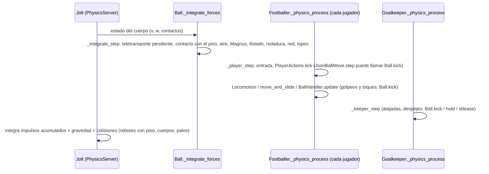
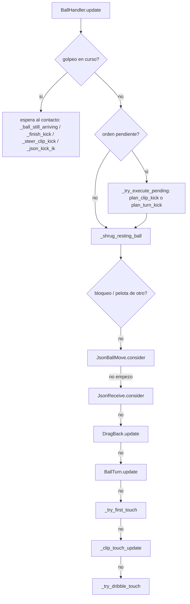

# Física del balón: cómo funciona hoy

Rama `respaldo-f3`. Todo lo de este documento está **comprobado leyendo el código**, salvo lo que se marca como
**[INFERIDO]**. Las líneas corresponden al commit de esta documentación: si el código cambia, se regeneran con
`python3 tools/transfer/make_symbol_index.py`. Si este documento y el código no coinciden, manda el código.

Leyenda: **[C]** comprobado en código o con datos · **[I]** inferido · **[?]** desconocido.

## 1. Qué es la pelota

| Cosa | Dónde | Valor | |
|---|---|---|---|
| Nodo | `scripts/ball/ball.gd` (`class_name Ball`, `extends RigidBody3D`, línea 2) | cuerpo rígido de Godot | [C] |
| Motor | `project.godot` líneas 106-110 | Jolt Physics, 60 pasos/s, hasta 3 pasos por imagen, `max_angular_velocity` 200 | [C] |
| Gravedad | `project.godot` línea 109 | 9.81 m/s² (la aplica el motor, no el script) | [C] |
| Ajustes | `scripts/ball/ball_tuning.gd` (`BallTuning`, se accede como `Tuning.ball`) | ver tabla del punto 3 | [C] |
| Colisiones | `Ball._build` (`ball.gd:84-91`) | capa 2 (`LAYER_BALL`); choca con mundo 1, jugadores 4, arqueros 8 y palos 16; `continuous_cd = true`, `can_sleep = false`, `custom_integrator = false` | [C] |
| Material | `Ball.apply_tuning` (`ball.gd:128-148`) | `bounce` 0.54, `friction` 0.6 (PhysicsMaterial), inercia de esfera hueca 2/3·m·r², amortiguamiento lineal 0 en modo REPLACE | [C] |

La integración de la posición la hace **el motor** (Jolt). El script no fija la posición durante el juego: solo
modifica la **velocidad** en `_integrate_forces` y con impulsos. Las tres excepciones son:

- `Ball.reset_at` (`ball.gd:198`): teletransporte para saques y reinicios. Se aplica en el siguiente `_integrate_step`
  (`ball.gd:355-361`).
- `Ball.hold` (`ball.gd:210`): la pelota queda congelada en modo cinemático, en las manos del arquero o en un balón
  parado.
- `Ball._ball_step` (`ball.gd:307-311`): mientras alguien la sostiene, la pelota sigue al ancla.

## 2. Un paso de física (60 Hz)

**[I]** El orden entre `_integrate_forces` y los `_physics_process` sale del diseño de Godot 4 (`Main::iteration`:
`flush_queries` llama a los integradores propios, después `physics_process` de la escena y después `step`). No se midió
en este proyecto. Lo que sí está en el código **[C]** es que `Ball.kick` usa `apply_central_impulse`
(`ball.gd:157`). El impulso se suma en el paso del motor que sigue, así que dos golpes en el mismo paso se suman.

Los jugadores se procesan en el orden del árbol de escena: no hay un orden explícito (no se usa
`process_physics_priority`; búsqueda en `scripts/`). **[C]**

## 3. Qué hace `_integrate_step` (`ball.gd:354-436`)

| Paso | Líneas | Fórmula / regla | Parámetros (`BallTuning`) |
|---|---|---|---|
| Teletransporte pendiente | 355-361 | `state.transform` y la velocidad de `reset_at`; giro a 0 | — |
| ¿Toca el piso? | 365-371 | algún contacto con normal `y > 0.6` | — |
| Señal de bote | 373-377 | `floor_bounce` si la `vy` pasa de < −1 a > 0 tocando el piso | — |
| Aire (arrastre cuadrático) | 379-385 | `F = ½·ρ·Cd·π·r²·v²`, `dv = F/m·dt` (como mucho `v`) | `air_density` 1.2, `drag_coefficient` 0.25, `radius` 0.1, `mass` 0.42 |
| Magnus (solo en el aire, v > 1) | 387-389 | `v += (w × v)·(k/m)·dt` | `magnus_k` 0.0018 |
| Flotado (tiro sin giro) | 391-401 | fuerza lateral `sin(2π·f·t + fase)` y vertical `0.4·cos(1.3·…)`, mientras v ≥ 12, giro ≤ 12 rad/s y ≤ 1.5 s, hasta tocar el piso | `knuckle_accel` lo pone `Ball.set_knuckle` (`ball.gd:166`) desde `BallHandler.perform_shot` (`ball_handler.gd:1317-1318`) |
| Rodadura (piso y `|vy|` < 0.6) | 402-417 | velocidad horizontal exacta tras `dt` con `a + c·min(v, vk)` (`Ball._roll_step` → `Ball.roll_speed`); el giro horizontal se escala igual; el giro vertical decae `spin_decel_ground`·dt; con `v` < 0.05 se para | `rolling_decel` 0.3, `rolling_viscous` 1.0, `rolling_viscous_knee` 7.0, `spin_decel_ground` 6.0 |
| Red del arco | 419-428 | `v += net_accel·dt` (lo acumula `GoalNet`, `scripts/pitch/goal_net.gd:225`); giro × `exp(−net_grip·dt)` | `net_grip` 7.0 |
| Topes | 430-433 | ‖v‖ ≤ 38, ‖w‖ ≤ 150 | `max_speed`, `max_spin` |

- **Gravedad y rebotes:** los aplica Jolt con la gravedad del proyecto y el `bounce` y la `friction` del material. El
  script no calcula rebotes; solo detecta el bote para el sonido (`floor_bounce`). **[C]**
- **Aceleración:** la pelota no acelera por sí sola. Solo cambia de velocidad con un impulso (`Ball.kick`, `Ball.push`),
  con las fuerzas de arriba o al chocar. **[C]**

## 4. Modelo de rodadura compartido (predicción)

Las mismas fórmulas cerradas sirven para predecir y para planificar toques y pases (`ball.gd:439-583`):

| Función | Línea | Uso |
|---|---:|---|
| `Ball._roll_params` | 446 | (a, c, vk) desde `Tuning.ball` |
| `Ball.roll_decel` | 451 | desaceleración a la velocidad v |
| `Ball.roll_speed` / `Ball.roll_distance` / `Ball.roll_stop_time` | 474 / 485 / 496 | velocidad, distancia y tiempo hasta parar |
| `Ball.roll_speed_for` | 503 | velocidad inicial para recorrer `dist` en `t` s (toques de los clips: `JsonBallMove._touch`) |
| `Ball.roll_speed_to_stop` | 525 | velocidad para que se pare a `dist` (último toque de una frenada) |
| `Ball.roll_time` / `Ball.roll_start_speed` / `Ball.roll_catch_time` | 539 / 556 / 570 | tiempos de llegada y alcance |
| `BallPredictor.trajectory` | `scripts/ball/ball_predictor.gd:19` | trayectoria 3D (gravedad, aire, bote, rodadura, Magnus) por subpasos; la usan el arquero, la IA y las recepciones |
| `BallPredictor.crossing_x` | `ball_predictor.gd:76` | índice en que la trayectoria cruza el plano del arco |

La cabecera de `ball_predictor.gd` (líneas 1-12) documenta su calibración contra la pelota real: rodando, el arrastre
efectivo es ~0.5 de la fórmula; en el aire, la fórmula entera. **[C]** (son números medidos y escritos en el código; en
esta tarea no se volvieron a medir).

## 5. Quién cambia la pelota (todos los puntos de escritura)

Lista completa de llamadas a `kick`, `push`, `reset_at`, `hold`, `release`, `set_knuckle` y `net_accel` fuera de
`ball.gd` (búsqueda en `scripts/`):

| Sistema | Llamada | Línea | Cuándo |
|---|---|---|---|
| `BallHandler.perform_through` / `perform_cross` / `perform_pass` / `perform_shot` | `Ball.kick` (+ `set_knuckle` en el tiro) | `ball_handler.gd:1271, 1285, 1299, 1316-1318` | contacto válido del golpeo (`BallHandler._finish_clip_kick`, 1190) o golpeo sin clip (`BallHandler._finish_kick`, 1238) |
| `BallHandler._shrug_resting_ball` | `Ball.kick` | `ball_handler.gd:1637` | apartar una pelota quieta que estorba |
| `BallHandler._clip_touch_step` | `Ball.kick` (con giro de rodadura) | `ball_handler.gd:2209` | toque de conducción con clip de toque (modos anteriores) |
| `BallHandler._try_dribble_touch` | `Ball.kick` | `ball_handler.gd:2496` | toque de conducción físico (rumbo, carrera) |
| `BallHandler._try_first_touch` | `Ball.kick` | `ball_handler.gd:3061` | control físico de una pelota que llega (sin clip) |
| `BallHandler.attempt_tackle` | `Ball.kick` | `ball_handler.gd:3116` | robo |
| `JsonBallMove._touch` | `Ball.kick` | `json_ball_move.gd:617` (recepción) y `:690` (toques del clip) | en el instante de cada toque del clip |
| `BallTurn._kick_to` | `Ball.kick` | `ball_turn.gd:304` | toques del giro con toques |
| `DragBack.update` / `DragBack._pull` | `Ball.kick` | `drag_back.gd:170, 175, 302` | pisada y arrastre con la suela (un impulso por paso que iguala la suela) |
| `Goalkeeper` | `kick` / `hold` / `release` | `goalkeeper.gd:621, 632, 699, 779, 795, 823, 963-1000, 1028-1056, 1098` | atajar, desviar, blocar, saque de arco, saque con la mano |
| `SetPiece` | `hold` / `release` | `scripts/gameplay/set_piece.gd:116, 318, 373` | balones parados |
| `MatchScene` | `reset_at` | `scripts/gameplay/match_scene.gd:227, 294, 311, 321` | saque de centro, laterales, córners y saques de arco |
| `GoalNet` | `net_accel +=` | `scripts/pitch/goal_net.gd:225` | la red empuja la pelota |
| `JuggleController` (pantalla de práctica) | `reset_at` / `hold` / `release` / `kick` | `scripts/gameplay/juggle_controller.gd:90-144` | fuera del partido |

### Orden dentro de un jugador (`Footballer._player_step`, `scripts/player/footballer.gd:203`)

1. `MatchContext.update_possession` (línea 207): decide quién es el poseedor (`scripts/gameplay/match_context.gd:37`).
2. Entrada: `input_source.poll` (línea 218). Puede ser la persona (`InputFrame`) o `AIInput.poll`.
3. `PlayerActions.tick` (línea 230). Si hay un clip con raíz activo (movimiento con pelota, giro, caída, barrida), mueve
   el cuerpo con la raíz (`player_actions.gd:139-209`). Ahí `JsonBallMove.step` (línea 193) puede dar los toques
   (`Ball.kick`). Después **el paso termina**: ese paso no se llama a `BallHandler.update` (`footballer.gd:230-233`).
4. Sin clip con raíz: giros sin pelota (`Footballer._json_turn_move`, línea 513), `Locomotion.step` o
   `Locomotion.step_scripted` (BallTurn / DragBack), `move_and_slide` (línea 450) y choques entre jugadores (453).
5. `BallHandler.update` (línea 460). Orden interno (`ball_handler.gd:370-449`):

La primera que actúa corta la cadena (`return`). Así, en un mismo paso, un jugador hace un solo tipo de toque. **[C]**

## 6. Pases, centros y tiros

La **velocidad de salida** la calculan los asistentes; el clip solo decide el **cuándo** y si el pie llegó:

| Acción | Cálculo de la velocidad y el giro | Archivo |
|---|---|---|
| Pase (raso, alto) | `PassAssist.compute` (línea 53): receptor por intención (`PassAssist.pick_target`, 11), velocidad por distancia (`KickModel.ground_speed_for_distance`, `kick_model.gd:115`; `KickModel.lob_speed_for_distance`, 133), error (`PassAssist._pass_sigma`, 260) | `scripts/assistance/pass_assist.gd` |
| Pase filtrado | `PassAssist.compute_through` (157) | idem |
| Centro (elevado, tenso, raso) | `CrossAssist.compute` (32), zonas `CrossAssist.zone_point` (19), velocidad `CrossAssist.launch_speed` (120) | `scripts/assistance/cross_assist.gd` |
| Tiro | `ShotAssist.compute` (54): punto del arco, altura, error, comba (`KickModel.curl_spin`, 61), flotado | `scripts/assistance/shot_assist.gd` |
| Límites | `pass_speed_min/max` 7-28, `lob_angle_deg` 38, `shot_speed_min/max` 12-30, `shot_loft_low/high_deg` 4-22, `shot_spin_factor` 14 | `scripts/ball/ball_tuning.gd:58-75` |

- **Balones aéreos:** son `Ball.kick` con componente vertical (globo, centro elevado, tiro alto). Después vuelan con la
  gravedad del motor, el aire y Magnus. No hay curvas guionadas ni posiciones fijadas. **[C]**
- **Golpeo de una pelota alta** (> 0.5 m, `BallHandler.AERIAL_MIN_BALL_Y`, `ball_handler.gd:799`): lo planifica
  `BallHandler.plan_aerial_kick` (803), con los clips `header` y `volley`.

## 7. Contactos con pies y cuerpo

- **Pies:** el pie **no tiene colisionador**. El contacto es una regla:
  - **Golpeo:** la pelota debe estar a ≤ `json_kick_reach` 0.65 m de la punta del pie del clip, en el instante de
    contacto del clip (`BallHandler._finish_clip_kick`, `ball_handler.gd:1190-1237`; `BallHandler.kick_reach`, 2525).
  - **Toques de clips:** a ≤ `JsonBallMove.MISS_DIST` 0.5 m de la punta (`json_ball_move.gd:43`, `JsonBallMove._touch`).
  - **Recepciones:** parte del cuerpo animada a ≤ radio + `JsonReceive.PART_REACH` (`json_receive.gd:71`; comprobación en
    `JsonBallMove.step`, `json_ball_move.gd:498-512`).

  Si se cumple, se aplica **un** impulso. **[C]**
- **Cuerpo:** la cápsula del jugador (radio 0.3, alto 1.75: `PlayerTuning.capsule_radius/height`,
  `scripts/player/player_tuning.gd:125-126`) está en la capa 4. La pelota choca con ella y rebota por física (Jolt). El
  propio jugador se vuelve **fantasma** (`Footballer.set_ball_ghost`, `footballer.gd:168`: capa 0) en estos casos
  (`ball_handler.gd:379`):
  - mientras conduce con la pelota a < 1.2 m (`DRIBBLE_GHOST_RANGE`);
  - durante un golpeo y 0.15 s después (`KICK_GHOST_SECONDS`);
  - durante los movimientos con pelota (`JsonBallMove._start`, `json_ball_move.gd:435`).

  **[C]**
- **Arquero:** cápsula en la capa 8. Atajar, desviar o blocar se resuelve en `Goalkeeper._evaluate_contact`
  (`goalkeeper.gd:763`), con las manos del clip que eligió `KeeperPlanner.plan_save` (`keeper_planner.gd:212`).

## 8. Destino del balón

- **Golpeos:** el destino es el que eligen los asistentes (receptor, punto del arco, zona del centro), más el error.
  **No** se usan los destinos de `animdb.adb` en los golpeos. **[C]**
- **Toques de clip** (`JsonBallMove._touch`): la pelota va a la posición que tendrá la punta del pie en el toque
  siguiente del clip, con la raíz y el rumbo reales del cuerpo (`JsonBallMove._touch_point`, `json_ball_move.gd:575`).
  La velocidad sale de `Ball.roll_speed_for(distancia, tiempo hasta el toque)`. En el último toque, la pelota queda
  delante del rumbo de salida, a la velocidad de salida (`v_out`) del clip, o parada con `Ball.roll_speed_to_stop` si
  el clip termina casi quieto. **[C]**
- **UCS:** el destino está en `animdb.adb` (campos 25-27; ver `DATOS_UCS.md`), en `assets/animations/animdb.json`
  (`destino_m`). El juego **no lo lee** en ningún sitio: `AnimDB.ucs` solo lo usa `AnimDB.joystick_window`, y su único
  llamador es `JsonBallMove.plan_ids` (`json_ball_move.gd:350`). **[C]**

## 9. Sincronización de la física con los cuadros de la animación

| Mecanismo | Cómo | Dónde |
|---|---|---|
| Golpeo con clip | El planificador elige el clip, el instante de inicio y el ajuste de zancada para que la punta del pie llegue a la pelota prevista en el cuadro de contacto medido (`contact.time`). El impulso sale cuando vence el tiempo del contacto (`_kick_timer`). Si la pelota todavía viene (> 2 m/s hacia el pie), espera hasta 0.1 s al paso con la punta **animada** más cerca. | `BallHandler.plan_clip_kick` (895), `BallHandler.update` (384-400), `BallHandler._ball_still_arriving` (1161) |
| Toques de clip | Cada toque sale cuando el tiempo del clip pasa por el instante medido del toque (`ball_touches`). | `JsonBallMove.step` (475-532) |
| Recepción | El toque sale cuando la parte del cuerpo **animada** (cinemática directa del clip) toca la pelota real, dentro de una ventana; si no llega, la recepción se corta. | `JsonBallMove.step` (493-516), `JsonReceive.path_point` (241) |
| Pie al punto real | IK de dos huesos que lleva la punta del pie los centímetros que faltan. **No** mueve la pelota. | `TouchFootIK` (`scripts/animation/touch_foot_ik.gd`), `JsonBallMove._update_ik` (715), `BallHandler._json_kick_ik` (2528) |
| Reloj | Todo va en el paso de física (60 Hz). El tiempo del clip avanza en `ActionMotion.step` (`scripts/animation/action_motion.gd:63`), dentro de `PlayerActions.tick`. | — |

## 10. Superposiciones y conflictos posibles

| Conflicto | Estado | Evidencia |
|---|---|---|
| Dos jugadores tocan la pelota en el mismo paso | posible: los impulsos se suman en el motor | `Ball.kick` usa la velocidad actual (`ball.gd:156`); no hay árbitro global de la pelota |
| Fantasma y choques entre jugadores | Con `set_ball_ghost(true)` el jugador sale de la capa 4 (`footballer.gd:169`). Los demás jugadores, cuyas máscaras incluyen la capa 4, dejan de chocar con él mientras dura el movimiento con pelota. **[I]** efecto lateral no medido. | `footballer.gd:77-78, 168-169` |
| Golpeo de primera frente a recepción con clip | Una orden de golpeo antes del toque corta la recepción y golpea el planificador normal. | `JsonBallMove._receive_step` (534) |
| Toque orientado tras un pase propio | Bloqueado 1.2 s (`JsonBallMove.STEER_AFTER_KICK_S`, línea 81). | E4 |
| Clips con raíz y `BallHandler.update` | Durante un clip con raíz no se ejecuta `BallHandler.update` (ni toques ni golpeos normales); los botones se leen en `JsonBallMove._receive_step`. | `footballer.gd:230-233` |
| Arquero y jugadores | El arquero no está en `MatchContext.update_possession` como un jugador más; tiene su propia mano (`Ball.hold`). | `goalkeeper.gd:621` |

## 11. Qué no se sabe

- **[?]** Cómo integra UCS su pelota: no se descompiló su lógica. Hay parámetros con nombres de pelota (`ShotDistMaxPower`,
  `KickErrorTrajScale`; ver `PARAMETROS_UCS.md`), pero no su uso.
- **[?]** El orden exacto de los pasos de Jolt en Android frente a escritorio (no se midió).
