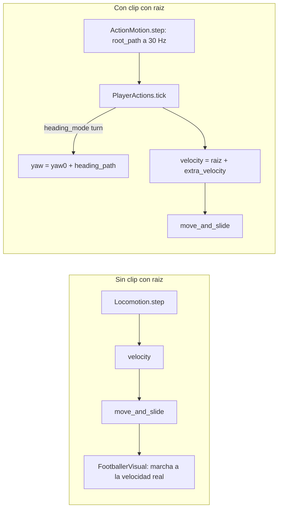

# El jugador y sus movimientos

Leyenda: **[C]** comprobado en código o datos · **[I]** inferido · **[?]** desconocido. Las rutas son relativas a la raíz
del repositorio (rama `respaldo-f3`).

**Regla para leer este documento:** salvo `WidthOpenPlay` y los demás parámetros de la IA de `UcsParams`, **ningún
valor del movimiento del jugador viene de UCS**. Todos están en el código de Futbol5 (`PlayerTuning` y constantes). En
la tabla del punto 9 se ponen al lado los parámetros de UCS con nombres parecidos, solo para comparar.

## 1. Piezas

| Pieza | Archivo | Qué hace |
|---|---|---|
| `Footballer` | `scripts/player/footballer.gd` | `CharacterBody3D` del jugador de campo. Orquesta el paso (`Footballer._player_step`, línea 203) |
| `Locomotion` | `scripts/player/locomotion.gd` | modelo de movimiento: velocidad objetivo, giro, aceleración, frenado y agarre lateral |
| `PlayerTuning` | `scripts/player/player_tuning.gd` | todos los valores (se accede como `Tuning.player`) |
| `PlayerAttributes` | `scripts/progression/player_attributes.gd` | atributos 0-100; `PlayerAttributes.factor(key, spread)` = 1 + (valor − 50)/50 · spread (línea 83) |
| `PlayerActions` + `ActionMotion` | `scripts/player/player_actions.gd`, `scripts/animation/action_motion.gd` | clips con raíz: el clip mueve el cuerpo (giros, movimientos con pelota, caídas, barridas) |
| `ActionArbiter` | `scripts/player/action_arbiter.gd` | quién manda en el cuerpo y en la pose (niveles) |
| `FootballerVisual` | `scripts/player/footballer_visual.gd` | AnimationTree: marcha mezclada por velocidad, acciones e inclinación |
| `TouchFootIK` | `scripts/animation/touch_foot_ik.gd` | IK de dos huesos del pie (los centímetros que faltan hasta la pelota) |
| `BallTurn` / `DragBack` | `scripts/player/ball_turn.gd`, `scripts/player/drag_back.gd` | movimiento guiado del cuerpo en el giro con toques y en la pisada (`Locomotion.step_scripted`) |

## 2. Velocidades

| Marcha | Valor | Dónde | Cómo se llega |
|---|---|---|---|
| caminata | 1.8 m/s | `PlayerTuning.walk_speed` (`player_tuning.gd:7`) | joystick < 0.35 → 0..1.8 (`Locomotion.speed_for_magnitude`, `locomotion.gd:211`) |
| trote | 3.6 m/s | `jog_speed` (línea 8) | joystick 0.35-0.7 → 1.8..3.6 |
| carrera | 5.2 m/s × factor(speed, 0.12) | `run_speed` (línea 9); `Locomotion.max_run_speed` (56) | joystick 0.7-1 → 3.6..carrera |
| sprint | 6.8 m/s × factor(speed, 0.12) | `sprint_speed` (línea 10); `Locomotion.max_sprint_speed` (59) | botón de sprint con joystick > 0.6 y resistencia (`locomotion.gd:79`) |
| hacia atrás | × 0.72 | `backpedal_factor` (línea 11) | — |
| cansado | sprint mezclado con carrera al 0.82 | `exhausted_speed_factor` (línea 36) | resistencia: `stamina_drain_sprint` 0.16/s, `stamina_regen` 0.07, `stamina_regen_standing` 0.14 |
| conduciendo | sprint × (0.86 … 0.97 según `ball_carrying`) | `BallHandler.dribble_speed_cap` (`ball_handler.gd:352`) | tope solo con la pelota a ≤ el radio de posesión (`footballer.gd:419-420`) |
| arquero | 4.2 m/s; salida 5.6 | `KeeperTuning.move_speed`, `rush_speed` (`scripts/goalkeeper/keeper_tuning.gd:6, 12`) | — |

**[C]** Con `factor(speed, 0.12)` el sprint va de 6.8 × 0.88 = 5.98 a 6.8 × 1.12 = 7.62 m/s (atributo 0 a 100).

## 3. Aceleración, frenado y giro (`Locomotion.step`, `locomotion.gd:68-158`)

| Qué | Fórmula | Valores (`PlayerTuning`) |
|---|---|---|
| Aceleración hacia adelante | `a = accel·factor(acceleration, 0.16)·lerp(0.45, 1, margen)`; el margen cae al acercarse a la velocidad objetivo (líneas 136-145) | `accel` 6.2 m/s² (línea 15) |
| Frenado | `decel` sin entrada o al bajar el objetivo; `brake` en giros cerrados o si el giro bloquea (> 80° a más de trote, `Locomotion.turn_rate_blocks_speed`, 221) | `decel` 9.5, `brake` 14.0 (líneas 17-19) |
| Agarre lateral | `v_lat ·= exp(−grip·dt)`, `grip = lateral_grip·lerp(1.25, 0.8, v/7)·factor(agility)` (líneas 147-149) | `lateral_grip` 9.0 (línea 21) |
| Giro del cuerpo | tasa `lerp(turn_rate_standing, turn_rate_sprint, (v/vmax)²)·factor(agility, 0.14)·turn_scale` grados/s (líneas 101-110) | 620 °/s parado, 165 °/s en sprint (líneas 25-27) |
| Giro cerrado | más de `sharp_turn_angle_deg` a más del 70 % de la carrera → `sharp_turning` (línea 111) | 115° |
| Velocidad en giros | entre 55° y 150° de diferencia, el objetivo baja hacia la caminata (líneas 116-120) | — |
| Marcaje (jockey) | mira a `face_override` a 0.8 × 620 °/s; velocidad ≤ 0.8 × carrera (`Locomotion._step_jockey`, 184) | — |
| Movimiento guiado | gira hacia una cara a una tasa dada y lleva la velocidad a un objetivo con una aceleración dada (`Locomotion.step_scripted`, 160) | lo piden `BallTurn.body_control` (`ball_turn.gd:177`) y `DragBack.body_control` (`drag_back.gd:193`) |
| Con pelota | `turn_scale` = `BallHandler.carry_turn_scale` (`ball_handler.gd:2827`): el cuerpo no deja la pelota a la espalda | `footballer.gd:395` |

Convención **[C]**: `Locomotion.dir_from_yaw(y) = (−sin y, 0, −cos y)` (`locomotion.gd:43`). Con `yaw = 0` mira a −Z y
`Locomotion.right` es +X (línea 52). Un `yaw` creciente gira a la **izquierda**. Los clips usan el mismo signo
(`ActionMotion.heading_rel`, `action_motion.gd:49`: + = izquierda).

## 4. Piernas, zancada y pies

- **Marcha:** BlendSpace por velocidad con ciclos medidos (`JsonCatalog.GAIT` y `JsonCatalog.CARRY`,
  `scripts/animation/json_catalog.gd:12-19`). Cada ciclo empieza en el apoyo izquierdo y se reproduce con una línea de
  tiempo común, así que las fases coinciden al mezclar (cabecera de `json_catalog.gd`, líneas 3-4). **[C]**

  | escalón | clip | velocidad natural (m/s) | duración del ciclo (s) |
  |---|---|---:|---:|
  | reposo | `jn_idle_0520` | 0 | 3.333 |
  | caminata | `jn_walk_0460` | 1.32 | 1.017 |
  | trote | `jn_jog_1144` | 2.79 | 0.733 |
  | carrera | `jn_jog_2390` | 4.11 | 0.650 |
  | sprint | `jn_sprint_3022` | 5.67 | 0.483 |
  | con pelota: reposo | `jn_idle_ball_0524` | 0 | 2.000 |
  | con pelota: caminata | `jn_dribble_walk_0234` | 1.60 | 1.050 |
  | con pelota: trote | `jn_dribble_jog_1574` | 2.95 | 0.667 |
  | con pelota: carrera | `jn_dribble_run_3186` | 4.21 | 0.533 |
  | con pelota: rápida | `jn_dribble_fast_0548` | 5.54 | 0.533 |
  | con pelota: sprint | `jn_dribble_sprint_1582` | 5.98 | 0.533 |

  (Velocidades y duraciones: metadatos de la librería, volcados con `tools/transfer/dump_library_meta.tscn`.)
- **Zancada:** `JsonCatalog.stride_of` = velocidad natural × duración del ciclo (`json_catalog.gd:80`). El ritmo de la
  marcha es `JsonCatalog.cycles_per_second` (86): la velocidad dividida por la zancada interpolada, para que los pies no
  patinen. **[C]**
- **Con y sin pelota:** la mezcla pasa a los ciclos `CARRY` con `CARRY_BLEND_RATE` 4/s
  (`footballer_visual.gd:76`, `FootballerVisual.drive_motion`, 647). **[C]**
- **Posición de los pies:** se lee del esqueleto animado en cada paso (`BallHandler._sample_feet`, `ball_handler.gd:1382`:
  huesos `mixamorig_LeftToeBase` / `RightToeBase`) y se expone con `BallHandler.toe_world` (2065). En headless la pose
  global no se recalcula: `feet_live` es falso y se usan los datos medidos de los clips. **[C]**
- **IK:** `TouchFootIK` (`scripts/animation/touch_foot_ik.gd`) es un modificador de esqueleto (cadera-rodilla-tobillo).
  Corrección máxima por clase: toques de clip `JsonBallMove.IK_MAX` 0.32 m (`json_ball_move.gd:50`) y golpeo
  `BallHandler.JSON_KICK_IK_MAX` 0.55 (`ball_handler.gd:2518`). **[C]** No hay IK de pies en el suelo (anclaje de
  apoyo): el apoyo depende de que la velocidad del cuerpo coincida con la del clip. **[C]**
- **Botines:** ~0.26 m de largo en `assets/characters/json/json_human.scn` (E3). **[C]**

## 5. Giros con y sin pelota

| Giro | Sistema | Condición | Dónde |
|---|---|---|---|
| Sin pelota, con clip | `Footballer._json_turn_move` | sin pelota y a ≥ 6 m de ella (`JSON_TURN_BALL_DIST`); joystick ≥ 0.5 a ≥ 100°; `turn_start` a < 1.3 m/s o `turn_run` a 2.2-5.6 m/s (solo la persona); giro del clip a ±35° y v_in a ±1.6 m/s; espera 2.5 s (4 s la IA) | `footballer.gd:503-543` |
| Sin pelota, sin clip | `Locomotion.step` (tasa de giro) | resto de los casos | `locomotion.gd:101-110` |
| Con pelota, clip (turn) | `JsonBallMove.consider`, intención `turn` | joystick ≥ 0.35 a ≥ 50° (IA ≥ 110°); ≤ 6.5 m/s; v_in a ±1.5 m/s; la pelota llega al primer toque | `json_ball_move.gd:204-296` |
| Con pelota, toque orientado (steer) | intención `steer` | persona; joystick a 14-50°; 0.6-5 m/s; 1.2 s sin golpe propio; ventana del joystick de UCS | `json_ball_move.gd:251-257, 351-353` |
| Con pelota, sin clip | `BallTurn` (toques que rodean la pelota) o `DragBack` (pisada) | cuando ningún clip llega a la pelota | `ball_turn.gd:117`, `drag_back.gd:116` |
| Golpeo girando | `BallHandler.plan_turn_kick` | destino a ≥ 50° del frente (`TURN_KICK_MIN`); ≥ 100°: primero gira con la pelota (`TURN_FIRST_MIN`, `JsonBallMove.turn_for_kick`) | `ball_handler.gd:53-55, 1013`; `json_ball_move.gd:302` |

## 6. Transiciones entre animaciones

- **Marcha ↔ acción:** las acciones con raíz las arranca `PlayerActions.start_move` (`player_actions.gd:133`) con un
  nivel del árbitro (`ActionArbiter.Level`, `action_arbiter.gd:23`: GESTURE 10 < OVERLAY 20 < BALL_MOVE 40 < KICK 50
  < BODY 60 < SET_PIECE 70 < FALL 80). Solo un nivel **estrictamente mayor** interrumpe. **[C]**
- **Salida de un clip con rumbo:** el cuerpo sigue con la última velocidad de la raíz del clip y la marcha retoma
  (`PlayerActions.tick`, `player_actions.gd:194-201`). **[C]**
- **Compatibilidad:** se elige por velocidad. La carrera de entrada del clip (`v_in`) debe estar cerca de la del
  jugador, con una tolerancia por sistema; la salida (`v_out`) es la velocidad con que retoma la marcha. Las
  tolerancias de cada clip están en `INVENTARIO_ANIMACIONES.csv` (columnas `transicion_entrada_compatible` y
  `transicion_salida_compatible`). **[C]**
- **Poses en el sitio** (gestos, reacciones): solo si el cuerpo no corre más que el clip + 1.8 m/s
  (`ActionArbiter.IN_PLACE_SLACK`, `action_arbiter.gd:35`). **[C]**
- **Mezcla visual:** el AnimationTree de `FootballerVisual._setup_animation_tree` (`footballer_visual.gd:286`) y
  `FootballerVisual.play_pack_clip` (559). Los tiempos de mezcla están en esas funciones; no se midieron en esta tarea.

## 7. Posición del jugador respecto de la pelota

| Qué | Dónde |
|---|---|
| Vector y distancia a la pelota | `BallHandler.ball_offset` / `BallHandler.ball_distance` (`ball_handler.gd:203, 207`) |
| Radio de posesión | `BallHandler.possession_radius` (212) sobre `PlayerTuning.possession_radius` 1.1 m (`player_tuning.gd:78`); el poseedor lo decide `MatchContext.update_possession` (`match_context.gd:37-73`) |
| Hueco de conducción | `BallHandler.carry_gap` (1545); `carry_gap_stand` 0.38, `touch_lead_jog` 0.70, `touch_lead_sprint` 1.20 (`player_tuning.gd:46-49`) |
| Conducción sin clip | `BallHandler.plan_carry` (2633), `BallHandler.carry_steer` (2895), `BallHandler.follow_steer` (2961): el cuerpo sigue a la pelota; los toques los da `BallHandler._try_dribble_touch` (2236) |
| Acomodarse a una pelota quieta | `BallHandler.settle_steer` (2669) |
| Correr a una pelota propia que se adelantó para golpearla | `BallHandler.kick_approach_steer` (2774); `footballer.gd:379-383` |
| Ir al encuentro de un pase | `BallHandler.incoming_ball_point` (279), `Footballer._player_step` (líneas 257-290) |

## 8. Raíz de la animación frente a movimiento físico

- **Sin clip con raíz:** la física manda. `Locomotion` calcula la velocidad, `move_and_slide` mueve la cápsula y la
  animación de marcha se ajusta a la velocidad real (`JsonCatalog.cycles_per_second`). **[C]**
- **Con clip con raíz:** la animación manda. `ActionMotion` guarda el recorrido de la raíz aparte de la cadera
  (`root_path`, acumulado a 30 Hz, en metros de juego) y el rumbo (`heading_path`), en
  `scripts/animation/action_motion.gd:1-10`. `PlayerActions.tick` convierte esa raíz en velocidad en el marco del inicio
  del clip, gira el cuerpo con el rumbo y llama a `move_and_slide` (`player_actions.gd:144-170`). La física solo
  corrige: choques, y `extra_velocity`, el ajuste de paso para llegar a la pelota (`JsonBallMove.CORR_SPEED` 1.4 m/s,
  `CORR_MAX` 0.4 m; `json_ball_move.gd:37-38`). **[C]**
- **Golpeo:** comparte el cuerpo con `Locomotion`. La velocidad del cuerpo la fija el balanceo del clip
  (`BallHandler.kick_body_velocity`, `ball_handler.gd:705`), con un ajuste de zancada de hasta `kick_adjust_max` 0.30 m
  (+0.28 m en sprint) (`footballer.gd:434-440`; `player_tuning.gd:94-95`). **[C]**
- **El cuerpo no sale de la cancha** con la raíz de un clip (+0.8 m; `player_actions.gd:155-163`). **[C]**

## 9. Valores del código frente a parámetros de UCS

| Concepto | Futbol5 (código) | UCS (`libMPX.so`, valor por defecto) | Relación |
|---|---|---|---|
| Sprint por atributo | 6.8 m/s × (0.88 … 1.12) | `SpeedSprint0/1` = 3738 / 4539 (Q12: 0.913 / 1.108) | **[I]** podría ser una escala de sprint por atributo; cociente UCS 1.21, nuestro 1.27. Sin conectar |
| Velocidad conduciendo | sprint × 0.86 … 0.97 | `TechniqueDribbleSpeedScale0/1` = 820 / 956 (Q12: 0.200 / 0.233) | **[?]** con la lectura Q12 sería un 20 %: no encaja con «velocidad conduciendo»; sin conectar |
| Reacción del jugador | decisión cada 0.12 s (`AIInput.DECISION_PERIOD`, `ai_input.gd:9`) | `ResponsePlayerAction0/1` = 40 / 20 | **[I]** cuadros por el nombre del grupo; definido en `UcsParams.RESPONSE_ACTION_S` sin uso |
| Alcance de barrida | planificador por clip (`PlayerActions.try_slide_tackle`, `player_actions.gd:211`) | `StrengthSlideTackleRange0/1` = 81920 / 147456 (Q12 20 / 36) | **[?]** unidad desconocida; sin conectar |
| Alcance de entrada | `BallHandler.attempt_tackle` (3083) | `StrengthPressureTackleRange0/1` = 49152 / 81920 (Q12 12 / 20) | **[?]** sin conectar |
| Potencia de golpeo | `BallTuning` 7-28 m/s pase, 12-30 tiro | `KickPower0/1` = 18382 / 21627 (Q12 4.49 / 5.28) | **[?]** sin conectar |
| Pie malo | `KickModel.weak_foot_power_mult` (`kick_model.gd:108`) | `KickPowerWrongFoot` = 3891 (Q12 0.95) | **[I]** escala de potencia con el pie malo; sin conectar |
| Arquero | `KeeperTuning.reaction_time` 0.2 s (`keeper_tuning.gd:16`) | `ResponseGKSave0/1` = 15 / 4 | probado y descartado (E4) |

Todos los parámetros, con su evidencia: `PARAMETROS_UCS.md`.

## 10. Qué no se sabe

- **[?]** La velocidad real de los jugadores de UCS en m/s: no hay un parámetro de velocidad absoluta en el cargador.
  En los controles, los campos 5 y 6 de `animdb.adb` (× 10) siguen nuestros `v_in`/`v_out` (r 0.90/0.87), pero su
  unidad no se estableció (`DATOS_UCS.md`).
- **[?]** Si UCS usa IK de pies: no hay datos.
