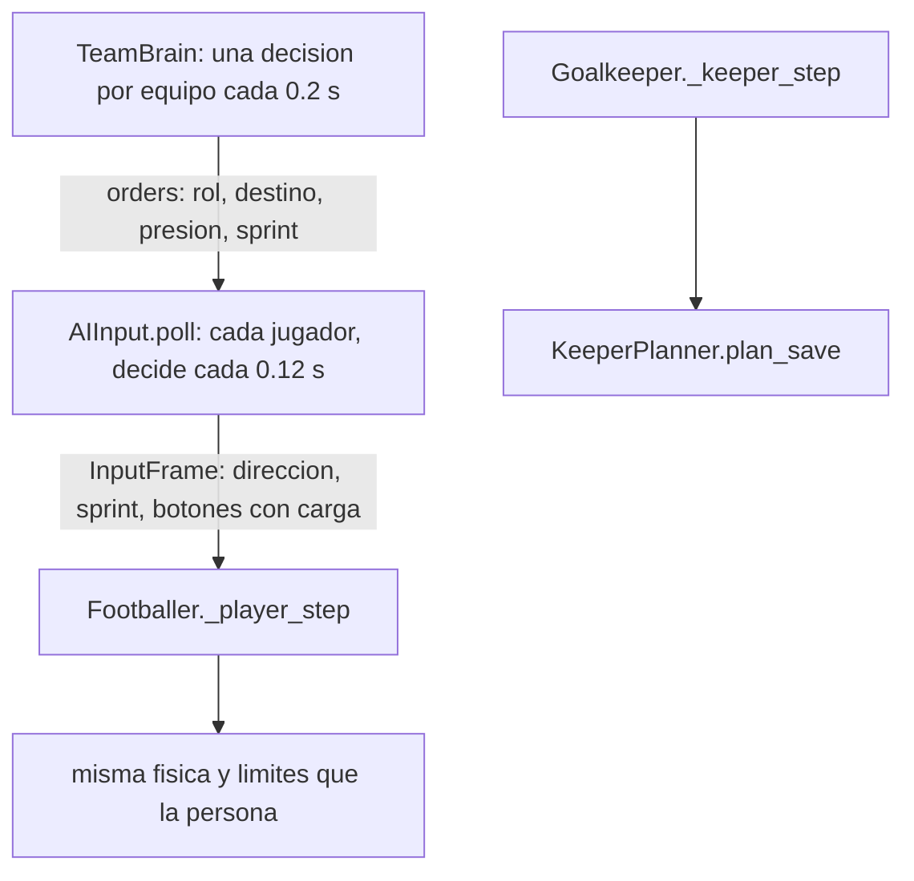

# La IA de UCS y la nuestra

Leyenda de evidencia:

- **[C-código]** comprobado en el código (en UCS: valores leídos del binario; en Futbol5: archivo y línea);
- **[D-parámetro]** deducido del nombre y el valor de un parámetro de UCS;
- **[O]** inferido por observación de video;
- **[?]** desconocido.

## 0. Qué se sabe de la IA de UCS, y qué no

- **[C-código]** Los **valores por defecto** de 211 parámetros de juego que lee `libMPX.so` (`PARAMETROS_UCS.md`).
- **[?]** **La lógica no se conoce.** No se descompiló el código que usa esos parámetros: el binario está despojado de
  símbolos. Por eso **ningún comportamiento de UCS de este documento está comprobado por código**. Todo lo que se dice
  de UCS es **[D-parámetro]**: un nombre y un valor.
- **[O]** No hay observaciones de la IA de UCS. Los videos de UCS revisados en E3
  (`docs/fases/E3_video_conduccion_notas.md`) muestran la conducción del jugador de la persona, no el comportamiento de
  la IA. La persona pidió no tomar como referencia su video de nuestro juego (E4).
- **[?]** La configuración del servidor de UCS podría cambiar los valores.

Nuestra IA tiene dos niveles. Lo que sigue está comprobado en su código:

- `TeamBrain` (`scripts/ai/team_brain.gd`, `TeamBrain.DECISION_PERIOD` 0.2 s, línea 19) da **órdenes**. Se obtienen
  con `TeamBrain.for_team` (54) y `TeamBrain.order_for` (60).
- `AIInput` (`scripts/ai/ai_input.gd`, `AIInput.DECISION_PERIOD` 0.12 s, línea 9) produce el mismo `InputFrame` que una
  persona (`AIInput.poll`, 68).
- Cada equipo tiene 4 jugadores de campo y un arquero (`MatchScene.home_field_players` / `away_field_players` = 4,
  `scripts/gameplay/match_scene.gd:11-12`). Roles por puesto: `ROLES_BY_SLOT` [3, 1, 2, 0] (línea 136); rombo 1-2-1:
  0 cierre, 1 ala izquierda, 2 ala derecha, 3 pivote (cabecera de `ai_input.gd`).

## 1. Comparación por comportamiento

| Comportamiento | Futbol5 (qué hace, dónde) [C-código] | UCS: parámetros relacionados (valor por defecto) [D-parámetro] | Integrado |
|---|---|---|---|
| **Formación y posicionamiento** | Ancla por rol: profundidad `ROLE_DEPTH` [0.2, 0.5, 0.5, 0.78] del largo, desplazada con la pelota (`ROLE_SHIFT`), y lateral `ROLE_LATERAL` [0, −5, 5, 0] m + 0.3 × la z de la pelota (`AIInput._anchor`, `ai_input.gd:656`; constantes 11-13). Encima, los puestos de `TeamBrain` | `PosChangeFrames` 120, `CentreXPercentPOS` 20 / `OOP` 27, `MidLinePercentPOS` 75 / `OOP` 25 | no |
| **Líneas defensivas y ofensivas** | Defensa: línea a `clamp(profundidad de la pelota − 7, 2.5, 13)` m del arco propio; el bloque no pasa de esa línea + 4 m (`TeamBrain._defend`, `team_brain.gd:353-381`). Ataque: puesto `safety` 6-9 m por detrás de la pelota (164) | `BackLinePOS` 85, `BackLineOOP` 60, `BackLineSetPiece` 24, `BackLineKickOffAdjust` −5, `MarkingBacklineExtra` 32768 | no |
| **Amplitud** | Puesto `width`: banda contraria al 60 % del medio ancho (`team_brain.gd:159`) | `WidthOpenPlay` 60 (además `WidthFreeKick` 50, `WidthFreeKickDirect` 30, `WidthCorner` 30, `WidthGoalKick` 40, `WidthThrowIn` 60, `WidthKickOff` 45, `WidthOOPPercent` 60) | **sí, solo `WidthOpenPlay`** (lo de «60 %» es inferido) |
| **Búsqueda y seguimiento del balón** | Pelota suelta: va **uno** por equipo, el que llega antes al punto previsto a 0.35 s (o quien la tocó si sigue a < 3 m); los demás conservan su puesto (`TeamBrain._loose`, 409). Perseguidor: `AIInput._chaser` (633); el jugador va con `BallHandler.loose_ball_chase` (`ball_handler.gd:296`) | `UrgencyLooseBallOppoFrames` 30, `LooseBallDribbleTolerance` −30, `InterceptUrgency` 5120 | no (`UcsParams.URGENCY_LOOSE_BALL_OPPO_S` e `INTERCEPT_URGENCY` definidos sin uso) |
| **Presión y coberturas** | Presiona el que llega antes al portador (punto a 0.4 s), con sprint si está a > 4 m. Cobertura: el que llega antes al punto entre la pelota y el arco a 6.5 m (`COVER_DIST`). Si llega en ≤ 1.2 s, es segundo presionador (`press2`) a 2.5 m del portador **sin entrar**. Si la persona controla al más cercano, la presión es suya (`TeamBrain._defend`, 317-351) | `MaxActivePresses` 2, `MaxActiveTackles` 1, `PressureSpeedRate` 3891 | **sí** `MaxActivePresses` / `MaxActiveTackles`; `PressureSpeedRate` probado y descartado |
| **Entradas** | La IA contiene (jockey) y entra cuando la pelota queda expuesta o, protegida, con probabilidad 0.45 (`Footballer._ai_commits_tackle`, `footballer.gd:559`; `AI_TACKLE_COMMIT`, 39). Robo: `BallHandler.attempt_tackle` (`ball_handler.gd:3083`); barrida: `PlayerActions.try_slide_tackle` (`player_actions.gd:211`) | `TacklingOpponentCircleSize` 21845, `TacklingMinDist` 655360, `TackleMinStatusFrames` 15, `TackleSpeedRate` 4096, `StrengthPressure/Passive/SlideTackleRange0/1`, `BotPressureRate0/1` 0 / 34, `BotSlideRate0/1` 0 / 22 | no |
| **Marcaje** | Bloque: cada defensor cierra al rival más peligroso por el lado del arco (1.8 m) y hacia la línea de pase (35 %) (`team_brain.gd:362-375`). En `AIInput`, punto de marca a `MARK_GOAL_SIDE` 2.6 m del rival, hacia el arco propio, con rivales a ≤ `MARK_RANGE` 15 m del arco (`AIInput._mark_spot`, 673) | `MarkingThreshold` 1024, `MarkingBacklineExtra` 32768, `MarkingZonePersistTolerance` 98304, `MarkingDist0/1` 49152 | no |
| **Intercepciones** | Sin sistema dedicado: perseguir la pelota suelta (`_loose`), cerrar líneas de pase (`AIInput._lane_cut_spot`, 419) y el bloque | `InterceptClearanceSpace` 163840, `InterceptClearanceHeight` 49152, `InterceptHeightBase` 65156, `InterceptHeightBlendRate` 2048, `InterceptUrgency` 5120 | no |
| **Decisión de pase** | Cada 0.12 s con pelota (`AIInput._decide_with_ball`, 482-552). Pasa con un rival a < 3 m (`PASS_PRESSURE_DIST`); si el compañero progresa > 2 m y ya pasaron 0.5 s, con probabilidad 0.45·(0.6+habilidad); siempre a los 2 s (`CARRY_PATIENCE`). Receptor: `AIInput._best_pass_target` (771); filtrado: `AIInput._through_target` (584) con probabilidad 0.35·(0.4+habilidad); sin receptor y atascado, despeje | `BotMinKickFrames` 30, `BotMaxKickFrames` 120, `BotPassAdjustGoalDist` 50, `BotPassAdjustMaxMoveDist` 5 | **sí** `BotMin/MaxKickFrames` (0.5 / 2 s; cuadros de 60 Hz inferidos) |
| **Decisión de tiro** | Dentro de `lerp(10, 15, habilidad)` m, con cono de tiro útil (`AIInput._shot_cone_ok`, 606; `MIN_SHOT_APERTURE_DEG` 16, `SHOT_CONE_SLOPE` 0.55) y línea libre o rival encima; apunta al palo contrario al arquero; carga 0.45 + distancia; a veces con comba (líneas 497-514) | `ShotDistMaxPower` 32, `ShotDistNoPower` −68 | no |
| **Centros** | Desde la banda en el último tercio con compañeros llegando al área (`AIInput._crossing_zone`, 366; `AIInput._box_has_mates`, 575); raso el 30 % | `FocalFreeKickPercent` 33 (balón parado) | no |
| **Conducción** | Hacia el borde del área chica, esquivando rivales (`AIInput._avoid_opponents`, 796) y las paredes; sprint si no hay rival a 4 m; ruleta a veces con un rival a < 1.9 m (líneas 556-574). Clips de giro con pelota de la IA solo a ≥ 110° y cada 3 s (`JsonBallMove.AI_TURN_MIN`, `AI_COOLDOWN`) | `TechniqueDribbleSpeedScale0/1`, `DribbleMinDist` 163840, `Freeze*` | no |
| **Desmarques y apoyos** | Puestos de ataque de `TeamBrain._attack` (134): `support` a 4-7 m con línea de pase libre, `width`, `depth` (altura del último defensor), `safety`; reparto de coste mínimo (`TeamBrain._assign`, 268); separación ≥ 6 m (`MIN_SPACING`); con centro, al primer palo, segundo palo y punto de penal (`CrossAssist.zone_point`). Carreras: `AIInput._run_behind_spot` (390), `AIInput._box_run_spot` (371) | `RunTimeout` 300, `RunArrowLength` 10, `RunAutoMaxRunners` 2, `RunAutoRandomConsider` 5, `RunAutoOnsideYards` 15, `RunAutoMinGoalDist` 20, `RunAutoMinBallDist` 15, `RunAutoRotRange` 1024 | no (`RUN_AUTO_MAX_RUNNERS` y `RUN_TIMEOUT_S` definidos sin uso) |
| **Compañeros sin pelota** | Siguen su orden (`AIInput._follow_order`, 310); dejan paso al portador (`AIInput._make_way`, 822; 3 m) | `ResponsePlayerMovePos0/1` 21 / 1, `ResponsePlayerMoveOOP0/1` 21 / 1 | no |
| **Balones divididos** | Uno por equipo (`_loose`); el resultado lo decide la física (quién llega antes y el `Ball.kick` de su toque) | `UrgencyLooseBallOppoFrames` 30 | no |
| **Tiempo de respuesta** | Fijo: 0.12 s por jugador y 0.2 s por equipo | `ResponsePlayerAction0/1` 40 / 20; `ResponsePlayerKickPos/OOP0/1` 21 / 1 | no (`RESPONSE_ACTION_S` definido sin uso) |
| **Balón parado** | `AIInput._decide_dead_ball` (439); saques en `SetPiece` (`scripts/gameplay/set_piece.gd`) | `Focal*`, `Width*`, `BackLineSetPiece`, `PossessionTimerSetPieceReset*` | no |
| **Arquero** | Posición entre la pelota y el arco (`Goalkeeper._tick_position`, `goalkeeper.gd:254`); lectura del tiro con error de percepción y reacción propia (`Goalkeeper._assess_shot`, 336; `KeeperTuning.reaction_time` 0.2 s); plan de atajada por clip (`KeeperPlanner.plan_save`, `keeper_planner.gd:212`); achique 1 contra 1 (`Goalkeeper._try_smother`, 1154); centros (`Goalkeeper._assess_cross`, 1200); saques (`Goalkeeper._choose_distribution`, 862) | `TechniqueGKMinSaveDist0/1`, `TechniqueGKMaxSaveDist0/1`, `TechniqueGKSaveSpeed0/1`, `GKPresence*`, `ResponseGKSave0/1` 15 / 4, `GKSafeDistScale0/1`, `GKSweep*`, `GKCharge*`, `GKCloseDown*` | `ResponseGKSave` probado y descartado; el resto no |
| **Dificultad** | `ai_skill` del partido (`MatchScene`) y atributos por jugador | `BotDifficultyWinRateScale`, `BotDifficultyPenaltyKicks`, `BotUserKickErrorScale0/1`, `BotStatScale0/1` | no |

## 2. Pruebas hechas con los parámetros de UCS (E4, resultados reales)

Están en [`docs/fases/E4_integracion_ucs.md`](../fases/E4_integracion_ucs.md) («Probado y descartado»). En resumen:

- **Quedaron:** `MaxActivePresses`, `MaxActiveTackles` (implícito), `WidthOpenPlay` y `BotMin/MaxKickFrames`. `ai_match`
  pasó en 3 de 3 corridas; `goalkeeper` 5/0, `full_match` 4/0, `shot_keeper` 1/0.
- **Se descartaron:**
  - `ResponseGKSave`: con nuestro modelo de estirada atajaba el 87-97 % a 8-11 m.
  - `PressureSpeedRate` como velocidad: cambiaba los tiros con un defensor encima, y falló `test_shot_keeper`.

## 3. Qué falta para acercar la IA a la de UCS

Está en `PENDIENTES_INTEGRACION.md`, sección IA. El límite principal es que **sin la lógica de UCS**, cada parámetro
solo se puede aplicar como una hipótesis de significado, que hay que validar con pruebas propias.
