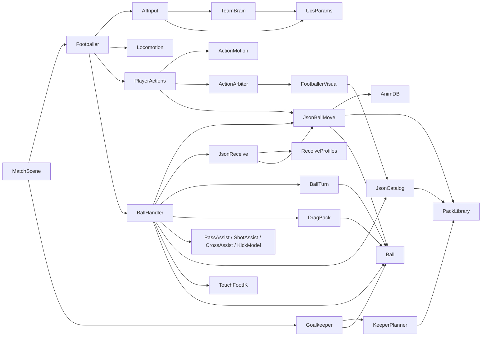

# Mapa del código: archivos, funciones y conexiones

Leyenda: **[C]** comprobado en código · **[I]** inferido. Las líneas son de la rama `respaldo-f3` al momento de esta
documentación. El **anexo** al final (generado por `python3 tools/transfer/make_symbol_index.py`) lista cada función con
su línea y su primer comentario. Para buscar sin leer el código:

- `python3 tools/docs_index.py find <palabras>`;
- `python3 tools/docs_index.py where Clase.miembro`.

## 1. Orden de ejecución en un paso de física (60 Hz)

```mermaid
flowchart TD
    subgraph Motor
      IF[Ball._integrate_forces: aire, Magnus, rodadura, red, topes]
    end
    subgraph Escena
      MS[MatchScene._physics_process: reglas, saques, reloj]
      subgraph Cada Footballer._physics_process -> _player_step
        P1[MatchContext.update_possession]
        P2[input_source.poll: HumanInput o AIInput -> TeamBrain.order_for]
        P3[SetPiece.tick si hay balon parado]
        P4{PlayerActions.tick: clip con raiz?}
        P5[ActionMotion.step + move_and_slide + JsonBallMove.step]
        P6[botones REGATE, recepcion asistida, presion y entradas, acomodarse]
        P7[kick_approach_steer, golpeo en curso, plan_carry, dribble_speed_cap]
        P8[_json_turn_move]
        P9[DragBack/BallTurn.body_control -> Locomotion.step_scripted, o Locomotion.step]
        P10[move_and_slide + _check_player_collisions]
        P11[BallHandler.update: golpeo / orden / JsonBallMove.consider / JsonReceive.consider / DragBack / BallTurn / control / toques]
        P12[FootballerVisual.update_motion]
      end
      GK[Goalkeeper._physics_process -> _keeper_step]
    end
    IF --> MS --> P1 --> P2 --> P3 --> P4
    P4 -- si --> P5 --> P12
    P4 -- no --> P6 --> P7 --> P8 --> P9 --> P10 --> P11 --> P12
    P12 --> GK
    GK --> STEP[Jolt: integra impulsos, gravedad y colisiones]
```

- Líneas en `scripts/player/footballer.gd`:

  | paso | líneas |
  |---|---|
  | P1 | 207 |
  | P2 | 218 |
  | P3 | 221-225 |
  | P4/P5 | 230-233 |
  | P6 | 235-369 |
  | P7 | 379-420 |
  | P8 | 422-423 |
  | P9 | 425-432 |
  | P10 | 450-453 |
  | P11 | 460 |
  | P12 | 466-470 |

- **[I]** Que `_integrate_forces` vaya antes que los `_physics_process` sale del diseño de Godot 4 (ver
  `FISICAS_BALON.md` §2). El orden entre jugadores es el del árbol de escena. **[C]**

## 2. Sistemas

Formato de cada sistema:

- **Responsabilidad**;
- **Archivos**;
- **Funciones principales**;
- **Quién lo llama** / **A quién llama**;
- **Datos que recibe y produce**;
- **Orden**;
- **Dependencias**;
- **Problemas conocidos**.

### Footballer — `scripts/player/footballer.gd` (757 líneas)

- **Responsabilidad:** el `CharacterBody3D` del jugador de campo; orquesta el paso.
- **Archivos:** `footballer.gd`.
- **Funciones principales:**
  - `Footballer._player_step` (203): todo el paso;
  - `Footballer.set_ball_ghost` (168): fantasma para la pelota;
  - `Footballer._json_turn_move` (513): giros sin pelota con clip;
  - `Footballer._ai_commits_tackle` (559);
  - `Footballer._gait_overlays` (592);
  - `Footballer._update_reaction` (714);
  - `Footballer._check_player_collisions` (728).
- **Quién lo llama:** el motor (`_physics_process`, 198). Lo crea `MatchScene._spawn_teams`
  (`scripts/gameplay/match_scene.gd:141`).
- **A quién llama:**
  - `MatchContext`;
  - `HumanInput` / `AIInput` (`poll`);
  - `SetPiece`;
  - `PlayerActions` (`tick`, `start_move`, `try_slide_tackle`, `tackle_request`);
  - `PressController`;
  - `BallHandler` (`update` y las consultas de dirección);
  - `Locomotion` (`step`, `step_scripted`);
  - `FootballerVisual` (`update_motion`);
  - `ActionArbiter` (`play`, `play_situation`).
- **Datos:**
  - recibe un `InputFrame` (dirección, sprint, botones);
  - produce `velocity`, `rotation.y` y señales (`tackled`).
- **Orden:** sección 1.
- **Dependencias:** `PlayerTuning`, `PlayerAttributes`, `PackLibrary.json_mode`.
- **Problemas conocidos:**
  - con un clip con raíz activo el paso termina en `PlayerActions.tick` y no corre `BallHandler.update` (230-233);
  - fantasma: sale de la capa 4 y los demás jugadores no chocan con él (`FISICAS_BALON.md` §10).

### Locomotion — `scripts/player/locomotion.gd` (237)

- **Responsabilidad:** el modelo de movimiento: velocidad objetivo, giro, aceleración, frenado, agarre y resistencia.
- **Archivos:** `locomotion.gd`, `scripts/player/player_tuning.gd`.
- **Funciones principales:**
  - `Locomotion.step` (68);
  - `Locomotion.step_scripted` (160);
  - `Locomotion._step_jockey` (184);
  - `Locomotion.speed_for_magnitude` (211);
  - `Locomotion.face_towards` (225);
  - `Locomotion.dir_from_yaw` / `Locomotion.yaw_from_dir` (43 / 46).
- **Quién lo llama:** `Footballer._player_step`. `PlayerActions.tick` escribe `yaw`, `velocity` y `speed`.
  `BallHandler` lee `forward`, `speed` y `yaw`.
- **A quién llama:** `PlayerAttributes.factor`.
- **Datos:** recibe dirección, intensidad y sprint; produce `velocity`, `yaw`, `turn_rate` y `speed`.
- **Orden:** P9.
- **Dependencias:** `PlayerTuning`.
- **Problemas conocidos:** ninguno de UCS conectado (`FISICAS_JUGADOR.md` §9).

### BallHandler — `scripts/player/ball_handler.gd` (3128)

- **Responsabilidad:** todo lo del jugador con la pelota:
  - posesión;
  - botones y órdenes de golpeo;
  - planificación y ejecución del golpeo con clip;
  - control;
  - conducción (toques físicos y de clip);
  - acomodarse;
  - robo.

  Además coordina `JsonBallMove`, `JsonReceive`, `DragBack` y `BallTurn`.
- **Archivos:** `ball_handler.gd`.
- **Funciones principales:**
  - `BallHandler.update` (370);
  - `BallHandler._update_buttons` (451);
  - `BallHandler._try_execute_pending` (524);
  - `BallHandler.plan_clip_kick` (895), `BallHandler.plan_aerial_kick` (803), `BallHandler.plan_turn_kick` (1013);
  - `BallHandler._start_clip_kick` (1100), `BallHandler._ball_still_arriving` (1161),
    `BallHandler._finish_clip_kick` (1190);
  - `BallHandler.perform_action` (1253) / `BallHandler.perform_pass` (1295) / `BallHandler.perform_shot` (1311) /
    `BallHandler.perform_cross` (1281) / `BallHandler.perform_through` (1268);
  - `BallHandler._after_kick` (1330);
  - `BallHandler._sample_feet` (1382), `BallHandler.toe_world` (2065);
  - `BallHandler._try_dribble_touch` (2236);
  - `BallHandler.plan_carry` (2633), `BallHandler.settle_steer` (2669), `BallHandler.kick_approach_steer` (2774);
  - `BallHandler._try_first_touch` (3020);
  - `BallHandler.attempt_tackle` (3083).
- **Quién lo llama:**
  - `Footballer._player_step` (`update`, consultas);
  - `AIInput` (`has_possession`, `is_kick_in_progress`…);
  - `JsonBallMove` y `JsonReceive` (su `handler`);
  - `PlayerActions` (`lockout`, `json_move.step`).
- **A quién llama:**
  - `Ball.kick`;
  - `PassAssist`, `ShotAssist`, `CrossAssist`, `KickModel`;
  - `JsonCatalog.kick_candidates` (vía `AnimationCatalog.kick_candidates`);
  - `PackLibrary.meta`;
  - `ActionArbiter.play` / `relevel`;
  - `FootballerVisual.play_pack_clip`;
  - `TouchFootIK` (`_foot_ik`);
  - `BallPredictor`;
  - `MatchContext.emit_event`.
- **Datos:**
  - recibe el `InputFrame`, la dirección del joystick y el estado de la pelota;
  - produce impulsos, eventos (`PASS`, `SHOT`, `KICK_WHIFF`) y la velocidad y el giro del cuerpo durante el golpeo.
- **Orden:** P11. Cadena interna en `FISICAS_BALON.md` §5.
- **Dependencias:** `PlayerTuning`, `BallTuning`, `PackLibrary`, `JsonCatalog`, `AnimDB` (indirecta).
- **Problemas conocidos:**
  - archivo muy grande, con lógica de los modos anteriores (toques con clip de toque, `_clip_touch_update`) que convive
    con la del modo 4;
  - la velocidad de salida del golpeo **no depende** de la velocidad del pie del clip: la fijan los asistentes. Solo
    `plan_turn_kick` exige pie ≥ 7 m/s para un tiro (1032);
  - no usa los datos de contacto de UCS (`DATOS_UCS.md`).

### JsonBallMove — `scripts/player/json_ball_move.gd` (813)

- **Responsabilidad:** los movimientos con pelota con clip:
  - giro (`turn`);
  - regate (`skill`);
  - pisada atrás (`drag`);
  - frenada (`stop`);
  - toque orientado (`steer`);
  - arranque (`start`);
  - giro para golpear (`kick_turn`);
  - recepción (`receive`, que planifica `JsonReceive`).
- **Archivos:** `json_ball_move.gd`; listas `tools/json_anim/steer_pool.json` y `start_pool.json` (las escribe
  `tools/json_anim/dump_ball_pools.gd`).
- **Funciones principales:**
  - `JsonBallMove.consider` (204);
  - `JsonBallMove.plan_move` (315) / `JsonBallMove.plan_ids` (323);
  - `JsonBallMove._start` (395);
  - `JsonBallMove.start_receive` (444);
  - `JsonBallMove.step` (475);
  - `JsonBallMove._touch` (585) / `JsonBallMove._touch_point` (575);
  - `JsonBallMove._update_ik` (715);
  - `JsonBallMove.finish` (752);
  - `JsonBallMove.turn_for_kick` (302);
  - `JsonBallMove.steer_pool` (155) / `JsonBallMove.start_pool` (179).
- **Quién lo llama:**
  - `BallHandler.update` (`consider`) y `BallHandler._try_execute_pending` (`turn_for_kick`);
  - `PlayerActions.tick` (`step`, `finish`);
  - `JsonReceive.consider` (`start_receive`);
  - `Footballer._player_step` (`request_skill`).
- **A quién llama:**
  - `PlayerActions.start_move`;
  - `ActionMotion.heading_rel` / `_at`;
  - `AnimDB.joystick_window`;
  - `Ball.kick` / `Ball.roll_speed_for` / `Ball.roll_speed_to_stop`;
  - `TouchFootIK` (vía `BallHandler`);
  - `JsonReceive.path_point` / `contact_velocity`.
- **Datos:**
  - recibe la dirección, la intensidad y los metadatos (`ball_touches`, `heading_path`, `root_path`, `v_in`,
    `v_out`);
  - produce el plan (clip, inicio, ajuste de paso), los impulsos y las estadísticas (`stats`, `last`, `history`).
- **Orden:** `consider` en P11; `step` dentro de P5.
- **Dependencias:** `PackLibrary`, `AnimDB`, `DragBack.MIN_ANGLE`, `Locomotion`.
- **Problemas conocidos:**
  - la ventana del joystick de UCS se usa solo en el toque orientado (en los giros grandes no está centrada: E4);
  - la IA no usa el toque orientado ni el arranque (`JsonBallMove._person`, 298).

### JsonReceive — `scripts/player/json_receive.gd` (703) + `ReceiveProfiles` (`scripts/player/receive_profiles.gd`)

- **Responsabilidad:** elegir, antes de que llegue la pelota, el clip de recepción cuya parte del cuerpo estará en la
  pelota en el contacto.
- **Funciones principales:**
  - `JsonReceive.consider` (341);
  - `JsonReceive.plan` (402);
  - `JsonReceive.contact_point` (176);
  - `JsonReceive.path_point` (241);
  - `JsonReceive.contact_velocity` (647);
  - `JsonReceive.selectable` (128);
  - `JsonReceive.ended` (700);
  - `JsonReceive.warm_cache` (278).
- **Quién lo llama:** `BallHandler.update` (`consider`) y `JsonBallMove` (`path_point`, `contact_velocity`, `ended`).
- **A quién llama:** `BallPredictor.trajectory`, `JsonRig` (pose canónica), `JsonBallMove.start_receive`.
- **Datos:** recibe los perfiles (parte, instante, estado) y la trayectoria prevista; produce un plan y la velocidad
  tras el contacto.
- **Orden:** P11, después de `JsonBallMove.consider`.
- **Dependencias:** `ReceiveProfiles` (generado: no editar a mano), `PackLibrary`, `JsonRig`.
- **Problemas conocidos:**
  - 23 perfiles pendientes;
  - la cabeza no está conectada;
  - los nombres están en espejo respecto de los datos (cabecera).

### BallTurn — `scripts/player/ball_turn.gd` (342)

- **Responsabilidad:** giro con la pelota dando toques, sin clip: rodea la pelota con el pie de afuera.
- **Funciones principales:** `BallTurn.update` (117), `BallTurn.body_control` (177), `BallTurn._try_start` (221),
  `BallTurn._touch` (272), `BallTurn._kick_to` (299), `BallTurn._update_ik` (315).
- **Quién lo llama:** `BallHandler.update` (`update`, `cancel`) y `Footballer._player_step` (`body_control`).
- **A quién llama:** `Ball.kick`, `Locomotion.step_scripted` (a través de `Footballer`), `TouchFootIK`.
- **Datos:** recibe la dirección y la pelota; produce el control del cuerpo (cara, tasa, velocidad, aceleración) y los
  impulsos.
- **Orden:** P11, después de `DragBack`. El control del cuerpo se aplica en P9 del paso siguiente.
- **Problemas conocidos:** solo entra cuando ningún clip de `JsonBallMove` llega a la pelota (`ball_handler.gd:441-447`).

### DragBack — `scripts/player/drag_back.gd` (336)

- **Responsabilidad:** pisada y arrastre con la suela (media vuelta del futsal), sin clip.
- **Funciones principales:** `DragBack.request` (100), `DragBack.update` (116), `DragBack.body_control` (193),
  `DragBack._try_start` (214), `DragBack.reachable` (274), `DragBack._pull` (290).
- **Quién lo llama:** `Footballer._player_step` (`request`, `body_control`) y `BallHandler.update`.
- **A quién llama:** `Ball.kick` (un impulso por paso que iguala la suela), `TouchFootIK`.
- **Orden:** P11, antes de `BallTurn`.
- **Problemas conocidos:** compite con la intención `drag` de `JsonBallMove`, que se intenta primero.

### PlayerActions — `scripts/player/player_actions.gd` (681)

- **Responsabilidad:** acciones de cuerpo entero con clip y raíz: movimientos con pelota, giros, barridas, entradas,
  cargas, caídas, levantarse, tropiezos, saltar entradas y la ruleta (en otros modos).
- **Funciones principales:**
  - `PlayerActions.start_move` (133) y `PlayerActions.tick` (139);
  - `PlayerActions.try_slide_tackle` (211) / `PlayerActions._slide_candidate` (263) / `PlayerActions._resolve_slide`
    (421);
  - `PlayerActions.tackle_request` (294), `PlayerActions.tackle_gesture` (332), `PlayerActions.shoulder_charge` (375);
  - `PlayerActions.avoid_tackle` (456), `PlayerActions.suffer_contact` (482);
  - `PlayerActions._json_fall` (540), `PlayerActions._json_getup` (612).
- **Quién lo llama:** `Footballer._player_step`, `JsonBallMove._start`, `BallHandler`.
- **A quién llama:** `ActionMotion` (`motion`), `ActionArbiter` (`request` / `release`), `JsonBallMove.step` / `finish`,
  `FootballerVisual`, `Ball` (barrida).
- **Datos:** recibe el clip, la velocidad, el inicio y el corte; produce la velocidad del cuerpo desde la raíz, el
  rumbo y las cadenas de clips (`_chain`).
- **Orden:** P4/P5.
- **Problemas conocidos:** mientras dura un clip, `BallHandler.update` no corre.

### ActionMotion — `scripts/animation/action_motion.gd` (94)

- **Responsabilidad:** convertir la raíz y el rumbo del clip en movimiento del cuerpo.
- **Funciones principales:** `ActionMotion.start` (27), `ActionMotion.heading_at` (46), `ActionMotion.heading_rel`
  (49), `ActionMotion.root_at` (57), `ActionMotion.step` (63), `ActionMotion.sample_velocity` (74),
  `ActionMotion.offset_between` (85).
- **Quién lo llama:** `PlayerActions` y `JsonBallMove` (`heading_rel`, `_at`); `Footballer._json_turn_move`.
- **Datos:** recibe `root_path` (30 Hz) y `heading_path`; produce la velocidad de la raíz (adelante, derecha) y el
  rumbo.
- **Problemas conocidos:** ninguno conocido.

### ActionArbiter — `scripts/player/action_arbiter.gd` (234)

- **Responsabilidad:** la única autoridad sobre qué acción controla el cuerpo y la pose (niveles; ver
  `FISICAS_JUGADOR.md` §6).
- **Funciones principales:** `ActionArbiter.request` (69), `ActionArbiter.play` (88), `ActionArbiter.play_situation`
  (102), `ActionArbiter.handover` (124), `ActionArbiter.release` (135), `ActionArbiter.relevel` (147),
  `ActionArbiter.cut_pose` (155), `ActionArbiter.fits_in_place` (179).
- **Quién lo llama:** `PlayerActions`, `BallHandler` (golpeo: nivel KICK y después OVERLAY), `Footballer` (reacciones).
- **A quién llama:** `FootballerVisual` (`play_pack_clip`, `play_situation`, `stop_action`) y `AnimationCatalog`.
- **Datos:** recibe la petición (tipo, nivel, origen, clip); produce un testigo, el registro (`log`) y estadísticas.
- **Problemas conocidos:** solo un nivel mayor interrumpe; una petición de igual nivel se rechaza (comportamiento
  buscado).

### FootballerVisual — `scripts/player/footballer_visual.gd` (779)

- **Responsabilidad:** el modelo, el AnimationTree (marcha por velocidad, con y sin pelota, mezcla direccional,
  acciones) y la capa procedural (inclinación, torso, mirada).
- **Funciones principales:**
  - `FootballerVisual.build` (176), `FootballerVisual._setup_animation_tree` (286);
  - `FootballerVisual.update_motion` (643), `FootballerVisual.drive_motion` (647);
  - `FootballerVisual.play_pack_clip` (559), `FootballerVisual.play_situation` (583), `FootballerVisual.start_kick`
    (615), `FootballerVisual.play_touch` (417).
- **Quién lo llama:** `Footballer` (`update_motion`), `ActionArbiter`, `BallHandler`, `Goalkeeper`.
- **A quién llama:** `JsonCatalog` (ciclos y escalones), `PackLibrary`, `TouchFootIK` (modificador del esqueleto).
- **Datos:** recibe la velocidad, el giro y si conduce; produce la pose del esqueleto, de la que salen las puntas de los
  pies (`BallHandler._sample_feet`).
- **Problemas conocidos:**
  - en headless la pose global no se recalcula (`feet_live` es falso): las pruebas sin render usan los datos medidos y
    no el pie animado;
  - las rutas del modelo de Tripo (`MODEL_PATH`) son de los modos anteriores; el modo 4 usa
    `JsonCatalog.HUMAN_SCENE`.

### TouchFootIK — `scripts/animation/touch_foot_ik.gd` (149)

- **Responsabilidad:** IK de dos huesos de la pierna para llevar la punta del pie al punto real de la pelota.
- **Funciones principales:** `TouchFootIK.set_correction` (31), `TouchFootIK.set_target` (40), `TouchFootIK.weight`
  (48), `TouchFootIK._ik_step` (61), `TouchFootIK.ik_toe` (111).
- **Quién lo llama:** `BallHandler` (`_foot_ik`, `_update_touch_ik`, `_json_kick_ik`), `JsonBallMove._update_ik`,
  `BallTurn`, `DragBack`.
- **Datos:** recibe la corrección y el peso; produce la pose de la pierna (no mueve la pelota).
- **Problemas conocidos:**
  - corrección máxima acotada (0.32 m en los toques de clip, 0.55 m en el golpeo);
  - no hay IK de apoyo.

### JsonCatalog — `scripts/animation/json_catalog.gd` (191)

- **Responsabilidad:** las tablas del modo 4: escalones de marcha, mezcla direccional, candidatos de golpeo y clips de
  situación.
- **Funciones principales:** `JsonCatalog.gait_points` (67), `JsonCatalog.cycles_per_second` (86),
  `JsonCatalog.kick_candidates` (108), `JsonCatalog.situation_clip` (169), `JsonCatalog.dir_points` (28).
- **Quién lo llama:** `FootballerVisual`, `AnimationCatalog` (`scripts/animation/animation_catalog.gd:98, 115-117`),
  `Footballer`, `PlayerActions`.
- **Problemas conocidos:** los candidatos se guardan en caché por tipo y carga (`_kick_cache`); hay que vaciarla
  (`JsonCatalog.reset_caches`) si cambia la librería.

### PackLibrary — `scripts/animation/pack_library.gd` (256)

- **Responsabilidad:** cargar las librerías de animación y dar acceso a los metadatos.
- **Funciones principales:** `PackLibrary.json_mode` (37), `PackLibrary.field` (144), `PackLibrary.keeper` (149),
  `PackLibrary.has_clip` (156), `PackLibrary.clip` (167), `PackLibrary.meta` (194), `PackLibrary.by_role` (199).
- **Datos:** `res://assets/animations/json_clips.res`, `json_scenes.res`, `json_keeper.res` (líneas 21-24).
- **Problemas conocidos:** las tres librerías pesan ~39 MB (25 + 6.6 + 7.4); los espejos se guardan como clips aparte
  (`00_auditoria_modo_json.md`).

### AnimDB — `scripts/animation/anim_db.gd` (71)

- **Responsabilidad:** leer `assets/animations/animdb.json` (los datos de UCS por clip).
- **Funciones principales:** `AnimDB.ucs` (37), `AnimDB.joystick_window` (57), `AnimDB.clips_for` (65),
  `AnimDB.summary` (69), `AnimDB.index_of` (30).
- **Quién lo llama:** **solo** `JsonBallMove.plan_ids` (`json_ball_move.gd:350`).
- **Problemas conocidos:**
  - el campo `toque_cuadro` es en realidad el byte de la cabecera del `.sat`;
  - el cuadro de contacto (campo 24) no se copia;
  - `v_in_x10` y `v_out_x10` valen solo en CONTROL (`DATOS_UCS.md`).

### PassAssist / ShotAssist / CrossAssist / KickModel — `scripts/assistance/`

- **Responsabilidad:** calcular la velocidad, el giro y el error de pases, tiros y centros.
- **Funciones principales:**
  - `PassAssist.compute` (53), `PassAssist.compute_through` (157), `PassAssist.pick_target` (11),
    `PassAssist._pass_sigma` (260), `PassAssist.pressure` (275);
  - `ShotAssist.compute` (54), `ShotAssist.aim_edge` (233);
  - `CrossAssist.compute` (32), `CrossAssist.zone_point` (19), `CrossAssist.launch_speed` (120);
  - `KickModel.ground_speed_for_distance` (115), `KickModel.lob_speed_for_distance` (133), `KickModel.curl_spin`
    (61), `KickModel.balance_state` (78), `KickModel.weak_foot_error_mult` (105), `KickModel.weak_foot_power_mult`
    (108).
- **Quién lo llama:** `BallHandler.perform_*`; `AIInput` (`PassAssist`); `TeamBrain` (`CrossAssist.zone_point`).
- **Datos:** reciben el jugador, el contexto, el joystick, la carga y el nivel de asistencia; producen un
  `KickModel.KickResult` (velocidad, giro, receptor, error, flotado).
- **Problemas conocidos:** independientes del clip (ver `BallHandler`). No usan los parámetros de UCS (`KickPower`,
  `TechniqueKickError*`).

### TeamBrain — `scripts/ai/team_brain.gd` (443)

- **Responsabilidad:** las decisiones colectivas por equipo: puestos de ataque, presión, cobertura, bloque y pelota
  suelta.
- **Funciones principales:**
  - `TeamBrain.for_team` (54), `TeamBrain.order_for` (60), `TeamBrain._update` (88);
  - `TeamBrain._attack` (134), `TeamBrain._defend` (317), `TeamBrain._loose` (409);
  - `TeamBrain._assign` (268), `TeamBrain._spread` (251);
  - `TeamBrain._open_lane` (198), `TeamBrain._clear_carrier_corridor` (228);
  - `TeamBrain.person_drives` (406).
- **Quién lo llama:** `AIInput` (`order_for`).
- **A quién llama:** `MatchContext`, `UcsParams`, `CrossAssist.zone_point`.
- **Datos:** recibe las posiciones y el poseedor; produce órdenes `{role, target, press, sprint}`.
- **Problemas conocidos:** ver `IA_UCS_Y_FUTBOL5.md` (la mayoría de los parámetros de UCS sin conectar).

### AIInput — `scripts/ai/ai_input.gd` (862)

- **Responsabilidad:** el cerebro de un jugador de la IA; produce un `InputFrame` como una persona.
- **Funciones principales:**
  - `AIInput.poll` (68), `AIInput._decide` (192), `AIInput._follow_order` (310);
  - `AIInput._decide_with_ball` (482), `AIInput._decide_dead_ball` (439);
  - `AIInput._best_pass_target` (771), `AIInput._through_target` (584), `AIInput._shot_cone_ok` (606);
  - `AIInput._anchor` (656), `AIInput._mark_spot` (673), `AIInput._support_spot` (705), `AIInput._run_behind_spot`
    (390), `AIInput._box_run_spot` (371), `AIInput._lane_cut_spot` (419);
  - `AIInput._avoid_opponents` (796), `AIInput._start_button` (105), `AIInput._run_button` (133).
- **Quién lo llama:** `Footballer._player_step` (`input_source.poll`).
- **A quién llama:** `TeamBrain`, `MatchContext`, `PassAssist`, `UcsParams`.
- **Problemas conocidos:** decisiones con azar fijo por semilla (`MatchScene._seed_ai`). La reacción no depende de los
  parámetros de UCS.

### Goalkeeper / KeeperPlanner / KeeperTuning — `scripts/goalkeeper/`

- **Responsabilidad:** el arquero: posición, lectura del tiro, atajada por clip, salidas, achique, centros, pase atrás y
  saques.
- **Funciones principales:**
  - `Goalkeeper._keeper_step` (210), `Goalkeeper._tick_position` (254), `Goalkeeper._assess_shot` (336);
  - `Goalkeeper._begin_action` (705), `Goalkeeper._tick_action` (719), `Goalkeeper._evaluate_contact` (763);
  - `Goalkeeper._try_smother` (1154), `Goalkeeper._assess_cross` (1200), `Goalkeeper._receive_backpass` (662);
  - `Goalkeeper._choose_distribution` (862), `Goalkeeper.start_goal_kick` (1047);
  - `KeeperPlanner.plan_save` (212), `KeeperPlanner.candidates` (32), `KeeperPlanner.hands_world` (93).
- **Quién lo llama:** el motor (`Goalkeeper._physics_process`, 205); `MatchScene` / `SetPiece` (saques).
- **A quién llama:** `Ball` (`hold` / `kick` / `release`), `BallPredictor`, `FootballerVisual.play_pack_clip`,
  `KeeperPlanner`.
- **Problemas conocidos:** la reacción de UCS se probó y se descartó; los 11 giros del arquero no están conectados.

### Ball / BallTuning / BallPredictor — `scripts/ball/`

Ver `FISICAS_BALON.md`.

### MatchContext — `scripts/gameplay/match_context.gd` (155)

- **Responsabilidad:** el estado compartido del partido: pelota, cancha, jugadores, poseedor y eventos.
- **Funciones principales:** `MatchContext.update_possession` (37), `MatchContext.ball_locked_for` (75).
- **Quién lo llama:** todos los sistemas (`ctx`).

### Otros

| Sistema | Archivo | Qué hace |
|---|---|---|
| `MatchScene` | `scripts/gameplay/match_scene.gd` | arma el partido: equipos (`MatchScene._spawn_teams`, 141), reglas, saques y cambio de jugador controlado |
| `SetPiece` | `scripts/gameplay/set_piece.gd` | balones parados (colocación, sostener y soltar la pelota) |
| `PressController` | `scripts/assistance/press_controller.gd` | presión y jockey (dirección hacia el portador) |
| `AnimationCatalog` | `scripts/animation/animation_catalog.gd` | catálogo común de todos los modos; en el modo 4 delega en `JsonCatalog` |
| `JsonRig` / `JsonRetarget` | `scripts/animation/json_rig.gd`, `json_retarget.gd` | esqueleto canónico y retarget de los JSON |
| `GoalNet` | `scripts/pitch/goal_net.gd` | red del arco: aceleración de tela sobre la pelota |
| `MatchCamera` | `scripts/camera/match_camera.gd` | cámara |
| `TouchControls` | `scripts/ui/touch_controls.gd` | botones táctiles |
| `UcsParams` | `scripts/ai/ucs_params.gd` | constantes de UCS que usa nuestra IA (`PARAMETROS_UCS.md`) |

## 3. Dependencias entre sistemas (vista general)



## Anexo: índice de símbolos (generado)

Generado con `python3 tools/transfer/make_symbol_index.py`. «Lo usan» es una búsqueda del nombre de la clase en el
texto de los demás archivos: puede incluir menciones en comentarios.


### Ball (`scripts/ball/ball.gd`, 589 lineas)

Lo usan (scripts): `scripts/ai/ai_input.gd`, `scripts/ai/team_brain.gd`, `scripts/assistance/kick_model.gd`, `scripts/assistance/pass_assist.gd`, `scripts/assistance/press_controller.gd`, `scripts/audio/sfx.gd`, `scripts/ball/ball_predictor.gd`, `scripts/camera/match_camera.gd`, `scripts/gameplay/goal_replay.gd`, `scripts/gameplay/juggle_controller.gd`, `scripts/gameplay/match_context.gd`, `scripts/gameplay/match_manager.gd`, `scripts/gameplay/match_scene.gd`, `scripts/gameplay/practice_scene.gd`, `scripts/gameplay/set_piece.gd`, `scripts/goalkeeper/goalkeeper.gd`, `scripts/pitch/goal.gd`, `scripts/pitch/goal_net.gd`, `scripts/pitch/pitch.gd`, `scripts/player/ball_handler.gd`, `scripts/player/ball_turn.gd`, `scripts/player/drag_back.gd`, `scripts/player/footballer.gd`, `scripts/player/json_ball_move.gd`, `scripts/player/json_receive.gd`, `scripts/player/player_actions.gd`

Lo usan (pruebas y herramientas): 19 archivos

| linea | constante / parametro | valor |
|---:|---|---|
| 21 | `LAYER_WORLD` | `1` |
| 22 | `LAYER_BALL` | `2` |
| 23 | `LAYER_PLAYERS` | `4` |
| 24 | `LAYER_KEEPERS` | `8` |
| 25 | `LAYER_GOAL_FRAME` | `16` |
| 57 | `TRAIL_POINTS` | `18` |
| 58 | `TRAIL_MIN_SPEED` | `15.0` |
| 59 | `TRAIL_MIN_SPIN` | `14.0` |
| 69 | `KNUCKLE_MIN_SPEED` | `12.0` |
| 70 | `KNUCKLE_MAX_SPIN` | `12.0` |
| 71 | `KNUCKLE_MAX_TIME` | `1.5` |
| 264 | `VISUAL_SPIN_DEG_PER_FRAME` | `20.0` |
| 267 | `VISUAL_SHUTTER` | `0.5` |

| linea | funcion | que hace (comentario del codigo) |
|---:|---|---|
| 78 | `Ball._ready` |  |
| 84 | `Ball._build` |  |
| 128 | `Ball.apply_tuning` | Aplica los parametros de BallTuning (se puede llamar en caliente desde el laboratorio). |
| 153 | `Ball.kick` | Golpe: aplica el impulso necesario para que la pelota salga con la velocidad y el giro dados. |
| 166 | `Ball.set_knuckle` | Activa el "flotado" del tiro sin giro recien pateado: amplitud (m/s^2), frecuencia (Hz) y fase (rad) de la fuerza |
| 175 | `Ball.rolling_spin` | Giro de rodadura sin deslizamiento para una velocidad horizontal dada (w = up x v / r). |
| 179 | `Ball.push` | Impulso arbitrario (desvios, choques) sin cambiar el ultimo toque salvo que se indique actor. |
| 184 | `Ball.register_touch` |  |
| 198 | `Ball.reset_at` | Teletransporte controlado (saques de centro, reinicios). No se usa durante el juego normal. |
| 210 | `Ball.hold` |  |
| 220 | `Ball.release` |  |
| 229 | `Ball.is_held` |  |
| 232 | `Ball.is_grounded` |  |
| 235 | `Ball.speed` |  |
| 238 | `Ball.ground_speed` |  |
| 241 | `Ball.capture_state` |  |
| 254 | `Ball.apply_state` |  |
| 273 | `Ball._process` |  |
| 278 | `Ball._visual_step` |  |
| 302 | `Ball._physics_process` |  |
| 307 | `Ball._ball_step` |  |
| 313 | `Ball._update_trail` | Estela: se activa con un tiro rapido o con mucho efecto lateral en el aire y se desvanece al frenar o tocar el suelo. |
| 349 | `Ball._integrate_forces` |  |
| 354 | `Ball._integrate_step` |  |
| 446 | `Ball._roll_params` | (a, c, vk) de la rodadura. |
| 451 | `Ball.roll_decel` | Desaceleracion (m/s2) de la rodadura a la velocidad v. |
| 456 | `Ball._visc_speed` | Tramo proporcional (v <= vk): velocidad y distancia exactas a los t s, hasta pararse. |
| 460 | `Ball._visc_stop_time` |  |
| 464 | `Ball._visc_distance` |  |
| 470 | `Ball._roll_step` | Velocidad tras rodar dt segundos sobre el piso partiendo de v (modelo exacto de _integrate_forces, sin el aire). |
| 474 | `Ball.roll_speed` | Velocidad (m/s) de una pelota que rueda t segundos partiendo de v0. |
| 485 | `Ball.roll_distance` | Distancia (m) que recorre en t segundos una pelota que rueda partiendo de v0 (hasta detenerse). |
| 496 | `Ball.roll_stop_time` | Tiempo (s) hasta que la pelota que sale a v0 se detiene. |
| 503 | `Ball.roll_speed_for` | Velocidad inicial (m/s) para recorrer dist metros en t segundos rodando (la mas baja que llega, hasta 60 m/s). |
| 525 | `Ball.roll_speed_to_stop` | Velocidad inicial (m/s) con la que la pelota rueda dist metros y se detiene ahi. |
| 539 | `Ball.roll_time` | Tiempo (s) que tarda en recorrer dist metros una pelota que rueda partiendo de v0 (INF si se detiene antes). |
| 556 | `Ball.roll_start_speed` | Velocidad (m/s) con la que tiene que salir la pelota para rodar a v_end dentro de t segundos. |
| 570 | `Ball.roll_catch_time` | Tiempo (s) en que una pelota tocada desde un cuerpo que va a vp m/s queda `advance` metros mas adelantada que el y |
| 584 | `Ball._on_body_entered` |  |

### BallTuning (`scripts/ball/ball_tuning.gd`, 76 lineas)

Lo usan (scripts): `scripts/ai/ai_input.gd`, `scripts/assistance/cross_assist.gd`, `scripts/assistance/kick_model.gd`, `scripts/assistance/pass_assist.gd`, `scripts/assistance/shot_assist.gd`, `scripts/ball/ball.gd`, `scripts/ball/ball_predictor.gd`, `scripts/gameplay/tuning.gd`, `scripts/goalkeeper/goalkeeper.gd`, `scripts/pitch/goal_net.gd`, `scripts/player/ball_handler.gd`

Lo usan (pruebas y herramientas): 4 archivos

| linea | constante / parametro | valor |
|---:|---|---|
| 8 | `radius` | `0.1` |
| 10 | `mass` | `0.42` |
| 12 | `visual_scale` | `1.25` |
| 18 | `angular_damp` | `0.01` |
| 22 | `drag_coefficient` | `0.25` |
| 23 | `air_density` | `1.2` |
| 26 | `rolling_decel` | `0.3` |
| 31 | `rolling_viscous` | `1.0` |
| 35 | `rolling_viscous_knee` | `7.0` |
| 37 | `spin_decel_ground` | `6.0` |
| 39 | `magnus_k` | `0.0018` |
| 42 | `net_stiffness` | `1800.0` |
| 50 | `net_grip` | `7.0` |
| 52 | `net_max_bulge` | `0.6` |
| 53 | `max_speed` | `38.0` |
| 54 | `max_spin` | `150.0` |
| 58 | `pass_speed_min` | `7.0` |
| 59 | `pass_speed_max` | `28.0` |
| 62 | `pass_arrival_speed` | `6.0` |
| 63 | `lob_angle_deg` | `38.0` |
| 64 | `driven_pass_extra` | `1.25` |
| 68 | `shot_speed_min` | `12.0` |
| 69 | `shot_speed_max` | `30.0` |
| 71 | `shot_charge_time` | `0.9` |
| 72 | `shot_loft_low_deg` | `4.0` |
| 73 | `shot_loft_high_deg` | `22.0` |
| 75 | `shot_spin_factor` | `14.0` |

| linea | funcion | que hace (comentario del codigo) |
|---:|---|---|

### BallHandler (`scripts/player/ball_handler.gd`, 3129 lineas)

Lo usan (scripts): `scripts/ai/ai_input.gd`, `scripts/animation/animation_catalog.gd`, `scripts/animation/json_catalog.gd`, `scripts/animation/pack_library.gd`, `scripts/animation/procedural_pose.gd`, `scripts/animation/touch_foot_ik.gd`, `scripts/gameplay/match_context.gd`, `scripts/gameplay/match_scene.gd`, `scripts/gameplay/set_piece.gd`, `scripts/goalkeeper/goalkeeper.gd`, `scripts/player/action_arbiter.gd`, `scripts/player/ball_turn.gd`, `scripts/player/drag_back.gd`, `scripts/player/footballer.gd`, `scripts/player/footballer_visual.gd`, `scripts/player/json_ball_move.gd`, `scripts/player/json_receive.gd`, `scripts/player/player_actions.gd`, `scripts/player/player_tuning.gd`

Lo usan (pruebas y herramientas): 40 archivos

| linea | constante / parametro | valor |
|---:|---|---|
| 19 | `KICK_LOG_MAX` | `64` |
| 21 | `PENDING_KICK_MAX` | `0.5` |
| 24 | `PENDING_APPROACH_MAX` | `1.4` |
| 26 | `APPROACH_MAX_DIST` | `4.0` |
| 28 | `APPROACH_MIN_CLOSING` | `0.3` |
| 32 | `KICK_PLANT_TIME` | `0.10` |
| 33 | `KICK_PLANT_SPEED` | `0.4` |
| 35 | `PLANT_FOOT_MAX_Y` | `0.06` |
| 37 | `PLANT_SPEED_GAIN_MAX` | `1.5` |
| 39 | `JSON_KICK_VARIETY` | `0.05` |
| 42 | `JSON_PLANT_MISMATCH_COST` | `0.28` |
| 45 | `JSON_STEP_COST` | `0.35` |
| 47 | `JSON_KICK_EVAL` | `24` |
| 53 | `TURN_KICK_MIN` | `50.0` |
| 54 | `TURN_KICK_TOL` | `40.0` |
| 55 | `TURN_FIRST_MIN` | `100.0` |
| 56 | `TURN_KICK_MAX_LATENCY` | `0.6` |
| 58 | `TURN_KICK_PRESS_DIST` | `2.2` |
| 59 | `TURN_KICK_PRESSED_LATENCY` | `0.4` |
| 61 | `MOCAP_EXTRA_LATENCY` | `0.08` |
| 63 | `PLANT_MISMATCH_COST` | `0.06` |
| 66 | `KICK_NUDGE_MAX` | `3.2` |
| 67 | `KICK_NUDGE_PER_MS` | `0.4` |
| 69 | `PENDING_FIRST_TIME_MAX` | `1.4` |
| 72 | `ACCEL_TOUCH_PER_FRACTION` | `2.5` |
| 73 | `ACCEL_TOUCH_MAX` | `0.3` |
| 76 | `ACCEL_TOUCH_KEEP_FRACTION` | `0.2` |
| 78 | `REVERSAL_TOUCH_GAP` | `0.12` |
| 80 | `RESTING_BALL_SPEED` | `0.6` |
| 82 | `BALL_TURN_SCALE` | `0.5` |
| 83 | `RESTING_BALL_SECONDS` | `0.4` |
| 102 | `OWN_KICK_SECONDS` | `0.7` |
| 106 | `OWN_TOUCH_NO_CONTROL_SECONDS` | `0.9` |
| 115 | `REVERSAL_GHOST_SECONDS` | `0.3` |
| 119 | `KICK_GHOST_SECONDS` | `0.15` |
| 121 | `DRIBBLE_GHOST_RANGE` | `1.2` |
| 289 | `LOOSE_CHASE_RANGE` | `9.0` |
| 290 | `LOOSE_CHASE_MAX_BALL_SPEED` | `9.0` |
| 291 | `LOOSE_CHASE_MAX_Y` | `1.6` |
| 791 | `MAX_SAMPLES` | `3` |
| 794 | `AERIAL_SETS` | `[` |
| 799 | `AERIAL_MIN_BALL_Y` | `0.5` |
| 1149 | `CONTACT_ARRIVE_TOL` | `0.10` |
| 1150 | `CONTACT_WAIT_MAX` | `0.1` |
| 1345 | `FOOT_CONTACT` | `0.28` |
| 1347 | `FOOT_MAX_Y` | `0.20` |
| 1349 | `FOOT_BALL_LEAD` | `0.10` |
| 1351 | `FOOT_WAIT_MAX` | `0.30` |
| 1477 | `FOOT_ZONE_FWD` | `0.62` |
| 1478 | `FOOT_ZONE_BACK` | `-0.05` |
| 1479 | `FOOT_ZONE_LAT` | `0.34` |
| 1481 | `OVERRUN_FWD` | `0.18` |
| 1484 | `SETTLE_ZONE_BACK` | `-0.05` |
| 1485 | `SETTLE_ZONE_LAT` | `0.40` |
| 1486 | `SETTLE_COMFY_MIN` | `0.12` |
| 1487 | `SETTLE_COMFY_MAX` | `0.70` |
| 1488 | `SETTLE_COMFY_LAT` | `0.30` |
| 1490 | `SETTLE_STILL_SPEED` | `0.35` |
| 1492 | `SETTLE_STRIKE_SCALE` | `1.15` |
| 1494 | `SETTLE_UNDER` | `0.30` |
| 1496 | `SETTLE_STEP_SPEED` | `0.35` |
| 1611 | `RESTING_BALL_MIN_Y` | `0.45` |
| 1678 | `TOUCH_LAT_TOL` | `0.13` |
| 1680 | `TOUCH_MAX_TOE_Y` | `0.15` |
| 1683 | `TOUCH_MAX_FOLLOW` | `0.07` |
| 1686 | `TOUCH_EARLY` | `0.10` |
| 1687 | `TOUCH_LATE` | `0.04` |
| 1690 | `TOUCH_GAP` | `0.03` |
| 1691 | `TOUCH_LIVE_LAT` | `0.15` |
| 1692 | `TOUCH_LIVE_Y` | `0.18` |
| 1697 | `TOUCH_IK_FWD` | `0.06` |
| 1698 | `TOUCH_IK_LAT` | `0.15` |
| 1699 | `TOUCH_IK_LAT_STRAIGHT` | `0.05` |
| 1701 | `TOUCH_IK_RESIDUAL` | `0.08` |
| 1703 | `TOUCH_IK_IN` | `0.12` |
| 1704 | `TOUCH_IK_OUT` | `0.12` |
| 1706 | `TOUCH_MIN_SPEED` | `1.6` |
| 1708 | `TOUCH_MAX_TURN` | `50.0` |
| 1710 | `TOUCH_SYNC_KEEP` | `1.6` |
| 1732 | `TOUCH_STICK_RATE_MAX` | `1.0` |
| 1735 | `TOUCH_CURVE_DEG` | `8.0` |
| 1736 | `TOUCH_CURVE_RATE` | `0.25` |
| 1737 | `TOUCH_SHARP_DEG` | `25.0` |
| 1740 | `TOUCH_CURVE_HOLD` | `0.5` |
| 1744 | `CLOSE_CONTROL_SPEED` | `3.2` |
| 2227 | `CATCH_LEAD` | `0.12` |
| 2228 | `CATCH_CLOSING` | `0.6` |
| 2507 | `JSON_TOUCH_IK_MAX` | `0.34` |
| 2508 | `JSON_TOUCH_IK_HOLD` | `0.05` |
| 2509 | `JSON_TOUCH_IK_FADE` | `0.07` |
| 2517 | `JSON_KICK_IK_IN` | `0.12` |
| 2518 | `JSON_KICK_IK_MAX` | `0.55` |
| 2579 | `STEER_TOUCH_DEG` | `18.0` |
| 2580 | `STEER_TOUCH_REACH` | `0.1` |
| 2850 | `CURVE_LEAD_DEG` | `8.0` |
| 2851 | `CURVE_BALL_BEARING` | `12.0` |
| 2852 | `CURVE_TURN_SCALE` | `0.06` |
| 2853 | `CURVE_GENTLE_MAX_DEG` | `40.0` |
| 2854 | `CURVE_CARRY_MAX_DEG` | `30.0` |
| 2893 | `ESCAPE_STEER_SPEED` | `0.8` |
| 2924 | `CATCH_UP_TIME` | `0.6` |
| 2925 | `CATCH_UP_MARGIN` | `0.25` |
| 2957 | `FOLLOW_MAX_DIST` | `4.0` |
| 2959 | `FOLLOW_BACK` | `0.40` |

| linea | funcion | que hace (comentario del codigo) |
|---:|---|---|
| 192 | `BallHandler._init` |  |
| 200 | `BallHandler.ball` |  |
| 203 | `BallHandler.ball_offset` |  |
| 207 | `BallHandler.ball_distance` |  |
| 212 | `BallHandler.possession_radius` | Radio (m) dentro del cual se considera que el jugador lleva la pelota. Crece con la velocidad: a sprint la pelota |
| 215 | `BallHandler.has_possession` |  |
| 231 | `BallHandler.is_dribbling` | Conduce aunque el ultimo toque largo la haya alejado un poco: fue el ultimo en tocarla, no la pateo (pase/tiro) y |
| 239 | `BallHandler.seconds_since_kick` | Segundos de simulacion desde el ultimo pase o tiro de este jugador. |
| 244 | `BallHandler.incoming_ball_eta` | Segundos hasta que una pelota que se ACERCA pase a menos de radius del jugador (INF si no viene hacia el, va alta o |
| 267 | `BallHandler._ball_rolling` | La pelota va rodando por el piso (no en el aire ni botando): su avance sigue el modelo de rodadura de Ball. |
| 271 | `BallHandler.ball_travel` | Desplazamiento horizontal de la pelota en t segundos: rodando, con la rodadura de Ball; en el aire, recto. |
| 279 | `BallHandler.incoming_ball_point` | Punto (en el suelo) de la trayectoria de la pelota que viene mas cercano al jugador: donde preparar el golpeo de primera. |
| 296 | `BallHandler.loose_ball_chase` | Punto (en el suelo) donde el jugador alcanza una pelota suelta: el primero de su recorrido (rodadura de Ball) al que |
| 319 | `BallHandler.is_waiting_first_time` | Hay una orden de pase/tiro esperando una pelota que llega (golpeo de primera, sin control previo). |
| 325 | `BallHandler.ball_owned_by_other` | La pelota es de otro jugador (la conduce o la acaba de controlar): no se la puede conducir ni controlar, solo disputar. |
| 341 | `BallHandler.controls_ball` | El equipo del jugador controla la pelota: esta cerca Y fue tocada por ultima vez por su equipo. |
| 345 | `BallHandler.can_reach` |  |
| 352 | `BallHandler.dribble_speed_cap` | Alcance efectivo de un toque: el jugador estira mas la pierna a mayor velocidad. |
| 355 | `BallHandler.touch_reach` |  |
| 359 | `BallHandler._sprint_ratio` |  |
| 363 | `BallHandler.assist_pass_level` |  |
| 366 | `BallHandler.assist_shot_level` |  |
| 370 | `BallHandler.update` | Paso de simulacion. stick_world: direccion del joystick en el mundo; desired_dir: direccion deseada final. |
| 451 | `BallHandler._update_buttons` |  |
| 507 | `BallHandler.curl_from` | Efecto pedido con el joystick: angulo (con signo) entre la direccion al pulsar y al soltar. Un giro de 15-60 grados |
| 516 | `BallHandler._queue` |  |
| 524 | `BallHandler._try_execute_pending` |  |
| 551 | `BallHandler.contact_delay` | Segundos entre el inicio de la patada y el golpeo (la animacion y el impulso comparten este instante). |
| 555 | `BallHandler.request_kick` | Comienza una patada: arranca la animacion y programa el impulso para el instante de contacto. |
| 572 | `BallHandler.is_kick_in_progress` |  |
| 578 | `BallHandler.uses_clip_kicks` | true si este futbolista patea con los clips del pack (visual con libreria y clips de patada en el sitio). |
| 584 | `BallHandler.foot_contact_world` | Posicion MUNDIAL de la punta del pie en el golpeo de un clip, para un jugador en pos con orientacion yaw. |
| 598 | `BallHandler.clip_timing` | Velocidad de reproduccion, punto de inicio y latencia real para que el clip llegue a su contacto en kick_latency. |
| 620 | `BallHandler._predicted_yaw` | Vector (pelota - pie) en el plano, en metros, al instante de contacto del clip, PREDICHO desde el estado actual |
| 632 | `BallHandler.abort_kick` | Aborta una patada en curso y la accion pendiente (caida, barrida): no se aplica ningun impulso. |
| 647 | `BallHandler.cancel_charge` | Cancela la carga de pase/tiro en curso sin ejecutar nada (la IA lo usa cuando la pelota se le fue). |
| 660 | `BallHandler.clip_plant_velocity` | Velocidad (adelante, derecha) en m/s del cuerpo que deja QUIETO el pie de apoyo de un clip en el sitio en los |
| 678 | `BallHandler.plant_velocity` | Velocidad del cuerpo (mundo) con el pie de apoyo plantado para un contacto, con orientacion yaw y velocidad previa v. |
| 688 | `BallHandler.kick_body_travel` | Recorrido del cuerpo en las proximas latency s de una patada que empieza (o sigue) con velocidad v: a velocidad |
| 693 | `BallHandler.kick_nudge_cap` | Ajuste de paso maximo (m/s) a la velocidad de cuerpo v. |
| 697 | `BallHandler.kick_adjust_capacity` | Metros de ajuste de paso que caben antes de plantar el pie en una patada de latencia `latency`. |
| 701 | `BallHandler.is_clip_kick_in_progress` | true durante una patada con clip (balanceo hasta el contacto). |
| 705 | `BallHandler.kick_body_velocity` | Velocidad del cuerpo durante una patada con clip: la de partida, frenada con el pie de apoyo plantado. |
| 722 | `BallHandler._steer_clip_kick` | Ajuste de paso en lazo cerrado: cada fotograma se vuelve a predecir donde estara el pie en el contacto y se corrige |
| 735 | `BallHandler._fast_prediction` | Lo comun a todos los clips de una accion en predicted_foot_to_ball (misma latencia): giro previsto, pelota prevista y velocidad. |
| 745 | `BallHandler._foot_to_ball_fast` | predicted_foot_to_ball con lo precalculado por _fast_prediction (mismas cuentas, sin repetir las comunes). |
| 750 | `BallHandler.predicted_foot_to_ball` |  |
| 762 | `BallHandler.contact_samples` | Puntos validos de golpeo de un clip: muestras de la trayectoria del pie (adelante, arriba, derecha) con la punta baja y |
| 778 | `BallHandler.contact_samples_cached` | contact_samples de un clip, con a lo sumo MAX_SAMPLES instantes repartidos por la trayectoria (modo 4), guardado por clip. |
| 803 | `BallHandler.plan_aerial_kick` | Planifica un golpeo con la pelota en el aire: busca, entre los clips de cabezazo y volea, el instante en que la cabeza |
| 879 | `BallHandler._path_bbox` | Caja (min, max) de la trayectoria `key` de un clip en el marco del cuerpo, entre 0.1 y 1.1 s (lo que prueba el planificador |
| 895 | `BallHandler.plan_clip_kick` | Elige el mejor clip, pierna E INSTANTE DE CONTACTO para la accion. El instante sale de la trayectoria real del pie del |
| 989 | `BallHandler.estimated_kick_dir` | Direccion (plana) en la que saldria la pelota si se golpeara ahora: la misma asistencia que el golpeo real (receptor del |
| 1013 | `BallHandler.plan_turn_kick` | Modo 4: planifica un golpeo girando hacia un destino a `alpha` grados del frente (+ izquierda). El cuerpo sigue la raiz y |
| 1070 | `BallHandler._turn_kick_clip_t` | Golpeo girando en curso: instante del clip ahora. |
| 1075 | `BallHandler.kick_body_yaw` | Orientacion del cuerpo durante un golpeo girando (NAN si no hay): la del clip. |
| 1083 | `BallHandler._turn_kick_foot_to_ball` | Golpeo girando: donde quedara la punta del pie en el contacto respecto a la pelota prevista, con el cuerpo en su sitio de |
| 1100 | `BallHandler._start_clip_kick` |  |
| 1137 | `BallHandler._log_kick` |  |
| 1156 | `BallHandler._contact_toe_now` | Punta del pie del golpeo en curso (esqueleto vivo), o ZERO. |
| 1161 | `BallHandler._ball_still_arriving` |  |
| 1183 | `BallHandler._contact_reset` |  |
| 1190 | `BallHandler._finish_clip_kick` | Resuelve el golpeo de una patada con clip: valido solo si la pelota esta a kick_contact_radius del pie REAL |
| 1238 | `BallHandler._finish_kick` |  |
| 1253 | `BallHandler.perform_action` | Ejecuta el golpeo de una accion (pase, filtrado, centro o tiro) en el instante de contacto. |
| 1268 | `BallHandler.perform_through` | Pase filtrado: al espacio por delante del desmarque del receptor. |
| 1281 | `BallHandler.perform_cross` | Centro al area: con ALTO sale raso; con carga alta, tenso; si no, elevado. |
| 1295 | `BallHandler.perform_pass` | Ejecuta un pase ahora mismo (la pelota debe estar a alcance). Devuelve el resultado. |
| 1311 | `BallHandler.perform_shot` |  |
| 1330 | `BallHandler._after_kick` |  |
| 1377 | `BallHandler.get_dt` |  |
| 1382 | `BallHandler._sample_feet` | Lee las puntas de los pies del esqueleto animado. Si no se mueven (headless, maniqui) feet_live queda en false y la |
| 1422 | `BallHandler.foot_distance` | Distancia (m) del centro de la pelota al pie i (segmento del tobillo a la punta). |
| 1434 | `BallHandler._foot_strike` | Pie (0 izquierdo, 1 derecho) que puede tocar la pelota ahora: punta baja, a FOOT_CONTACT de la pelota, por detras de |
| 1498 | `BallHandler._ball_at_foot` |  |
| 1521 | `BallHandler.touch_turn_max_deg` | Giro maximo (grados) que un toque puede dar a la pelota a esta velocidad: caminando casi cualquiera, a sprint poco |
| 1533 | `BallHandler.turn_toward` | Gira `from` hacia `to` como mucho `max_rad` (en el plano). |
| 1545 | `BallHandler.carry_gap` | Distancia (m) a la que el jugador quiere la pelota respecto al pie a una velocidad dada. Ley de tres tramos |
| 1554 | `BallHandler._carry_skill` |  |
| 1559 | `BallHandler._touch_interval` | Segundos entre toques. Con el pack, la cadencia sigue a la de los pasos de la animacion (uno por apoyo a trote, |
| 1573 | `BallHandler.nearest_opponent` | Rival mas cercano a este jugador dentro de `radius` (o null). Lo usan la proteccion y el calculo de presion. |
| 1589 | `BallHandler._touch_mode` | Modo del proximo toque segun la intencion del joystick y el estado del cuerpo. |
| 1612 | `BallHandler._shrug_resting_ball` |  |
| 1643 | `BallHandler._body_partner` | Otro jugador (de cualquier equipo) con la pelota apoyada tambien en su cuerpo (a menos de radius en el plano), o null. |
| 1716 | `BallHandler.reset_caches` | Vacia los datos calculados con la libreria de clips (cambian al cambiar de modo). |
| 1761 | `BallHandler.touch_candidates` |  |
| 1822 | `BallHandler.uses_clip_touches` |  |
| 1827 | `BallHandler.is_clip_touch_in_progress` | true si hay un toque de clip en curso (entre el disparo y el contacto). |
| 1831 | `BallHandler._body_coords` | Punto p respecto al cuerpo: (adelante, altura, derecha) en metros. |
| 1836 | `BallHandler._toe_body` | Punta del pie i respecto al cuerpo: (adelante, altura, derecha) en metros. |
| 1841 | `BallHandler._clip_driving` | Conduccion por toques de clip en marcha: con esqueleto vivo y fuera de la arrancada. Fuera de esto la conduccion por |
| 1846 | `BallHandler._launching` | Arrancada: SPRINT pedido lejos de la velocidad punta. Mandan los toques largos de arrancada de siempre (la pelota al |
| 1852 | `BallHandler.clip_touch_gap` | Distancia (m) por delante del cuerpo a la que los toques de clip dejan la pelota a esta velocidad (centro de la |
| 1862 | `BallHandler._tight` | Conduccion con la pelota pegada y toques de cualquier pie: en curva o en control cercano. |
| 1865 | `BallHandler._clip_touch_update` |  |
| 1968 | `BallHandler._plan_clip_touch` | Recorre la punta del clip c (en el cuerpo) frente a la pelota prevista y devuelve el primer punto de la ventana en que |
| 2007 | `BallHandler._predict_body` | Cuerpo previsto con la misma ley que Locomotion: la velocidad va hacia la pedida (_touch_target_speed) con su |
| 2048 | `BallHandler._body_point` | Punto del plano a `fwd` metros por delante y `side` a la derecha de un cuerpo en pos con rumbo yaw. |
| 2052 | `BallHandler._foot_ik` |  |
| 2056 | `BallHandler._ik_fwd` |  |
| 2061 | `BallHandler._plan_lat_tol` | En recta la pelota va en el carril del pie que la toca (un toque por zancada con el mismo pie, como en el video de |
| 2065 | `BallHandler.toe_world` | Punta del pie i en el mundo tal como se dibuja (con la correccion del IK del toque). |
| 2072 | `BallHandler._update_touch_ik` | Correccion del pie del toque en curso: del punto de contacto planeado del clip (sobre el cuerpo previsto en ese |
| 2099 | `BallHandler._fade_touch_ik` | Tras el toque la correccion se suelta en TOUCH_IK_OUT s (el pie vuelve al gesto del clip sin saltos). |
| 2112 | `BallHandler._release_touch_ik` |  |
| 2117 | `BallHandler._clip_touch_step` | Un paso del toque de clip en curso: contacto cuando la punta viva llega a la pelota dentro de la ventana. |
| 2223 | `BallHandler.force_dribble_touch` | Un toque de conduccion en la direccion dada (lo usa una accion con raiz, que no pasa por update()). |
| 2231 | `BallHandler._catching_ball` | El cuerpo se acerca a la pelota que va delante (mas rapido que ella) y en CATCH_LEAD s la tendra al alcance del pie. |
| 2236 | `BallHandler._try_dribble_touch` |  |
| 2521 | `BallHandler._json_kicks` | true si este jugador patea con los clips del modo 4 (Json). |
| 2525 | `BallHandler.kick_reach` | Distancia (m) maxima entre el pie del clip y la pelota para que el golpeo cuente. |
| 2528 | `BallHandler._json_kick_ik` |  |
| 2546 | `BallHandler._json_touch_ik_start` |  |
| 2558 | `BallHandler._json_touch_ik_step` |  |
| 2583 | `BallHandler._steer_angle` | Angulo (grados) entre el camino de la pelota (su velocidad, o hacia donde esta si va quieta) y el rumbo pedido. |
| 2592 | `BallHandler._steer_touch_ready` |  |
| 2602 | `BallHandler._carry_speed_after_turn` | Velocidad a la que el jugador podra llevar la pelota tras el giro (en un giro cerrado el cuerpo frena antes de |
| 2613 | `BallHandler._shield_dir` | Direccion en la que conviene colocar la pelota al pararla: lejos del rival mas cercano (proteccion). Cero si no |
| 2633 | `BallHandler.plan_carry` | Decide, ANTES de que el cuerpo gire, hacia donde mira el jugador mientras lleva la pelota. Lo llama el futbolista |
| 2669 | `BallHandler.settle_steer` | Frenar con la pelota: con el joystick suelto, si la pelota propia sigue rodando lejos del pie, el jugador la |
| 2727 | `BallHandler._settle_close` | settle_steer con la pelota al alcance: [direccion, magnitud, hacia donde mirar] para que el cuerpo quede de frente a la |
| 2762 | `BallHandler._magnitude_for_speed` | Inversa de Locomotion.speed_for_magnitude (magnitud del joystick para ir a `speed` m/s). |
| 2774 | `BallHandler.kick_approach_steer` | Golpeo pedido (cargando o en espera) con la pelota PROPIA por delante (o suelta, para el jugador de la persona), fuera |
| 2807 | `BallHandler.holding_for_kick` | Golpeo pedido que todavia no puede salir (bloqueo tras un movimiento con pelota o una recepcion) con la pelota propia al |
| 2814 | `BallHandler.is_approaching_for_kick` | true si hay un golpeo en espera y el jugador se esta acercando de verdad a su pelota (ver kick_approach_steer). |
| 2827 | `BallHandler.carry_turn_scale` | Escala del giro del cuerpo mientras conduce. Con la pelota al alcance pero NO hacia el rumbo pedido (un cambio de |
| 2856 | `BallHandler._curve_turn_scale` |  |
| 2895 | `BallHandler.carry_steer` |  |
| 2930 | `BallHandler.carry_catch_up_mag` | Pelota propia por delante en el rumbo pedido pero mas lejos que la distancia de conduccion (un toque largo, frenar con la |
| 2961 | `BallHandler.follow_steer` |  |
| 3014 | `BallHandler.carry_face` | Direccion a la que debe mirar el cuerpo mientras conduce (control lateral o proteccion). Cero = libre. |
| 3020 | `BallHandler._try_first_touch` |  |
| 3071 | `BallHandler.first_touch_absorb` | Fraccion (0.15-0.93) de la velocidad de la pelota que amortigua el primer toque: control del jugador, pelota por detras |
| 3083 | `BallHandler.attempt_tackle` | Intenta quitar la pelota. No esta garantizado: depende de distancia, orientacion, equilibrio, |

### JsonBallMove (`scripts/player/json_ball_move.gd`, 814 lineas)

Lo usan (scripts): `scripts/animation/pack_library.gd`, `scripts/player/ball_handler.gd`, `scripts/player/footballer.gd`, `scripts/player/json_receive.gd`, `scripts/player/player_actions.gd`

Lo usan (pruebas y herramientas): 11 archivos

| linea | constante / parametro | valor |
|---:|---|---|
| 20 | `TURN_MIN_ANGLE` | `50.0` |
| 21 | `MIN_STICK` | `0.35` |
| 23 | `MAX_SPEED` | `6.5` |
| 25 | `TURN_TOL` | `35.0` |
| 28 | `STOP_MIN_SPEED` | `2.6` |
| 29 | `STOP_MAX_SPEED` | `4.6` |
| 30 | `STOP_WINDOW` | `0.15` |
| 34 | `MAX_DV_STICK` | `1.5` |
| 35 | `MAX_DV_BUTTON` | `3.0` |
| 37 | `CORR_SPEED` | `1.4` |
| 38 | `CORR_MAX` | `0.4` |
| 39 | `FOOT_SLACK` | `0.16` |
| 41 | `BALL_LEAD` | `0.12` |
| 43 | `MISS_DIST` | `0.5` |
| 46 | `MAX_LEAD` | `0.4` |
| 48 | `IK_LEAD` | `0.16` |
| 49 | `IK_HOLD` | `0.06` |
| 50 | `IK_MAX` | `0.32` |
| 53 | `AI_TURN_MIN` | `110.0` |
| 54 | `AI_COOLDOWN` | `3.0` |
| 56 | `COOLDOWN` | `0.6` |
| 57 | `PLAN_EVERY` | `3` |
| 59 | `ROLES_TURN` | `[&"ball_turn"]` |
| 60 | `ROLES_DRAG` | `[&"ball_turn", &"ball_turn_stop", &"ball_skill"]` |
| 61 | `ROLES_SKILL` | `[&"ball_skill"]` |
| 62 | `ROLES_STOP` | `[&"ball_stop"]` |
| 66 | `STEER_MIN_ANGLE` | `14.0` |
| 67 | `STEER_TOL` | `24.0` |
| 68 | `STEER_MAX_DV` | `1.6` |
| 69 | `STEER_COOLDOWN` | `0.15` |
| 70 | `STEER_TAIL` | `0.12` |
| 72 | `STEER_SNAP_SPRINT` | `22.0` |
| 73 | `STEER_MIN_SPEED` | `0.6` |
| 77 | `STEER_MAX_SPEED` | `5.0` |
| 81 | `STEER_AFTER_KICK_S` | `1.2` |
| 84 | `STEER_OUTER_FOOT_BONUS` | `0.06` |
| 86 | `STEER_ROLES` | `[&"ball_turn", &"ball_dribble", &"ball_skill", &"ball_start", &"ball_t` |
| 94 | `START_TOL` | `40.0` |
| 95 | `START_MIN_STICK` | `0.6` |
| 96 | `START_MAX_DV` | `1.2` |
| 97 | `START_MAX_V_IN` | `1.2` |

| linea | funcion | que hace (comentario del codigo) |
|---:|---|---|
| 150 | `JsonBallMove._init` |  |
| 155 | `JsonBallMove.steer_pool` | Clips de conduccion de UCS que sirven para el toque orientado (con su espejo): los de control con «dribble» en el nombre |
| 179 | `JsonBallMove.start_pool` | Clips de arranque con pelota: los de conduccion de UCS que entran casi quietos (v_in < START_MAX_V_IN) y todos los del rol |
| 194 | `JsonBallMove.reset_caches` |  |
| 199 | `JsonBallMove.request_skill` |  |
| 204 | `JsonBallMove.consider` | Paso de fisica (BallHandler.update, modo 4, antes de DragBack y BallTurn): decide si empieza un movimiento con pelota. |
| 298 | `JsonBallMove._person` | Jugador que lleva la persona con su mando: el toque orientado y el arranque son solo suyos. Con el control puede pasar al |
| 302 | `JsonBallMove.turn_for_kick` | Golpeo pedido hacia `dir` casi detras del jugador: giro con la pelota hacia alli (el golpeo espera a que termine). |
| 315 | `JsonBallMove.plan_move` | Elige el clip, el instante de inicio y el ajuste de paso para que la pelota llegue al primer toque del clip. |
| 323 | `JsonBallMove.plan_ids` | Como plan_move, sobre una lista de clips. steer: toque orientado (se corta tras el segundo toque: ese es el que deja la |
| 395 | `JsonBallMove._start` |  |
| 444 | `JsonBallMove.start_receive` | Recepcion planificada por JsonReceive: el mismo movimiento con pelota, pero la pelota llega al primer toque desde lejos |
| 475 | `JsonBallMove.step` | Paso de fisica durante el clip (PlayerActions.tick). clip_t: tiempo del clip ya avanzado. |
| 534 | `JsonBallMove._receive_step` | Recepcion en curso: la pelota desviada antes del toque la corta; los botones se leen (PlayerActions no deja pasar el |
| 566 | `JsonBallMove._drift` | Lo que se desvio el cuerpo de la trayectoria prevista (choques): se suma a los puntos de toque. |
| 575 | `JsonBallMove._touch_point` | Punto del mundo donde debe estar el centro de la pelota en el toque i (punta del pie mas el radio, hacia donde va el pie). |
| 585 | `JsonBallMove._touch` |  |
| 704 | `JsonBallMove._received` | Primer contacto de la recepcion hecho: no se vuelve a controlar enseguida, el cuerpo ya no choca con la pelota y se avisa |
| 715 | `JsonBallMove._update_ik` | Pie al toque: la punta va hasta la pelota real (unos centimetros) en el tramo del toque. |
| 752 | `JsonBallMove.finish` | Fin del clip (PlayerActions): la conduccion normal sigue desde aqui. |
| 769 | `JsonBallMove._abort` |  |
| 788 | `JsonBallMove._end_early` | Fin antes de tiempo sin error (golpeo pedido tras el control): se suelta el clip y sigue el paso normal. |
| 794 | `JsonBallMove._remember` |  |
| 800 | `JsonBallMove.cancel` | La accion se corto desde fuera (saque, gol, caida). |
| 809 | `JsonBallMove._release_ik` |  |

### JsonReceive (`scripts/player/json_receive.gd`, 704 lineas)

Lo usan (scripts): `scripts/animation/pack_library.gd`, `scripts/gameplay/match_scene.gd`, `scripts/player/ball_handler.gd`, `scripts/player/footballer.gd`, `scripts/player/json_ball_move.gd`, `scripts/player/player_tuning.gd`

Lo usan (pruebas y herramientas): 2 archivos

| linea | constante / parametro | valor |
|---:|---|---|
| 27 | `ROLES` | `[&"receive", &"receive_turn", &"control_stand", &"ball_start", &"jostl` |
| 29 | `PARTS` | `[&"foot", &"foot_air", &"thigh", &"knee", &"chest"]` |
| 31 | `MIN_CLOSING` | `1.0` |
| 32 | `MAX_DIST` | `12.0` |
| 33 | `MAX_BALL_Y` | `2.6` |
| 35 | `MIN_LEAD` | `0.15` |
| 36 | `MAX_LEAD` | `1.0` |
| 38 | `START_OFFSETS` | `[0.0, 0.1, 0.2, 0.3]` |
| 40 | `HORIZON` | `1.4` |
| 41 | `TRAJ_STEP` | `1.0 / 30.0` |
| 43 | `MAX_DV` | `1.2` |
| 45 | `STILL_OUT` | `1.2` |
| 46 | `STILL_TURN` | `60.0` |
| 48 | `MIN_STICK` | `0.35` |
| 49 | `TURN_TOL` | `50.0` |
| 51 | `DIR_TOL` | `60.0` |
| 53 | `MAX_APPROACH` | `110.0` |
| 54 | `MAX_FRONT` | `100.0` |
| 57 | `BODY_CLEAR` | `0.44` |
| 59 | `PART_SLACK` | `{&"foot": 0.1, &"foot_air": 0.1, &"thigh": 0.12, &"knee": 0.12, &"ches` |
| 60 | `PART_VTOL` | `{&"foot": 0.08, &"foot_air": 0.12, &"thigh": 0.12, &"knee": 0.12, &"ch` |
| 62 | `JOSTLE_RIVAL` | `2.5` |
| 64 | `REBOUND` | `0.6` |
| 66 | `MODEL_SCALE` | `1.75` |
| 69 | `CONTACT_EARLY` | `0.12` |
| 70 | `CONTACT_LATE` | `0.25` |
| 71 | `PART_REACH` | `{&"foot": 0.07, &"foot_air": 0.08, &"thigh": 0.1, &"knee": 0.08, &"che` |
| 74 | `APPROACH_MAX` | `2.5` |
| 75 | `APPROACH_STARTS` | `[0.15, 0.3, 0.45, 0.6, 0.8]` |
| 76 | `APPROACH_SPEED` | `4.0` |
| 77 | `APPROACH_EVERY` | `4` |
| 80 | `TRAJ_DRIFT` | `0.35` |
| 83 | `TRAJ_DV` | `1.0` |
| 85 | `UNVERIFIED_PENALTY` | `0.04` |
| 87 | `PLAN_EVERY` | `2` |
| 88 | `COOLDOWN` | `0.4` |

| linea | funcion | que hace (comentario del codigo) |
|---:|---|---|
| 106 | `JsonReceive._init` |  |
| 113 | `JsonReceive.profile` | Perfil de contacto del clip (el espejo usa el del original con la direccion de llegada y el giro cambiados de signo). |
| 128 | `JsonReceive.selectable` | El perfil entra en la seleccion automatica: usable o con condiciones, con instante de contacto y parte con fisica propia. |
| 137 | `JsonReceive._pose` | Huesos del clip en el instante t (transformaciones globales del esqueleto canonico, unidades del modelo). |
| 169 | `JsonReceive._bone` |  |
| 176 | `JsonReceive.contact_point` | Punto de contacto de la parte del cuerpo en el instante del contacto, en el marco del cuerpo en ese instante (metros; |
| 222 | `JsonReceive._part_point` | Punto de la parte del cuerpo en una pose (mismo criterio que contact_point; el pie y la pierna ya elegidos). |
| 241 | `JsonReceive.path_point` | Punto de la parte del cuerpo a `clip_t` en el marco del cuerpo (interpolado en la trayectoria de contact_point), o |
| 269 | `JsonReceive.reset_caches` |  |
| 278 | `JsonReceive.warm_cache` | Calcula los candidatos (y la pose del contacto de cada clip) si aun no estan. MatchScene la llama al cargar el partido. |
| 324 | `JsonReceive._min_dist` | Distancia horizontal minima (m) de `pos` a la trayectoria prevista entre `t_from` y `t_to` s (tramos interpolados como _at). |
| 341 | `JsonReceive.consider` | Paso de fisica (BallHandler.update, modo 4): si llega una pelota y algun clip la recibe, empieza la recepcion. |
| 370 | `JsonReceive._ball_incoming` | La pelota viene hacia el jugador, suelta (rodando o por el aire), y el jugador puede recibirla ahora (sin golpeo pedido ni |
| 395 | `JsonReceive._at` | Posicion de la pelota prevista a `t` s (interpolada en la trayectoria). |
| 402 | `JsonReceive.plan` | Elige clip, inicio y correccion de paso para que la parte del cuerpo del primer contacto este en la pelota cuando llega. |
| 538 | `JsonReceive._update_approach` | Anticipacion: entre los clips que se podrian usar ahora (mismas condiciones que plan), donde tendria que estar el cuerpo |
| 597 | `JsonReceive._local_point` | Punto del cuerpo en el marco del inicio del clip (x adelante, y arriba, z derecha), como `ball_touches`: raiz del clip mas |
| 603 | `JsonReceive._path_clear` | La pelota no choca con el cuerpo (capsula) ni lo cruza antes del contacto (a mas de 1.9 m de altura pasa por encima). |
| 619 | `JsonReceive._rival_within` |  |
| 628 | `JsonReceive._reject` |  |
| 634 | `JsonReceive.contact_offset` | Del punto de contacto al centro de la pelota: la pelota viene por `inc` y la parte del cuerpo se pone delante de ella, |
| 647 | `JsonReceive.contact_velocity` | Velocidad de la pelota tras el contacto de recepcion. Amortiguar depende del control del jugador, del equilibrio y de la |
| 687 | `JsonReceive._part_normal` | Normal (hacia fuera) de la superficie que toca la pelota: pie en el aire (empeine o planta), muslo (encima), rodilla |
| 700 | `JsonReceive.ended` | Fin de una recepcion (la llama JsonBallMove): un tiempo sin volver a planificar. |

### ReceiveProfiles (`scripts/player/receive_profiles.gd`, 133 lineas)

Lo usan (scripts): `scripts/player/json_receive.gd`

Lo usan (pruebas y herramientas): 1 archivos

| linea | constante / parametro | valor |
|---:|---|---|
| 7 | `PROFILES` | `{` |

| linea | funcion | que hace (comentario del codigo) |
|---:|---|---|

### BallTurn (`scripts/player/ball_turn.gd`, 343 lineas)

Lo usan (scripts): `scripts/player/ball_handler.gd`, `scripts/player/drag_back.gd`, `scripts/player/footballer.gd`, `scripts/player/footballer_visual.gd`, `scripts/player/json_ball_move.gd`, `scripts/player/player_actions.gd`

Lo usan (pruebas y herramientas): 4 archivos

| linea | constante / parametro | valor |
|---:|---|---|
| 16 | `MIN_ANGLE` | `115.0` |
| 17 | `MIN_STICK` | `0.35` |
| 19 | `MAX_SPEED` | `7.2` |
| 21 | `MIN_AHEAD` | `-0.05` |
| 22 | `MAX_AHEAD` | `1.4` |
| 23 | `MAX_LATERAL` | `0.6` |
| 26 | `REACH_AHEAD` | `0.5` |
| 27 | `REACH_AHEAD_PER_MS` | `0.08` |
| 28 | `REACH_AHEAD_MAX` | `0.95` |
| 29 | `REACH_MAX` | `0.4` |
| 31 | `FIRST_TOUCH_DELAY` | `0.1` |
| 33 | `TURN_SPEED` | `1.35` |
| 34 | `BRAKE` | `13.0` |
| 37 | `TURN_RATE` | `210.0` |
| 38 | `LATERAL_ACCEL` | `10.0` |
| 40 | `TOUCH_INTERVAL` | `0.28` |
| 41 | `TOUCH_INTERVAL_MAX` | `0.45` |
| 43 | `TOUCH_LEAD` | `0.42` |
| 45 | `TOUCH_SPEED_MAX` | `4.0` |
| 47 | `TOUCH_REACH` | `0.8` |
| 50 | `EXIT_ANGLE` | `28.0` |
| 51 | `EXIT_TIME` | `0.42` |
| 52 | `EXIT_LEAD` | `0.62` |
| 54 | `MAX_TIME` | `1.8` |
| 55 | `COOLDOWN` | `0.35` |
| 56 | `LOST_DIST` | `1.25` |
| 58 | `CATCH_REL` | `1.2` |
| 60 | `REQUEST_WINDOW` | `0.15` |
| 62 | `CROUCH` | `0.1` |
| 63 | `IK_RISE` | `0.12` |
| 64 | `IK_FALL` | `0.12` |

| linea | funcion | que hace (comentario del codigo) |
|---:|---|---|
| 93 | `BallTurn._init` |  |
| 96 | `BallTurn.active` |  |
| 99 | `BallTurn.cancel` |  |
| 107 | `BallTurn._end` | release: suelta el pie ya; sin soltarlo (toque de salida) el IK sigue unos fotogramas en el contacto y se desvanece solo. |
| 117 | `BallTurn.update` | Paso de fisica (lo llama BallHandler.update antes de los toques de conduccion). true mientras el giro manda. |
| 177 | `BallTurn.body_control` | Mando del cuerpo (Footballer lo aplica con Locomotion.step_scripted): {face, rate, sign, vel, accel}. Vacio sin giro. |
| 195 | `BallTurn.turn_control` | Ritmo de giro (grados/s), velocidad objetivo (m/s) y aceleracion (m/s2, sin el factor) del cuerpo girando a `speed`. |
| 200 | `BallTurn.predict_body` | Posicion, frente y velocidad del cuerpo dentro de `horizon` s con el mismo mando que body_control (paso de fisica). |
| 221 | `BallTurn._try_start` |  |
| 272 | `BallTurn._touch` | Toque del giro: la pelota va adonde estara el pie en el toque siguiente (cuerpo previsto + TOUCH_LEAD por delante). |
| 279 | `BallTurn._exit_touch` | Toque de salida: la pelota queda por delante del cuerpo que acelera hacia el rumbo nuevo, y vuelve la conduccion. |
| 299 | `BallTurn._kick_to` |  |
| 315 | `BallTurn._update_ik` | Pie que toca: sube hacia el lado de atras de la pelota (respecto del empuje) antes de cada toque y baja despues. |
| 334 | `BallTurn._toe_target` | Punta del pie que toca: detras de la pelota respecto del empuje, algo hacia fuera (el interior del pie) y a media altura. |
| 338 | `BallTurn._release_ik` |  |

### DragBack (`scripts/player/drag_back.gd`, 337 lineas)

Lo usan (scripts): `scripts/animation/touch_foot_ik.gd`, `scripts/player/ball_handler.gd`, `scripts/player/ball_turn.gd`, `scripts/player/footballer.gd`, `scripts/player/json_ball_move.gd`, `scripts/player/locomotion.gd`, `scripts/player/player_actions.gd`

Lo usan (pruebas y herramientas): 3 archivos

| linea | constante / parametro | valor |
|---:|---|---|
| 16 | `MIN_ANGLE` | `135.0` |
| 17 | `MIN_STICK` | `0.45` |
| 19 | `MAX_SPEED` | `5.6` |
| 21 | `MIN_AHEAD` | `0.12` |
| 22 | `MAX_AHEAD` | `1.05` |
| 23 | `MAX_LATERAL` | `0.38` |
| 26 | `SOLE_AHEAD` | `0.36` |
| 27 | `SOLE_AHEAD_PER_MS` | `0.03` |
| 28 | `SOLE_AHEAD_MAX` | `0.5` |
| 31 | `REACH_MAX` | `0.3` |
| 33 | `PLANT_BRAKE` | `20.0` |
| 34 | `HOLD_MIN` | `0.06` |
| 35 | `HOLD_MAX` | `0.26` |
| 37 | `PULL_BODY_SPEED` | `0.9` |
| 40 | `PULL_TIME` | `0.6` |
| 41 | `PULL_LEAD` | `0.55` |
| 42 | `PULL_SIDE` | `0.1` |
| 44 | `PULL_FOLLOW` | `0.08` |
| 45 | `IK_RELEASE` | `0.16` |
| 47 | `TURN_RATE` | `780.0` |
| 48 | `EXIT_SPEED` | `1.6` |
| 49 | `EXIT_ANGLE` | `22.0` |
| 51 | `MAX_TIME` | `1.2` |
| 52 | `COOLDOWN` | `0.5` |
| 54 | `LOST_MARGIN` | `0.12` |
| 58 | `CATCH_REL` | `1.2` |
| 61 | `REQUEST_WINDOW` | `0.12` |
| 62 | `REQUEST_HOLD` | `0.6` |

| linea | funcion | que hace (comentario del codigo) |
|---:|---|---|
| 93 | `DragBack._init` |  |
| 96 | `DragBack.active` |  |
| 100 | `DragBack.request` | Boton REGATE con el joystick hacia atras: la vuelta pisando la pelota queda pedida REQUEST_HOLD s. |
| 104 | `DragBack.cancel` |  |
| 116 | `DragBack.update` | Paso de fisica (lo llama BallHandler.update antes de los toques). Devuelve true mientras la vuelta manda (no hay |
| 193 | `DragBack.body_control` | Mando del cuerpo mientras dura la vuelta (Footballer lo aplica en lugar de la marcha normal): |
| 214 | `DragBack._try_start` |  |
| 274 | `DragBack.reachable` | Simula la llegada paso a paso (el cuerpo acelera como en REACH, hasta 0.8 m/s mas sin pasar run_max): true si la |
| 290 | `DragBack._pull` |  |
| 314 | `DragBack._update_ik` | Suela sobre la pelota: la punta del pie va a lo alto de la pelota (algo por delante de su centro) con el peso de la |
| 332 | `DragBack._release_ik` |  |

### Locomotion (`scripts/player/locomotion.gd`, 238 lineas)

Lo usan (scripts): `scripts/ai/ai_input.gd`, `scripts/ai/team_brain.gd`, `scripts/assistance/kick_model.gd`, `scripts/assistance/pass_assist.gd`, `scripts/assistance/press_controller.gd`, `scripts/assistance/shot_assist.gd`, `scripts/gameplay/juggle_controller.gd`, `scripts/gameplay/match_scene.gd`, `scripts/gameplay/practice_scene.gd`, `scripts/gameplay/referee.gd`, `scripts/gameplay/set_piece.gd`, `scripts/goalkeeper/goalkeeper.gd`, `scripts/goalkeeper/keeper_planner.gd`, `scripts/player/action_arbiter.gd`, `scripts/player/ball_handler.gd`, `scripts/player/ball_turn.gd`, `scripts/player/drag_back.gd`, `scripts/player/footballer.gd`, `scripts/player/footballer_visual.gd`, `scripts/player/json_ball_move.gd`, `scripts/player/json_receive.gd`, `scripts/player/player_actions.gd`

Lo usan (pruebas y herramientas): 44 archivos

| linea | funcion | que hace (comentario del codigo) |
|---:|---|---|
| 38 | `Locomotion._init` |  |
| 43 | `Locomotion.dir_from_yaw` | Vector de direccion (unitario) para un yaw. yaw = 0 mira hacia -Z. |
| 46 | `Locomotion.yaw_from_dir` |  |
| 49 | `Locomotion.forward` |  |
| 52 | `Locomotion.right` |  |
| 56 | `Locomotion.max_run_speed` |  |
| 59 | `Locomotion.max_sprint_speed` |  |
| 68 | `Locomotion.step` | Avanza un paso de simulacion. |
| 160 | `Locomotion.step_scripted` | Movimiento guiado por una accion del cuerpo con la pelota (DragBack): gira hacia face_dir a rate_deg grados/s por el |
| 184 | `Locomotion._step_jockey` |  |
| 211 | `Locomotion.speed_for_magnitude` | Velocidad objetivo (m/s) para una intensidad de joystick 0..1 (sin sprint). |
| 221 | `Locomotion.turn_rate_blocks_speed` |  |
| 225 | `Locomotion.face_towards` | Orienta el cuerpo sin moverlo (por ejemplo, al encarar la pelota estando parado). |
| 232 | `Locomotion.stop` |  |

### PlayerTuning (`scripts/player/player_tuning.gd`, 127 lineas)

Lo usan (scripts): `scripts/ai/ai_input.gd`, `scripts/assistance/press_controller.gd`, `scripts/gameplay/tuning.gd`, `scripts/player/ball_handler.gd`, `scripts/player/ball_turn.gd`, `scripts/player/drag_back.gd`, `scripts/player/footballer.gd`, `scripts/player/json_ball_move.gd`, `scripts/player/json_receive.gd`, `scripts/player/locomotion.gd`

Lo usan (pruebas y herramientas): 11 archivos

| linea | constante / parametro | valor |
|---:|---|---|
| 7 | `walk_speed` | `1.8` |
| 8 | `jog_speed` | `3.6` |
| 9 | `run_speed` | `5.2` |
| 10 | `sprint_speed` | `6.8` |
| 11 | `backpedal_factor` | `0.72` |
| 15 | `accel` | `6.2` |
| 17 | `decel` | `9.5` |
| 19 | `brake` | `14.0` |
| 21 | `lateral_grip` | `9.0` |
| 25 | `turn_rate_standing` | `620.0` |
| 27 | `turn_rate_sprint` | `165.0` |
| 29 | `sharp_turn_angle_deg` | `115.0` |
| 32 | `stamina_drain_sprint` | `0.16` |
| 33 | `stamina_regen` | `0.07` |
| 34 | `stamina_regen_standing` | `0.14` |
| 36 | `exhausted_speed_factor` | `0.82` |
| 40 | `touch_reach` | `0.95` |
| 42 | `touch_interval_jog` | `0.28` |
| 44 | `touch_interval_sprint` | `0.38` |
| 46 | `carry_gap_stand` | `0.38` |
| 48 | `touch_lead_jog` | `0.70` |
| 49 | `touch_lead_sprint` | `1.20` |
| 51 | `settle_gap` | `0.38` |
| 53 | `lateral_hold_seconds` | `0.40` |
| 56 | `lateral_max_stick` | `0.5` |
| 58 | `shield_radius` | `2.6` |
| 60 | `touch_overshoot_sprint` | `0.82` |
| 62 | `touch_escape_factor` | `1.05` |
| 64 | `touch_error_deg` | `4.0` |
| 66 | `touch_error_max_deg` | `8.0` |
| 68 | `touch_error_sprint` | `2.0` |
| 69 | `touch_error_turn` | `1.9` |
| 73 | `touch_turn_walk_deg` | `150.0` |
| 74 | `touch_turn_jog_deg` | `110.0` |
| 75 | `touch_turn_sprint_deg` | `70.0` |
| 77 | `kick_lockout` | `0.35` |
| 78 | `possession_radius` | `1.1` |
| 82 | `kick_contact_radius` | `0.30` |
| 87 | `json_kick_reach` | `0.65` |
| 90 | `kick_foot_max_height` | `0.25` |
| 91 | `kick_foot_min_speed` | `3.0` |
| 94 | `kick_adjust_max` | `0.30` |
| 95 | `kick_adjust_sprint` | `0.28` |
| 97 | `kick_start_residual` | `0.18` |
| 99 | `kick_latency` | `0.20` |
| 103 | `shot_windup` | `0.12` |
| 104 | `shot_windup_charge` | `0.06` |
| 106 | `kick_clip_speed_max` | `1.6` |
| 108 | `kick_turn_scale` | `0.35` |
| 110 | `kick_follow_through` | `0.30` |
| 114 | `first_touch_absorb` | `0.65` |
| 118 | `receive_contact` | `{` |
| 124 | `body_mass` | `75.0` |
| 125 | `capsule_radius` | `0.3` |
| 126 | `capsule_height` | `1.75` |

| linea | funcion | que hace (comentario del codigo) |
|---:|---|---|

### Footballer (`scripts/player/footballer.gd`, 758 lineas)

Lo usan (scripts): `scripts/ai/ai_input.gd`, `scripts/ai/team_brain.gd`, `scripts/animation/animation_catalog.gd`, `scripts/assistance/cross_assist.gd`, `scripts/assistance/kick_model.gd`, `scripts/assistance/pass_assist.gd`, `scripts/assistance/press_controller.gd`, `scripts/assistance/shot_assist.gd`, `scripts/camera/match_camera.gd`, `scripts/gameplay/match_context.gd`, `scripts/gameplay/match_scene.gd`, `scripts/gameplay/set_piece.gd`, `scripts/goalkeeper/goalkeeper.gd`, `scripts/network/input_source.gd`, `scripts/network/scripted_input.gd`, `scripts/player/action_arbiter.gd`, `scripts/player/ball_handler.gd`, `scripts/player/ball_turn.gd`, `scripts/player/drag_back.gd`, `scripts/player/footballer_visual.gd`, `scripts/player/human_input.gd`, `scripts/player/json_ball_move.gd`, `scripts/player/json_receive.gd`, `scripts/player/player_actions.gd`

Lo usan (pruebas y herramientas): 48 archivos

| linea | constante / parametro | valor |
|---:|---|---|
| 11 | `team` | `0` |
| 12 | `display_name` | `"Jugador"` |
| 13 | `shirt_number` | `10` |
| 14 | `dominant_right` | `true` |
| 16 | `build_visual` | `true` |
| 39 | `AI_TACKLE_COMMIT` | `0.45` |
| 41 | `LOOSE_SNAP_DEG` | `40.0` |
| 49 | `JOCKEY_RANGE` | `4.5` |
| 50 | `REACTION_MAX_SECONDS` | `2.4` |
| 51 | `REACTION_MAX_WAIT` | `1.0` |
| 52 | `REACTION_START_SPEED` | `1.5` |
| 53 | `RECEIVE_MAX_SPEED` | `2.0` |
| 54 | `RECEIVE_MAX_SECONDS` | `0.9` |
| 479 | `IDLE_TO_SPRINT` | `&"Idle_To_Sprint"` |
| 480 | `SPRINT_TURN` | `&"Sprint_Turn"` |
| 481 | `TIRED_STOP` | `&"Running_Tired"` |
| 482 | `TIRED_STOP_FROM` | `2.0` |
| 486 | `IDLE_FIDGET_AFTER` | `3.5` |
| 487 | `IDLE_FIDGET_BALL_DIST` | `7.0` |
| 505 | `JSON_TURN_MIN` | `100.0` |
| 506 | `JSON_TURN_TOL` | `35.0` |
| 507 | `JSON_TURN_BALL_DIST` | `6.0` |
| 508 | `JSON_TURN_COOLDOWN` | `2.5` |
| 509 | `JSON_TURN_COOLDOWN_AI` | `4.0` |
| 510 | `JSON_TURN_SPEED_AI` | `1.3` |
| 577 | `SLIDE_CUT_SPEED` | `1.8` |
| 578 | `SLIDE_CUT_TIME` | `0.15` |
| 688 | `BLOCK_CLIP` | `&"Defender_2"` |

| linea | funcion | que hace (comentario del codigo) |
|---:|---|---|
| 75 | `Footballer._ready` |  |
| 108 | `Footballer.setup` | Configura el jugador dentro de un partido. |
| 126 | `Footballer.expect_pass` | Un companero (`from`) acaba de pasarle la pelota: guarda el punto de llegada para ir a buscarla. |
| 134 | `Footballer.has_incoming_pass` | true mientras hay un pase en camino hacia este jugador (y la pelota no la tiene nadie todavia). |
| 139 | `Footballer.pass_meet_point` | Punto donde salir a buscar el pase que viene: el primero de la trayectoria PREDICHA de la pelota al que el jugador |
| 155 | `Footballer.set_attributes` |  |
| 160 | `Footballer._exit_tree` |  |
| 168 | `Footballer.set_ball_ghost` | Durante un golpeo en el aire (cabezazo, volea) la pelota atraviesa el cuerpo hasta el contacto del clip: si no, rebota |
| 171 | `Footballer.has_ball` |  |
| 174 | `Footballer.reset_motion` |  |
| 185 | `Footballer.place_at` |  |
| 198 | `Footballer._physics_process` |  |
| 203 | `Footballer._player_step` |  |
| 491 | `Footballer._json_idle` |  |
| 513 | `Footballer._json_turn_move` |  |
| 546 | `Footballer._keep_inside` | Quita la componente que saca al jugador mas alla de las lineas (con medio metro de margen). |
| 559 | `Footballer._ai_commits_tackle` | La IA no disputa en cada ocasion: contiene (jockey) y entra cuando la pelota queda expuesta (toque largo del |
| 568 | `Footballer._skill_is_drag_back` | El boton REGATE pide la vuelta pisando la pelota cuando el joystick apunta hacia atras (>= DragBack.MIN_ANGLE grados |
| 581 | `Footballer._json_clip_slides` |  |
| 592 | `Footballer._gait_overlays` |  |
| 636 | `Footballer._cancel_reaction` |  |
| 647 | `Footballer._on_match_event` | Reacciones de presentacion a eventos del partido: |
| 689 | `Footballer._try_block_jump` |  |
| 704 | `Footballer.rng_delay` |  |
| 707 | `Footballer._set_reaction` |  |
| 714 | `Footballer._update_reaction` | La reaccion a un gol arranca cuando el jugador casi se ha detenido (o tras REACTION_MAX_WAIT) para no animar un |
| 728 | `Footballer._check_player_collisions` | Un choque a velocidad con otro jugador provoca un tropiezo (presentacion) o, si es fuerte, un golpe de hombro y caida. |
| 750 | `Footballer.capture_state` | Datos replicables del jugador (para snapshots de red / pruebas). |

### FootballerVisual (`scripts/player/footballer_visual.gd`, 780 lineas)

Lo usan (scripts): `scripts/animation/animation_catalog.gd`, `scripts/animation/foot_trajectory.gd`, `scripts/animation/mocap_rig.gd`, `scripts/animation/pack_library.gd`, `scripts/ball/ball.gd`, `scripts/gameplay/goal_replay.gd`, `scripts/gameplay/juggle_controller.gd`, `scripts/gameplay/practice_scene.gd`, `scripts/gameplay/referee.gd`, `scripts/gameplay/set_piece.gd`, `scripts/gameplay/tuning.gd`, `scripts/goalkeeper/goalkeeper.gd`, `scripts/player/action_arbiter.gd`, `scripts/player/ball_handler.gd`, `scripts/player/ball_turn.gd`, `scripts/player/drag_back.gd`, `scripts/player/footballer.gd`, `scripts/player/json_ball_move.gd`, `scripts/player/json_receive.gd`, `scripts/player/player_actions.gd`

Lo usan (pruebas y herramientas): 38 archivos

| linea | constante / parametro | valor |
|---:|---|---|
| 10 | `MODEL_PATH` | `"res://assets/characters/player/player_base.glb"` |
| 11 | `CLIPS_PATH` | `"res://assets/animations/footballer_clips.res"` |
| 13 | `ALBEDO_PATH` | `"res://assets/characters/player/player_albedo.jpg"` |
| 14 | `MASK_A_PATH` | `"res://assets/characters/player/player_mask_a.png"` |
| 15 | `MASK_B_PATH` | `"res://assets/characters/player/player_mask_b.png"` |
| 17 | `MODEL_HEIGHT_SCALE` | `1.75` |
| 19 | `MODEL_YAW` | `PI * 0.5` |
| 22 | `NATURAL_SPEED` | `{"walk": 0.97, "run": 2.50}` |
| 23 | `MAX_TIME_SCALE` | `2.9` |
| 24 | `MIN_TIME_SCALE` | `0.6` |
| 26 | `ACTION_CLIPS` | `[&"celebrate_goal", &"dejected", &"frustrated", &"jump", &"turn",` |
| 32 | `PACK_LIB` | `&"pack"` |
| 35 | `PACK_GAIT_CLIPS` | `[&"offensive_idle", &"Walking_7_inplace", &"Jogging_inplace", &"jog_fo` |
| 41 | `PACK_GAIT_POINTS` | `[[&"offensive_idle", 0.0], [&"Walking_7_inplace", -1.0], [&"Jogging_in` |
| 45 | `DIR_POINTS` | `[` |
| 54 | `DIR_MAX` | `1.4` |
| 55 | `STRAFE_FAST_SPEED` | `3.14` |
| 58 | `TWIN_GAIT_POINTS` | `[[&"offensive_idle", 0.0], [&"Walking_7", -1.0], [&"Jogging", -1.0], [` |
| 59 | `TWIN_DIR_POINTS` | `[` |
| 68 | `DIR_REF_SPEED` | `2.3` |
| 74 | `CARRY_GAIT_POINTS` | `[[&"Soccer_Idle", 0.0], [&"Dribble_2", -1.0], [&"Running_inplace", 3.6` |
| 76 | `CARRY_BLEND_RATE` | `4.0` |
| 121 | `TOUCH_LEG_BONES` | `{` |
| 138 | `LEAN_TURN_GAIN` | `0.75` |
| 139 | `LEAN_ROLL_MAX` | `0.38` |
| 141 | `LEAN_ACCEL_MAX` | `0.18` |
| 142 | `LEAN_BRAKE_MAX` | `0.1` |
| 145 | `CARRY_CROUCH` | `0.13` |
| 465 | `GAIT_CYCLES` | `{&"Jogging_inplace": 3, &"Jogging": 3, &"Two_Cycle_Sprint_inplace": 2,` |
| 626 | `P_LOCO` | `&"parameters/Locomotion/blend_position"` |
| 627 | `P_LOCO_SCALE` | `&"parameters/LocoScale/scale"` |
| 628 | `P_CARRY_MIX` | `&"parameters/CarryMix/blend_amount"` |
| 629 | `P_CARRY` | `&"parameters/Carry/blend_position"` |
| 630 | `P_CARRY_SCALE` | `&"parameters/CarryScale/scale"` |
| 631 | `P_TOUCH_SCALE` | `[&"parameters/TouchScale0/scale", &"parameters/TouchScale1/scale"]` |
| 632 | `P_MODE_MIX` | `&"parameters/ModeMix/blend_amount"` |
| 633 | `P_DIR` | `&"parameters/Dir/blend_position"` |
| 634 | `P_DIR_SCALE` | `&"parameters/DirScale/scale"` |

| linea | funcion | que hace (comentario del codigo) |
|---:|---|---|
| 160 | `FootballerVisual.default_kit` | Colores por defecto del kit (camiseta, short, medias, botines, piel, pelo). |
| 167 | `FootballerVisual.referee_kit` |  |
| 171 | `FootballerVisual.keeper_kit` |  |
| 176 | `FootballerVisual.build` | Carga el modelo y aplica el kit. Devuelve false si se uso el maniqui provisional. |
| 238 | `FootballerVisual._apply_kit` |  |
| 252 | `FootballerVisual.set_kit` |  |
| 265 | `FootballerVisual._anim_node` |  |
| 272 | `FootballerVisual._json_cycle_node` | Modo 4: ciclo de marcha con una linea de tiempo comun de UN ciclo (todos empiezan en un apoyo del pie izquierdo), asi las |
| 282 | `FootballerVisual.reset_caches` | Vacia los datos calculados con la libreria de clips (cambian al cambiar de modo). |
| 286 | `FootballerVisual._setup_animation_tree` |  |
| 417 | `FootballerVisual.play_touch` | Toque de conduccion: reproduce el clip de toque `id` en la capa de la pierna `foot` a `speed` (la escala de la |
| 427 | `FootballerVisual.carry_phase` | Fase (s) del clip de marcha con pelota `clip` tras el ultimo proceso del AnimationTree; -1 si no esta en la mezcla. |
| 433 | `FootballerVisual.carry_clip_for` | Clip de la marcha con pelota que domina a una velocidad (el punto de la mezcla mas cercano, sin el reposo). |
| 451 | `FootballerVisual.play_action` | Dispara un clip de accion una sola vez. Devuelve su duracion efectiva en segundos. |
| 468 | `FootballerVisual.cycle_seconds` | Duracion (s) de UN ciclo de zancada del clip. |
| 474 | `FootballerVisual.gait_table` |  |
| 484 | `FootballerVisual.gait_scale_for` | Escala de tiempo de la marcha del pack a una velocidad: velocidad / velocidad natural de lo que se esta mezclando. |
| 500 | `FootballerVisual.gait_time_scale` |  |
| 506 | `FootballerVisual.carry_gait_table` | Tabla de la marcha CON balon, igual que gait_table pero con los clips de conduccion. |
| 517 | `FootballerVisual.carry_scale_for` |  |
| 535 | `FootballerVisual.step_interval_for` | Segundos entre apoyos consecutivos (un pie tras otro) de la marcha del pack a una velocidad, ya con la escala de |
| 559 | `FootballerVisual.play_pack_clip` | Dispara un clip del pack una sola vez, con velocidad de reproduccion y punto de inicio (s). Devuelve su duracion |
| 583 | `FootballerVisual.play_situation` | Reproduce la situacion de juego pedida (AnimationCatalog): clip del pack si existe, si no el de Tripo. |
| 594 | `FootballerVisual.stop_current_action` | Corta con un fundido la accion en curso (de Tripo o del pack). |
| 606 | `FootballerVisual.stop_action` |  |
| 615 | `FootballerVisual.start_kick` | Inicia la patada procedural: el golpeo ocurre a los contact_time segundos. side: +1 derecha, -1 izquierda. |
| 619 | `FootballerVisual.is_action_playing` |  |
| 637 | `FootballerVisual._set_param` |  |
| 643 | `FootballerVisual.update_motion` |  |
| 647 | `FootballerVisual.drive_motion` | Version por valores (la usan el futbolista y el arquero): velocidad horizontal y velocidad de giro (rad/s). |
| 733 | `FootballerVisual._build_placeholder` |  |
| 745 | `FootballerVisual._update_placeholder` |  |
| 752 | `FootballerVisual._add_mesh` |  |
| 760 | `FootballerVisual._capsule` |  |
| 768 | `FootballerVisual._sphere` |  |
| 776 | `FootballerVisual._box` |  |

### PlayerActions (`scripts/player/player_actions.gd`, 682 lineas)

Lo usan (scripts): `scripts/gameplay/match_scene.gd`, `scripts/gameplay/set_piece.gd`, `scripts/player/action_arbiter.gd`, `scripts/player/ball_handler.gd`, `scripts/player/footballer.gd`, `scripts/player/footballer_visual.gd`, `scripts/player/json_ball_move.gd`, `scripts/player/json_receive.gd`

Lo usan (pruebas y herramientas): 11 archivos

| linea | constante / parametro | valor |
|---:|---|---|
| 8 | `SLIDE_CLIPS` | `[&"soccer_tackle", &"soccer_tackle_2", &"soccer_tackle_3"]` |
| 11 | `LONG_SLIDE_CLIP` | `&"Defender"` |
| 12 | `LONG_SLIDE_MAX_YAW_FIX` | `22.0` |
| 14 | `FALL_SPRINT` | `&"Sprint_To_Backslide"` |
| 15 | `FALL_SPRINT_MIN_SPEED` | `5.0` |
| 17 | `FALL_SPRINT_INPLACE` | `&"Sprint_To_Backslide_inplace"` |
| 18 | `FALL_SPRINT_ROOM` | `7.5` |
| 20 | `FALLEN_IDLE` | `&"fallen_idle"` |
| 21 | `FALLEN_SECONDS` | `0.8` |
| 23 | `STUMBLE_ROOT` | `&"Jogging_Stumble"` |
| 24 | `FALL_TRIP` | `&"soccer_trip"` |
| 25 | `FALL_HIT` | `&"Shoulder_Hit_And_Fall"` |
| 26 | `GET_UP` | `[&"Getting_Up_3", &"standing_up"]` |
| 28 | `SHOVE_CLIPS` | `[&"Shove_Reaction", &"Shove_Reaction_2"]` |
| 29 | `PAIN_CLIP` | `&"Writhing_In_Pain"` |
| 30 | `PAIN_SECONDS` | `1.6` |
| 32 | `SLIDE_MIN_SPEED` | `3.6` |
| 33 | `SLIDE_MIN_DIST` | `1.0` |
| 34 | `SLIDE_MAX_DIST` | `3.6` |
| 35 | `SLIDE_COOLDOWN` | `6.0` |
| 36 | `SLIDE_SPEED` | `1.7` |
| 37 | `FALL_SPEED` | `1.7` |
| 39 | `SLIDE_REACH` | `0.55` |
| 41 | `SLIDE_BALL_RADIUS` | `0.65` |
| 42 | `SLIDE_BODY_RADIUS` | `0.9` |
| 451 | `AVOID_RADIUS` | `1.2` |
| 556 | `PUSH_WEIGHT` | `3.0` |
| 558 | `DIRECTED_MIN_COS` | `0.5` |
| 560 | `DIRECTED_IN_PLACE` | `0.35` |
| 562 | `LATERAL_CLEAR` | `0.25` |
| 624 | `LAND_MARGIN` | `0.5` |
| 657 | `SKILL_COOLDOWN` | `2.5` |
| 658 | `SKILL_MIN_SPEED` | `1.8` |

| linea | funcion | que hace (comentario del codigo) |
|---:|---|---|
| 55 | `PlayerActions._init` |  |
| 60 | `PlayerActions.reset` | Corta cualquier accion en curso (saque, reinicio, gol) y libera su lugar en el arbitro, pose incluida. |
| 65 | `PlayerActions.stop` | Corta la accion en curso por una razon del juego (pelota cerca, toque perdido, reinicio): raiz, encadenados, movimiento |
| 72 | `PlayerActions.interrupt` | Corte interno (lo llama tambien el arbitro cuando otra accion de mas nivel la sustituye): sin tocar el arbitro. |
| 82 | `PlayerActions.active` | true mientras una accion (o su encadenado) controla el cuerpo. |
| 85 | `PlayerActions._can_play` |  |
| 90 | `PlayerActions.can_start` | true si una accion de este tipo podria empezar ahora: la decide el arbitro por nivel (sin arbitro, como antes: nada en |
| 97 | `PlayerActions.start` | Empieza una accion. chain: [{kind, clip, speed, cut}] que se encadenan al terminar. El arbitro decide si entra (por |
| 112 | `PlayerActions._begin` | Arranca un clip de la accion: el primero pide el control al arbitro (y puede ser rechazado); los encadenados siguen con |
| 133 | `PlayerActions.start_move` | Modo 4: movimiento de cuerpo entero con rumbo propio (giro, giro con pelota, regate) desde `start_at` s del clip. Igual |
| 139 | `PlayerActions.tick` | Avanza un paso de fisica moviendo el cuerpo con la raiz del clip. Devuelve true si la accion se ocupo del paso. |
| 211 | `PlayerActions.try_slide_tackle` | Intenta lanzarse a una barrida contra el portador. Planifica como el golpeo: para cada clip (y su espejo) calcula |
| 263 | `PlayerActions._slide_candidate` | Mejor pie de un clip de barrida para alcanzar la pelota prevista. yaw_fix: grados que se permite reorientar el cuerpo |
| 294 | `PlayerActions.tackle_request` | Entrada pedida por la persona. Segun la situacion: entrada de pie (pelota al alcance), carga con el hombro (corriendo |
| 332 | `PlayerActions.tackle_gesture` | Modo 4: el gesto de la entrada de pie (uno de los clips de entrada parada, del lado de la pelota). Solo presentacion: el |
| 346 | `PlayerActions.press_gesture` | Modo 4: disputa de quien presiona pegado al portador sin llegar a entrar (forcejeo con el cuerpo y amago de pierna, |
| 358 | `PlayerActions._alongside` | true si el defensor corre a la par del portador (hombro con hombro): mismos sentidos, cerca y de costado. |
| 369 | `PlayerActions._from_behind` |  |
| 375 | `PlayerActions.shoulder_charge` | Carga legal con el hombro: gana el mas fuerte y equilibrado (con azar). El que pierde trastabilla (clip con raiz) y |
| 398 | `PlayerActions.stumble_root` | Trastabilla con el clip con raiz (pierde el equilibrio a la carrera y se recupera sin caer). |
| 415 | `PlayerActions._commit_foul` | Falta del defensor sobre el portador: el portador cae y el partido la sanciona (tiro libre o penal). |
| 421 | `PlayerActions._resolve_slide` |  |
| 456 | `PlayerActions.avoid_tackle` | Modo 4: esquivar una barrida que no llego (clips «avoid»: saltos por encima de una entrada o de la pelota). Nivel de cuerpo |
| 482 | `PlayerActions.suffer_contact` | El jugador cae por un contacto: "trip" (zancadilla), "hit" (golpe de hombro). Luego se levanta solo. |
| 540 | `PlayerActions._json_fall` | Modo 4: una caida convertida con un recorrido acorde a la carrera (a sprint resbala; parado, cae en el sitio), que entra |
| 566 | `PlayerActions.push_dir_local` | Sentido esperado de una caida o un trastabillon en el marco del jugador (x = adelante, y = derecha, como root_total): |
| 577 | `PlayerActions._directed_pick` | Elige del pool (clips sin espejo) uno cuyo recorrido (o el de su espejo) vaya en el sentido esperado; los clips en el |
| 612 | `PlayerActions._json_getup` | Modo 4: un levantarse convertido que empieza en la postura `lie` (cualquiera si no hay de esa postura). |
| 628 | `PlayerActions._lands_inside` | El recorrido de la raiz del clip (x = adelante, y = derecha) termina dentro de la cancha (+ LAND_MARGIN): una caida de |
| 640 | `PlayerActions._room_ahead` | Metros libres por delante del jugador hasta el borde del area de juego (lineas + area exterior). |
| 663 | `PlayerActions.try_skill` | Ruleta de 360 grados con la pelota (Soccer_Spin): mientras dura, el portador esta protegido de las entradas y la |
| 675 | `PlayerActions._skill_touches` | Mientras gira, la pelota no se queda atras: toques de conduccion en la direccion del avance. |
| 679 | `PlayerActions.stumble` | Tropiezo leve (solo presentacion): el cuerpo sigue su movimiento y el clip actua sobre el tronco. |

### ActionArbiter (`scripts/player/action_arbiter.gd`, 235 lineas)

Lo usan (scripts): `scripts/player/ball_handler.gd`, `scripts/player/footballer.gd`, `scripts/player/footballer_visual.gd`, `scripts/player/player_actions.gd`

Lo usan (pruebas y herramientas): 3 archivos

| linea | constante / parametro | valor |
|---:|---|---|
| 26 | `ACTION_LEVELS` | `{` |
| 33 | `ROOT_LEVELS` | `[Level.BALL_MOVE, Level.BODY, Level.SET_PIECE, Level.FALL]` |
| 35 | `IN_PLACE_SLACK` | `1.8` |
| 37 | `LOG_MAX` | `48` |

| linea | funcion | que hace (comentario del codigo) |
|---:|---|---|
| 51 | `ActionArbiter._init` |  |
| 54 | `ActionArbiter.level_for_action` |  |
| 58 | `ActionArbiter.current_level` | Nivel vigente. Si el dueno ya no sostiene la accion (termino o la corto otro sistema) se libera aqui. |
| 64 | `ActionArbiter.can_start` | true si se puede empezar ahora una accion de ese nivel (sin efectos). in_place_clip: pose en el sitio a comprobar. |
| 69 | `ActionArbiter.request` | Pide el control para una accion. Devuelve el testigo (0 = rechazada; el motivo queda en `log`). Si el nivel es mayor |
| 88 | `ActionArbiter.play` | request + reproducir el clip en la ranura de pose. Un clip inexistente o que no se reproduce falla sin dejar nada tomado. |
| 102 | `ActionArbiter.play_situation` | Situacion de presentacion (AnimationCatalog: festejos, lamentos, recepcion...) como pose en el sitio. |
| 124 | `ActionArbiter.handover` | Encadenado de la misma accion (caer -> tendido -> levantarse): cambia tipo y clip sin volver a arbitrar. |
| 135 | `ActionArbiter.release` | El dueno termina su accion. Un testigo que ya no es el vigente no hace nada (la accion fue sustituida o cortada). |
| 147 | `ActionArbiter.relevel` | Baja el nivel de la accion vigente sin cortarla: el golpeo, resuelto el contacto, queda como capa (su continuacion se |
| 155 | `ActionArbiter.cut_pose` | Corta la pose vigente si es un gesto o una capa (nivel <= max_level); las acciones de mas nivel no se tocan. |
| 164 | `ActionArbiter.reset` | Reinicio del jugador (colocacion para un saque, reinicio de partido): corta lo que haya, sin residuos. |
| 175 | `ActionArbiter.holds_pose` | La pose `c` la sostiene una accion con raiz que sigue en curso (FootballerVisual no la da por terminada aunque su |
| 179 | `ActionArbiter.fits_in_place` | Una pose en el sitio vale si el cuerpo no corre mas que el propio clip (+ IN_PLACE_SLACK). |
| 183 | `ActionArbiter.clip_speed` | Velocidad (m/s) que lleva el propio clip: recorrido de la raiz por segundo o su carrera de entrada / salida. |
| 188 | `ActionArbiter._verdict` |  |
| 196 | `ActionArbiter._alive` |  |
| 203 | `ActionArbiter._pose_is` |  |
| 207 | `ActionArbiter._interrupt` | Corta del todo a la accion vigente (la sustituye otra o un reinicio). |
| 217 | `ActionArbiter._stop_pose` |  |
| 221 | `ActionArbiter._clear` |  |
| 231 | `ActionArbiter._note` |  |

### ActionMotion (`scripts/animation/action_motion.gd`, 95 lineas)

Lo usan (scripts): `scripts/gameplay/practice_scene.gd`, `scripts/gameplay/set_piece.gd`, `scripts/goalkeeper/goalkeeper.gd`, `scripts/player/ball_handler.gd`, `scripts/player/footballer.gd`, `scripts/player/json_ball_move.gd`, `scripts/player/json_receive.gd`, `scripts/player/player_actions.gd`

Lo usan (pruebas y herramientas): 3 archivos

| linea | funcion | que hace (comentario del codigo) |
|---:|---|---|
| 27 | `ActionMotion.start` |  |
| 46 | `ActionMotion.heading_at` | Giro del cuerpo (rad, + izquierda) desde el inicio del clip hasta el instante `at` del clip (0 si el clip no lo trae). |
| 49 | `ActionMotion.heading_rel` |  |
| 57 | `ActionMotion.root_at` | Desplazamiento de raiz (adelante, derecha) desde el inicio del clip hasta `at`, en el marco del inicio. |
| 63 | `ActionMotion.step` | Avanza dt segundos y devuelve la velocidad de raiz (adelante, derecha) en m/s del mundo. Termina solo. |
| 74 | `ActionMotion.sample_velocity` | Velocidad de raiz (adelante, derecha) del clip en el instante t del clip (a velocidad 1). |
| 81 | `ActionMotion.stop` |  |
| 85 | `ActionMotion.offset_between` | Desplazamiento acumulado (adelante, derecha) entre dos instantes del clip. |
| 91 | `ActionMotion._at` |  |

### TouchFootIK (`scripts/animation/touch_foot_ik.gd`, 150 lineas)

Lo usan (scripts): `scripts/player/ball_handler.gd`, `scripts/player/ball_turn.gd`, `scripts/player/drag_back.gd`, `scripts/player/footballer_visual.gd`, `scripts/player/json_ball_move.gd`, `scripts/player/json_receive.gd`

Lo usan (pruebas y herramientas): 4 archivos

| linea | constante / parametro | valor |
|---:|---|---|
| 10 | `MAX_SHIFT` | `0.16` |
| 11 | `LEG` | `{` |

| linea | funcion | que hace (comentario del codigo) |
|---:|---|---|
| 31 | `TouchFootIK.set_correction` | Correccion de la punta del pie `foot` (0 izquierdo, 1 derecho): desplazamiento en el mundo (se limita a MAX_SHIFT) y |
| 40 | `TouchFootIK.set_target` | Lleva la punta del pie `foot` a world_toe (mundo, sin el limite de MAX_SHIFT) con el pie girado pitch rad (negativo = |
| 48 | `TouchFootIK.weight` |  |
| 53 | `TouchFootIK.applied_shift` | Desplazamiento (mundo) que se aplica ahora a la punta del pie. Las lecturas de huesos fuera del modificador |
| 56 | `TouchFootIK._process_modification_with_delta` |  |
| 61 | `TouchFootIK._ik_step` |  |
| 95 | `TouchFootIK._body_forward` | Frente del cuerpo en el espacio del esqueleto (de cadera izquierda a derecha, girado sobre la vertical). |
| 101 | `TouchFootIK._set_global_basis` |  |
| 111 | `TouchFootIK.ik_toe` | Lleva la punta del pie de la pierna `bones` [muslo, pierna, pie, punta] a want_toe (espacio del esqueleto) y gira el |

### JsonCatalog (`scripts/animation/json_catalog.gd`, 192 lineas)

Lo usan (scripts): `scripts/animation/animation_catalog.gd`, `scripts/animation/pack_library.gd`, `scripts/player/footballer.gd`, `scripts/player/footballer_visual.gd`, `scripts/player/player_actions.gd`

Lo usan (pruebas y herramientas): 2 archivos

| linea | constante / parametro | valor |
|---:|---|---|
| 8 | `HUMAN_SCENE` | `"res://assets/characters/json/json_human.scn"` |
| 9 | `KIT_SHADER_PATH` | `"res://assets/characters/json/json_kit.gdshader"` |
| 13 | `GAIT` | `[` |
| 17 | `CARRY` | `[` |
| 22 | `DIR_ROLES` | `[&"dir_back", &"dir_back_diag", &"dir_fwd_diag", &"dir_side", &"dir_ba` |
| 52 | `DIR_FORWARD` | `&"jn_jog_1144"` |
| 54 | `DIR_JOG_ROLES` | `[&"dir_back", &"dir_back_diag", &"dir_fwd_diag", &"dir_side"]` |
| 146 | `SITUATION_ROLES` | `{` |
| 164 | `SITUATION_ROOT_MAX` | `1.0` |

| linea | funcion | que hace (comentario del codigo) |
|---:|---|---|
| 28 | `JsonCatalog.dir_points` | Mezcla direccional del modo 4 (marcaje y presion mirando al rival, arquero, arbitro): [clip, x, y] con x = derecha e |
| 42 | `JsonCatalog.dir_ref_speed` | Velocidad media (m/s) de los clips de dir_points a su ritmo natural (referencia de la cadencia de la mezcla). |
| 56 | `JsonCatalog.active` |  |
| 60 | `JsonCatalog.model_path` | Modelo del modo: el humanoide propio (el GLB de Tripo adaptado se descarto: se deformaba con estas animaciones). |
| 63 | `JsonCatalog.is_human_model` |  |
| 67 | `JsonCatalog.gait_points` | Escalones [clip, posicion en el BlendSpace (m/s)] de la marcha (carry: con pelota) que existen en la libreria. |
| 80 | `JsonCatalog.stride_of` | Longitud de zancada (m por ciclo) de un escalon: velocidad natural por duracion del ciclo. |
| 86 | `JsonCatalog.cycles_per_second` | Ciclos por segundo de la marcha a una velocidad: la velocidad dividida por la zancada interpolada entre los escalones; |
| 108 | `JsonCatalog.kick_candidates` | Candidatos de patada de un tipo: [{clip, foot, contact, ks}] con el contacto medido del clip. charge (0..1) elige la clase de |
| 169 | `JsonCatalog.situation_clip` | Clip para una situacion de presentacion (modo 4), o &"" si no hay. pick: preferencia del que lo pide (su id). |
| 189 | `JsonCatalog.reset_caches` | Vacia las listas calculadas (cambian al recargar la libreria). |

### PackLibrary (`scripts/animation/pack_library.gd`, 257 lineas)

Lo usan (scripts): `scripts/animation/action_motion.gd`, `scripts/animation/animation_catalog.gd`, `scripts/animation/clip_roles_overlay.gd`, `scripts/animation/json_catalog.gd`, `scripts/gameplay/juggle_controller.gd`, `scripts/gameplay/match_manager.gd`, `scripts/gameplay/match_scene.gd`, `scripts/gameplay/practice_scene.gd`, `scripts/gameplay/referee.gd`, `scripts/gameplay/set_piece.gd`, `scripts/goalkeeper/goalkeeper.gd`, `scripts/goalkeeper/keeper_planner.gd`, `scripts/pitch/pitch.gd`, `scripts/player/action_arbiter.gd`, `scripts/player/ball_handler.gd`, `scripts/player/footballer.gd`, `scripts/player/footballer_visual.gd`, `scripts/player/json_ball_move.gd`, `scripts/player/json_receive.gd`, `scripts/player/player_actions.gd`

Lo usan (pruebas y herramientas): 50 archivos

| linea | constante / parametro | valor |
|---:|---|---|
| 13 | `FIELD_PATH` | `"res://assets/animations/pack_clips.res"` |
| 14 | `KEEPER_PATH` | `"res://assets/animations/pack_keeper.res"` |
| 16 | `TOUCH_PATH` | `"res://assets/animations/touch_clips.res"` |
| 19 | `MOCAP_PATH` | `"res://assets/animations/mocap_clips.res"` |
| 21 | `JSON_FIELD_PATH` | `"res://assets/animations/json_clips.res"` |
| 22 | `JSON_KEEPER_PATH` | `"res://assets/animations/json_keeper.res"` |
| 24 | `JSON_SCENES_PATH` | `"res://assets/animations/json_scenes.res"` |
| 209 | `VARY_ROLES` | `[&"slide", &"throw_in", &"setpiece_pass", &"setpiece_shot", &"setpiece` |

| linea | funcion | que hace (comentario del codigo) |
|---:|---|---|
| 37 | `PackLibrary.json_mode` | true si el juego usa el modo 4 y sus librerias existen (se pregunta mucho: el resultado de exists() se guarda). |
| 44 | `PackLibrary._ensure` |  |
| 115 | `PackLibrary._reset_caches` | Los caches de otras clases que dependen de los clips cargados (cambian al cambiar de modo). |
| 124 | `PackLibrary.resolve` | Id real de un clip pedido por su nombre del pack de Mixamo (modo 4); fuera de ese modo, el mismo id. |
| 144 | `PackLibrary.field` | Libreria de clips de campo, o null si no se ha generado. |
| 149 | `PackLibrary.keeper` | Libreria de clips de arquero (sin entidad todavia), o null. Se carga solo si alguien la pide. |
| 153 | `PackLibrary.available` |  |
| 156 | `PackLibrary.has_clip` |  |
| 167 | `PackLibrary.clip` | Clip de campo o del arquero por su id (los ids no se repiten entre librerias). |
| 178 | `PackLibrary.is_keeper_clip` | true si el clip es de la libreria del arquero (se reproduce desde "keeper/<id>"). |
| 189 | `PackLibrary.anim_path` | Nombre con el que el AnimationPlayer del visual conoce el clip ("pack/<id>" o "keeper/<id>"). |
| 194 | `PackLibrary.meta` | Metadatos medidos del clip (diccionario vacio si no existe). |
| 199 | `PackLibrary.by_role` | Modo 4: ids de los clips con ese rol (incluye las versiones espejo), en el orden de la libreria. |
| 216 | `PackLibrary.vary_aliases` | Reparte de nuevo los nombres del pack de los roles VARY_ROLES entre los clips de su rol (modo 4). Lo llaman el saque |
| 249 | `PackLibrary.reload` | Fuerza una nueva lectura de disco (pruebas). |

### AnimDB (`scripts/animation/anim_db.gd`, 72 lineas)

Lo usan (scripts): `scripts/player/json_ball_move.gd`

| linea | constante / parametro | valor |
|---:|---|---|
| 9 | `PATH` | `"res://assets/animations/animdb.json"` |
| 10 | `NO_WINDOW` | `Vector2(-INF, INF)` |

| linea | funcion | que hace (comentario del codigo) |
|---:|---|---|
| 15 | `AnimDB._ensure` |  |
| 25 | `AnimDB.available` |  |
| 30 | `AnimDB.index_of` | Indice NNNN del clip (los ids de la libreria terminan en «_NNNN» o «_NNNN_mirror»). |
| 37 | `AnimDB.ucs` | Datos de UCS del clip ya con el lado del espejo aplicado; {} si no esta. |
| 57 | `AnimDB.joystick_window` | Ventana del joystick (grados, + = izquierda) en la que UCS elige el clip; sin datos, sin limite. |
| 65 | `AnimDB.clips_for` | Todos los clips de una accion (rol), conectados o no. |
| 69 | `AnimDB.summary` |  |

### KickModel (`scripts/assistance/kick_model.gd`, 136 lineas)

Lo usan (scripts): `scripts/ai/ai_input.gd`, `scripts/assistance/cross_assist.gd`, `scripts/assistance/pass_assist.gd`, `scripts/assistance/press_controller.gd`, `scripts/assistance/shot_assist.gd`, `scripts/gameplay/match_scene.gd`, `scripts/gameplay/set_piece.gd`, `scripts/goalkeeper/goalkeeper.gd`, `scripts/player/ball_handler.gd`, `scripts/player/ball_turn.gd`, `scripts/player/drag_back.gd`, `scripts/player/footballer.gd`, `scripts/player/json_ball_move.gd`, `scripts/player/json_receive.gd`, `scripts/player/player_actions.gd`

Lo usan (pruebas y herramientas): 29 archivos

| linea | constante / parametro | valor |
|---:|---|---|
| 7 | `G` | `9.81` |

| linea | funcion | que hace (comentario del codigo) |
|---:|---|---|
| 32 | `KickModel.flat` |  |
| 35 | `KickModel.angle_between_deg` |  |
| 42 | `KickModel.signed_angle_deg` |  |
| 50 | `KickModel.rotate_toward` | Gira "dir" hacia "target_dir" como maximo max_deg grados (plano XZ). |
| 55 | `KickModel.gaussian_clipped` |  |
| 61 | `KickModel.curl_spin` | Efecto lateral (chanfle): giro sobre el eje vertical que curva la pelota a la derecha (curl > 0) o a la izquierda del |
| 66 | `KickModel.curl_offset` | Desvio lateral (m) acumulado por el efecto al recorrer `dist` m a velocidad horizontal `vh` (con algo de arrastre). |
| 73 | `KickModel.curl_preaim_deg` | Angulo (grados, con signo para KickModel: positivo = izquierda) para abrir la salida y que la curva cierre sobre el objetivo. |
| 78 | `KickModel.balance_state` | 1.0 = totalmente equilibrado. Baja con giros bruscos, frenadas y cansancio. |
| 89 | `KickModel.misalignment` | Proporcion de desalineacion entre el cuerpo y la direccion del golpe (0..1). |
| 94 | `KickModel.kicks_with_right` | True si golpea con el pie derecho: el del lado del cuerpo en el que esta la pelota. Con la pelota por delante del |
| 101 | `KickModel.is_weak_foot` | True si el balon queda del lado del pie no dominante. |
| 105 | `KickModel.weak_foot_error_mult` | Penalizacion de la pierna debil segun el atributo (1.0 = sin penalizacion). |
| 108 | `KickModel.weak_foot_power_mult` |  |
| 115 | `KickModel.ground_speed_for_distance` | Velocidad inicial (m/s) para recorrer d metros por el suelo y llegar con "arrival" m/s. |
| 133 | `KickModel.lob_speed_for_distance` | Velocidad de lanzamiento para un pase elevado que cubre d metros con el angulo dado (grados). |

### PassAssist (`scripts/assistance/pass_assist.gd`, 311 lineas)

Lo usan (scripts): `scripts/ai/ai_input.gd`, `scripts/assistance/assist_tuning.gd`, `scripts/assistance/cross_assist.gd`, `scripts/assistance/shot_assist.gd`, `scripts/gameplay/match_scene.gd`, `scripts/player/ball_handler.gd`, `scripts/ui/ground_ring.gd`

Lo usan (pruebas y herramientas): 2 archivos

| linea | constante / parametro | valor |
|---:|---|---|
| 26 | `FULL_AIM_LEVEL` | `0.6` |

| linea | funcion | que hace (comentario del codigo) |
|---:|---|---|
| 11 | `PassAssist.pick_target` | Companero que recibiria el pase con esta intencion (direccion, distancia por la carga y linea libre); null si |
| 28 | `PassAssist._pick_in_cone` |  |
| 53 | `PassAssist.compute` | Calcula un pase. stick_dir: direccion deseada en el mundo (o cero), charge: 0..1, lob: pase elevado. |
| 157 | `PassAssist.compute_through` | Pase filtrado: la pelota va al ESPACIO por delante del desmarque del receptor (hacia el arco rival), buscando el |
| 260 | `PassAssist._pass_sigma` | Desviacion tipica (grados) del error de un pase: precision, distancia, equilibrio, orientacion, velocidad, potencia y |
| 275 | `PassAssist.pressure` | Presion rival sobre un jugador (0 = nadie cerca, 1 = rival encima): sube el error de pases, centros y tiros. |
| 285 | `PassAssist._space_ahead` | Metros libres por delante de un jugador (hacia el arco rival) antes del rival mas cercano a su carril. |
| 295 | `PassAssist._lane_clearance` | 1.0 = linea totalmente libre; baja cuanto mas cerca de la linea de pase este un rival. |

### ShotAssist (`scripts/assistance/shot_assist.gd`, 254 lineas)

Lo usan (scripts): `scripts/player/ball_handler.gd`

Lo usan (pruebas y herramientas): 3 archivos

| linea | constante / parametro | valor |
|---:|---|---|
| 11 | `ASSIST_FULL` | `0.4` |
| 17 | `AIM_EDGE` | `0.85` |
| 19 | `SHOT_PRESSURE_ERROR` | `0.8` |
| 22 | `SHOT_PRESSURE_POWER` | `0.12` |
| 26 | `SHOT_POWER_CURVE` | `1.5` |
| 29 | `CURL_SPIN_MIN` | `38.0` |
| 30 | `CURL_SPIN_MAX` | `58.0` |
| 33 | `NATURAL_CURL_MIN` | `8.0` |
| 34 | `NATURAL_CURL_MAX` | `16.0` |
| 36 | `NATURAL_CURL_ACROSS_DEG` | `40.0` |
| 38 | `PLACED_CURL_SPIN` | `26.0` |
| 40 | `LOB_BACKSPIN` | `20.0` |
| 42 | `DRIVE_BACKSPIN` | `14.0` |
| 46 | `KNUCKLE_ACCEL` | `5.0` |
| 47 | `KNUCKLE_SPEED` | `18.0` |
| 48 | `KNUCKLE_FREQ_MIN` | `1.4` |
| 49 | `KNUCKLE_FREQ_MAX` | `2.6` |
| 52 | `CURL_AIR_VY` | `2.0` |

| linea | funcion | que hace (comentario del codigo) |
|---:|---|---|
| 54 | `ShotAssist.compute` |  |
| 233 | `ShotAssist.aim_edge` | Fraccion del ancho util a la que apunta el joystick hacia un palo para este tirador (ver AIM_EDGE). |
| 239 | `ShotAssist._stick_lateral` | Punto lateral del arco (-1..1 del ancho util) que elige el joystick: donde su direccion cruza la linea de gol; si no |

### CrossAssist (`scripts/assistance/cross_assist.gd`, 145 lineas)

Lo usan (scripts): `scripts/ai/ai_input.gd`, `scripts/ai/team_brain.gd`, `scripts/gameplay/match_scene.gd`, `scripts/player/ball_handler.gd`

Lo usan (pruebas y herramientas): 2 archivos

| linea | constante / parametro | valor |
|---:|---|---|
| 11 | `ZONES` | `[&"near_post", &"far_post", &"penalty_spot"]` |
| 13 | `HEAD_HEIGHT` | `1.7` |
| 14 | `DRIVEN_HEIGHT` | `1.2` |
| 15 | `LOFT_ANGLE_DEG` | `34.0` |
| 16 | `DRIVEN_ANGLE_DEG` | `15.0` |

| linea | funcion | que hace (comentario del codigo) |
|---:|---|---|
| 19 | `CrossAssist.zone_point` | Punto de una zona del area rival, visto desde el lado del centro (side = signo de z de la pelota). |
| 32 | `CrossAssist.compute` |  |
| 120 | `CrossAssist.launch_speed` | Velocidad de lanzamiento (m/s) con el angulo dado para que la pelota, con arrastre, llegue a `dist` metros en el plano |
| 136 | `CrossAssist._reach_at_height` | Distancia horizontal recorrida cuando la pelota, ya bajando, cruza la altura h (o donde toca el piso). |

### TeamBrain (`scripts/ai/team_brain.gd`, 444 lineas)

Lo usan (scripts): `scripts/ai/ai_input.gd`, `scripts/gameplay/match_context.gd`

| linea | constante / parametro | valor |
|---:|---|---|
| 19 | `DECISION_PERIOD` | `0.2` |
| 21 | `MIN_SPACING` | `6.0` |
| 23 | `SUPPORT_DIST` | `6.5` |
| 25 | `COVER_DIST` | `6.5` |
| 28 | `CLEAR_OF_BALL` | `5.0` |
| 30 | `PRESS2_DIST` | `2.5` |
| 31 | `PRESS2_MAX_TIME` | `1.2` |
| 49 | `KEEP_ROLE_BONUS` | `4.0` |
| 122 | `TEAM_POSSESSION_GRACE` | `1.0` |
| 225 | `CORRIDOR_HALF_WIDTH` | `2.5` |
| 226 | `CORRIDOR_LENGTH` | `9.0` |

| linea | funcion | que hace (comentario del codigo) |
|---:|---|---|
| 51 | `TeamBrain._init` |  |
| 54 | `TeamBrain.for_team` |  |
| 60 | `TeamBrain.order_for` | Orden actual para un jugador (recalcula si toca). {} si no hay orden. |
| 68 | `TeamBrain._atk` |  |
| 71 | `TeamBrain._flat` |  |
| 74 | `TeamBrain._mates` |  |
| 81 | `TeamBrain._opps` |  |
| 88 | `TeamBrain._update` |  |
| 124 | `TeamBrain._team_still_has_it` |  |
| 134 | `TeamBrain._attack` |  |
| 198 | `TeamBrain._open_lane` | Mueve el puesto hasta que la linea de pase desde el portador no la tape ningun rival (prueba desplazamientos laterales). |
| 210 | `TeamBrain._lane_clear` |  |
| 228 | `TeamBrain._clear_carrier_corridor` |  |
| 235 | `TeamBrain._clear_corridor` |  |
| 251 | `TeamBrain._spread` | Separa los puestos entre si (y del portador) al menos MIN_SPACING. |
| 268 | `TeamBrain._assign` | Reparto de coste minimo (permutaciones: como mucho 4 jugadores y 4 puestos). |
| 288 | `TeamBrain._role_bias` | Preferencia por el rol de formacion (cierre = seguridad, pivote = profundidad, alas = amplitud/apoyo): no obliga, |
| 300 | `TeamBrain._perms` |  |
| 314 | `TeamBrain._time_to` |  |
| 317 | `TeamBrain._defend` |  |
| 386 | `TeamBrain._spread_defense` | Separacion minima entre defensores sin presion (no dos marcando el mismo sitio). |
| 406 | `TeamBrain.person_drives` | El jugador lo maneja una persona (no basta con ser el «controlado»: sin persona, el control lo lleva un AIInput y la IA |
| 409 | `TeamBrain._loose` |  |

### AIInput (`scripts/ai/ai_input.gd`, 863 lineas)

Lo usan (scripts): `scripts/ai/team_brain.gd`, `scripts/gameplay/match_scene.gd`, `scripts/player/json_ball_move.gd`

Lo usan (pruebas y herramientas): 13 archivos

| linea | constante / parametro | valor |
|---:|---|---|
| 9 | `DECISION_PERIOD` | `0.12` |
| 11 | `ROLE_DEPTH` | `[0.2, 0.5, 0.5, 0.78]` |
| 12 | `ROLE_LATERAL` | `[0.0, -5.0, 5.0, 0.0]` |
| 13 | `ROLE_SHIFT` | `[0.3, 0.55, 0.55, 0.5]` |
| 15 | `MIN_SHOT_APERTURE_DEG` | `16.0` |
| 17 | `SHOT_CONE_SLOPE` | `0.55` |
| 19 | `MARK_GOAL_SIDE` | `2.6` |
| 21 | `MARK_RANGE` | `15.0` |
| 23 | `KICK_SAFE_RADIUS` | `0.75` |
| 24 | `KICK_SAFE_TIME` | `0.18` |
| 26 | `DESPERATE_SECONDS` | `0.9` |
| 28 | `PASS_PRESSURE_DIST` | `3.0` |
| 31 | `CARRY_PATIENCE` | `UcsParams.BOT_MAX_KICK_S` |
| 33 | `BALL_STALL_SECONDS` | `1.5` |
| 820 | `MAKE_WAY_DIST` | `3.0` |

| linea | funcion | que hace (comentario del codigo) |
|---:|---|---|
| 63 | `AIInput._init` |  |
| 68 | `AIInput.poll` |  |
| 96 | `AIInput._aligned` | Orienta el cuerpo hacia donde va a patear antes de pulsar: devuelve true si ya esta alineado (<= 28 grados). |
| 105 | `AIInput._start_button` |  |
| 115 | `AIInput._kick_safe` | true si ningun rival llegara a la pelota durante el balanceo de la patada (~0.25 s): con la pelota suelta entre dos |
| 127 | `AIInput._can_kick` | true si, tal como esta la pelota ahora, el golpeo llegaria (con clip: algun pie alcanza; sin clip: alcance de toque). |
| 133 | `AIInput._run_button` |  |
| 186 | `AIInput._attack_dir` |  |
| 189 | `AIInput._flat` |  |
| 192 | `AIInput._decide` |  |
| 310 | `AIInput._follow_order` | Ejecuta la orden del equipo. Devuelve false si la orden no aplica y debe decidir la logica individual. |
| 366 | `AIInput._crossing_zone` | true si el portador esta en zona de centro: cerca de la banda y en el ultimo tercio. |
| 371 | `AIInput._box_run_spot` |  |
| 390 | `AIInput._run_behind_spot` | Punto a la espalda del ultimo defensor rival, en el carril de este jugador. |
| 407 | `AIInput._cover_spot` | Cobertura: el cierre se coloca detras del companero que presiona al portador, entre ambos y el propio arco. |
| 419 | `AIInput._lane_cut_spot` | Cerrar la linea de pase: en el segmento entre el portador y su receptor mas peligroso (el rival mas cercano a nuestro |
| 439 | `AIInput._decide_dead_ball` | Balon parado: el equipo que saca se ofrece para recibir; el rival marca y respeta la distancia a la pelota. |
| 473 | `AIInput._around_ball` | Si el camino recto de pos a target pasa a menos de `radius` de la pelota, devuelve un punto intermedio sobre el |
| 482 | `AIInput._decide_with_ball` |  |
| 575 | `AIInput._box_has_mates` | Hay companeros llegando al area rival (para que un centro tenga destinatario). |
| 584 | `AIInput._through_target` | Companero que corre hacia delante con espacio a su espalda (destinatario de un pase filtrado). |
| 606 | `AIInput._shot_cone_ok` | true si desde `pos` hay angulo util para disparar: el cono crece con la distancia a la linea de gol, asi que |
| 613 | `AIInput._goal_aperture_deg` | Angulo (grados) bajo el que se ven los dos postes desde `pos`; 0 si la pelota esta en la linea de fondo o detras. |
| 621 | `AIInput._carrier` |  |
| 633 | `AIInput._chaser` | Companero (no arquero) que llega primero a la pelota. |
| 656 | `AIInput._anchor` |  |
| 673 | `AIInput._mark_spot` | Punto de marca: entre el rival asignado y el propio arco, sin que dos companeros marquen al mismo. Cero si no |
| 705 | `AIInput._support_spot` |  |
| 732 | `AIInput._move_to` |  |
| 741 | `AIInput._nearest_opponent_dist` |  |
| 752 | `AIInput._lane_clear` |  |
| 771 | `AIInput._best_pass_target` |  |
| 796 | `AIInput._avoid_opponents` |  |
| 822 | `AIInput._make_way` |  |
| 843 | `AIInput._around_goal` | Detras de la linea de fondo y a la altura del arco (por perseguir una pelota que salio), el camino recto de vuelta |
| 855 | `AIInput._avoid_walls` |  |

### UcsParams (`scripts/ai/ucs_params.gd`, 44 lineas)

Lo usan (scripts): `scripts/ai/ai_input.gd`, `scripts/ai/team_brain.gd`, `scripts/goalkeeper/goalkeeper.gd`

| linea | constante / parametro | valor |
|---:|---|---|
| 11 | `FPS` | `60.0` |
| 14 | `MAX_ACTIVE_PRESSES` | `2` |
| 15 | `MAX_ACTIVE_TACKLES` | `1` |
| 17 | `PRESSURE_SPEED_RATE` | `3891.0 / 4096.0` |
| 19 | `INTERCEPT_URGENCY` | `5120.0 / 4096.0` |
| 23 | `BOT_MIN_KICK_S` | `30.0 / FPS` |
| 24 | `BOT_MAX_KICK_S` | `120.0 / FPS` |
| 27 | `RESPONSE_ACTION_S` | `Vector2(40.0 / FPS, 20.0 / FPS)` |
| 29 | `RESPONSE_GK_SAVE_S` | `Vector2(15.0 / FPS, 4.0 / FPS)` |
| 32 | `RUN_AUTO_MAX_RUNNERS` | `2` |
| 33 | `RUN_TIMEOUT_S` | `300.0 / FPS` |
| 36 | `WIDTH_OPEN_PLAY` | `0.60` |
| 39 | `URGENCY_LOOSE_BALL_OPPO_S` | `30.0 / FPS` |

| linea | funcion | que hace (comentario del codigo) |
|---:|---|---|
| 42 | `UcsParams.by_skill` | Interpola un par (atributo minimo, maximo) con la habilidad 0..1. |

### Goalkeeper (`scripts/goalkeeper/goalkeeper.gd`, 1326 lineas)

Lo usan (scripts): `scripts/animation/animation_catalog.gd`, `scripts/audio/sfx.gd`, `scripts/gameplay/match_context.gd`, `scripts/gameplay/match_scene.gd`, `scripts/gameplay/set_piece.gd`

Lo usan (pruebas y herramientas): 9 archivos

| linea | constante / parametro | valor |
|---:|---|---|
| 15 | `SCRUM_SECONDS` | `1.2` |
| 17 | `KICK_READ_MAX` | `0.22` |
| 19 | `MANUAL_AUTO_SAVE_IDLE` | `0.3` |
| 21 | `FOOT_TRAP_RANGE` | `0.75` |
| 23 | `FOOT_PLAY_DELAY` | `0.6` |
| 25 | `MANUAL_HOLD_MAX` | `8.0` |
| 27 | `HOLD_IDLE_CLIP` | `&"goalkeeper_idle_2"` |
| 29 | `DIRECT_ATTACK_CLIP` | `&"goalkeeper_directing"` |
| 30 | `DIRECT_DEFENSE_CLIP` | `&"goalkeeper_directing_2"` |
| 31 | `DIRECT_SECONDS` | `2.2` |
| 32 | `DIRECT_COOLDOWN` | `11.0` |
| 35 | `MISS_CLIP` | `&"goalkeeper_miss"` |
| 37 | `PLACE_CLIPS` | `[&"goalkeeper_placing_ball", &"goalkeeper_placing_ball_2"]` |
| 38 | `PLACE_LONG_CUT` | `4.2` |
| 41 | `RUSH_RANGE` | `11.0` |
| 42 | `RUSH_GAP` | `2.6` |
| 43 | `RUSH_MAX_OUT` | `6.0` |
| 45 | `CLAIM_MAX_DEPTH` | `4.5` |
| 47 | `team` | `0` |
| 76 | `PLAN_RETRY` | `0.08` |
| 78 | `LATE_COMMIT` | `0.7` |
| 80 | `SLOW_SHOT_SPEED` | `14.0` |
| 82 | `CENTER_HOLD` | `0.7` |
| 84 | `CENTER_HOLD_MAX_Y` | `1.3` |
| 86 | `CENTER_HOLD_TIME` | `0.4` |
| 94 | `CONTACT_WINDOW` | `0.05` |

| linea | funcion | que hace (comentario del codigo) |
|---:|---|---|
| 131 | `Goalkeeper._ready` |  |
| 156 | `Goalkeeper.setup` | Configura el arquero dentro de un partido y lo coloca en su arco. |
| 166 | `Goalkeeper._exit_tree` |  |
| 174 | `Goalkeeper.goal_side` |  |
| 177 | `Goalkeeper.goal_x` |  |
| 180 | `Goalkeeper.inward` |  |
| 183 | `Goalkeeper.forward` |  |
| 186 | `Goalkeeper.right_vec` |  |
| 190 | `Goalkeeper.reset_position` |  |
| 200 | `Goalkeeper._norm` |  |
| 205 | `Goalkeeper._physics_process` |  |
| 210 | `Goalkeeper._keeper_step` |  |
| 254 | `Goalkeeper._tick_position` |  |
| 321 | `Goalkeeper._watch_kickers` | Anota desde cuando un rival cercano a la pelota esta armando una patada hacia su arco (para adelantar la reaccion). |
| 336 | `Goalkeeper._assess_shot` | Revisa si hay un disparo a puerta; si lo hay, tras el tiempo de reaccion planifica y empieza la atajada. |
| 433 | `Goalkeeper._perceived` | Velocidad del disparo tal como la percibe el arquero: la real girada por su error de percepcion, que se reduce a cero |
| 450 | `Goalkeeper._plan_after_reading` | Plan de atajada que no se lanza antes de terminar de leer el disparo si hay tiempo (como un arquero que espera a ver la |
| 462 | `Goalkeeper._hand_limits` | Velocidades a las que puede reproducir sus clips de atajada: la natural de la captura y un margen de explosividad que |
| 465 | `Goalkeeper._clip_speeds` |  |
| 471 | `Goalkeeper._perceived_spin` | Efecto de la pelota tal como lo percibe el arquero: la curva no se ve al salir el disparo, se lee mientras la pelota se |
| 478 | `Goalkeeper._perception_uncertain` | El arquero todavia no termino de leer el disparo (su estimacion de la direccion aun tiene error). |
| 482 | `Goalkeeper._origin_after_stop` | Donde quedara el arquero si frena desde ahora (los planes se hacen desde ese punto: en la preparacion se planta). |
| 488 | `Goalkeeper._tick_prepare` | Preparacion: sigue replanificando (posicion y trayectoria actuales) y se planta justo antes de lanzarse. |
| 512 | `Goalkeeper._replan` |  |
| 546 | `Goalkeeper._try_pickup` | Pelota suelta y lenta dentro de su area sin rival cerca: sale a recogerla con una atajada baja o la recogida. |
| 582 | `Goalkeeper._read_input` | Lee la entrada de la persona (si este arquero es el que maneja) y actualiza el tiempo con el joystick quieto. |
| 599 | `Goalkeeper._manual_action` | Boton con el arquero controlado: con la pelota en las manos saca (PASE = corto, TIRO = largo); con la pelota |
| 619 | `Goalkeeper._catch_in_place` | Atrapa la pelota donde esta (boton del arquero controlado): pasa a sostenerla y esperar orden de saque. |
| 628 | `Goalkeeper._clear_ball` | Despeje de emergencia con el pie hacia donde mira el arquero (o hacia el campo si no hay direccion). |
| 638 | `Goalkeeper._tick_manual` | Movimiento del arquero que maneja la persona: va a donde apunta el joystick, mirando siempre a la pelota. |
| 653 | `Goalkeeper._face_ball` | Orienta el cuerpo hacia la pelota (o hacia el campo si la tiene encima). |
| 662 | `Goalkeeper._receive_backpass` | Cedida de un companero: el arquero sale a su encuentro y la para con el pie en vez de lanzarse. Devuelve true |
| 695 | `Goalkeeper._foot_trap` | Para la pelota con el pie: amortigua su velocidad y la deja junto al arquero. |
| 705 | `Goalkeeper._begin_action` |  |
| 719 | `Goalkeeper._tick_action` |  |
| 759 | `Goalkeeper._contact_radius` | Radio de contacto de las manos del plan vigente (segun la habilidad de atrapar). |
| 763 | `Goalkeeper._evaluate_contact` | Resuelve la atajada con la distancia d (la menor entre los recorridos de manos y pelota en la ventana del contacto). |
| 804 | `Goalkeeper._log_save` |  |
| 811 | `Goalkeeper._set_lying` |  |
| 816 | `Goalkeeper._cancel_action` |  |
| 827 | `Goalkeeper._enter_hold` |  |
| 838 | `Goalkeeper._tick_hold` |  |
| 862 | `Goalkeeper._choose_distribution` | Elige companero libre y el tipo de saque; si no hay companero, despeja hacia el campo. |
| 901 | `Goalkeeper._begin_distribution` | Empieza el saque. `force_mode` lo fija la persona (o la cedida con el pie); vacio = lo elige el arquero. |
| 926 | `Goalkeeper._toe_speed` |  |
| 933 | `Goalkeeper._tick_distribute` |  |
| 997 | `Goalkeeper._release_ball` |  |
| 1008 | `Goalkeeper._throw_velocity` | Velocidad de salida para que la pelota llegue a `target` (con error segun el atributo de saque). |
| 1026 | `Goalkeeper._finish_distribution` |  |
| 1047 | `Goalkeeper.start_goal_kick` | Saque de arco: el arquero toma la pelota en el punto del saque, la coloca en el suelo con el clip de colocar |
| 1072 | `Goalkeeper._lowest_hands_time` | Instante (s del clip) en que las manos estan mas bajas (dejan la pelota en el suelo) dentro del tramo util. |
| 1083 | `Goalkeeper._tick_goal_kick` |  |
| 1120 | `Goalkeeper._start_goal_kick_strike` | Golpeo del saque de arco (pase con el pie): corto o largo. La persona lo pide con PASE (corto) o TIRO (largo). |
| 1128 | `Goalkeeper._lone_attacker` | Rival que se va solo hacia el arco con la pelota: a menos de RUSH_RANGE m y sin defensor propio entre el y el arco. |
| 1154 | `Goalkeeper._try_smother` | Mano a mano: si el portador se adelanta la pelota (toque largo) y el arquero llega antes, se lanza a sus pies |
| 1181 | `Goalkeeper._cross_landing` | Centro al area: si la pelota llega por alto (no a puerta) y el arquero la alcanza con las manos cerca de su linea antes |
| 1200 | `Goalkeeper._assess_cross` |  |
| 1234 | `Goalkeeper._plan_miss` | Estirada sin opciones: goalkeeper_miss se lanza a la derecha del arquero. Solo si la pelota cruza por ese lado, a |
| 1252 | `Goalkeeper._json_getup` | Modo 4: levantarse tras una estirada que termina tendido (meta lie): un clip de levantarse del arquero (o de campo) que |
| 1280 | `Goalkeeper._maybe_direct_team` | Indicaciones al equipo (presentacion): con la jugada lejos y sin peligro, de vez en cuando el arquero ordena. |
| 1305 | `Goalkeeper._on_match_event` |  |

### KeeperPlanner (`scripts/goalkeeper/keeper_planner.gd`, 375 lineas)

Lo usan (scripts): `scripts/animation/pack_library.gd`, `scripts/gameplay/juggle_controller.gd`, `scripts/gameplay/match_scene.gd`, `scripts/gameplay/set_piece.gd`, `scripts/goalkeeper/goalkeeper.gd`, `scripts/goalkeeper/keeper_tuning.gd`, `scripts/player/player_actions.gd`

Lo usan (pruebas y herramientas): 2 archivos

| linea | constante / parametro | valor |
|---:|---|---|
| 8 | `SAVE_CLIPS` | `{` |
| 15 | `PICKUP_CLIPS` | `[&"goalkeeper_scoop", &"goalkeeper_catch", &"goalkeeper_catch_2", &"go` |
| 17 | `PICKUP_MAX_HANDS_Y` | `0.7` |
| 20 | `JSON_ROLE_RADIUS` | `{&"gk_catch": 0.42, &"gk_dive": 0.50, &"gk_scoop": 0.40, &"gk_sidestep` |
| 23 | `READY_HANDS` | `Vector3(0.35, 1.0, 0.0)` |
| 103 | `DURATION_COST` | `0.06` |
| 190 | `SEG_BLOCK` | `8` |
| 192 | `K_BLOCK` | `6` |

| linea | funcion | que hace (comentario del codigo) |
|---:|---|---|
| 25 | `KeeperPlanner._role` |  |
| 32 | `KeeperPlanner.candidates` |  |
| 46 | `KeeperPlanner.radius_of` |  |
| 55 | `KeeperPlanner.path_world` | Posicion MUNDIAL de un punto de interes ("hands", "toe_l", "toe_r", "head") del clip en la muestra k, con el cuerpo |
| 66 | `KeeperPlanner.path_world_at_body` | Igual que path_world pero con el cuerpo YA movido por la raiz: `body` es la posicion actual del arquero. Resta el |
| 80 | `KeeperPlanner.peak_speed_time` | Instante (s del clip) de maxima velocidad de un punto de interes: lanzamiento de una mano o golpeo de un pie. |
| 93 | `KeeperPlanner.hands_world` | Posicion MUNDIAL de las manos en el instante k (muestra a 30 Hz) del clip, con el cuerpo en `origin` mirando a `yaw` |
| 107 | `KeeperPlanner.style_penalty` | Preferencia de estilo entre los clips que SI llegan (suma al puntaje; menor = mas natural): atrapar antes que |
| 135 | `KeeperPlanner.reset_caches` | Vacia los datos calculados con la libreria de clips (cambian al cambiar de modo). |
| 142 | `KeeperPlanner.warm_cache` | Calcula ya los datos fijos de los candidatos (MatchScene al cargar el partido). |
| 147 | `KeeperPlanner._candidate_data` | Candidatos con sus datos fijos: [id, manos, raiz, radio sin escala, caja de manos (min, max), estilo, duracion, es de |
| 195 | `KeeperPlanner._bbox` | Caja (min, max) de la trayectoria de manos de un clip en el marco del cuerpo (adelante, arriba, derecha). |
| 212 | `KeeperPlanner.plan_save` | Planifica una atajada. traj: posiciones de la pelota cada `step` s (0 = ahora). min_delay: segundos hasta que el |
| 219 | `KeeperPlanner._plan_save` |  |

### KeeperTuning (`scripts/goalkeeper/keeper_tuning.gd`, 81 lineas)

Lo usan (scripts): `scripts/gameplay/tuning.gd`, `scripts/goalkeeper/goalkeeper.gd`

Lo usan (pruebas y herramientas): 1 archivos

| linea | constante / parametro | valor |
|---:|---|---|
| 6 | `move_speed` | `4.2` |
| 7 | `accel` | `14.0` |
| 9 | `base_depth` | `0.9` |
| 11 | `max_depth` | `4.2` |
| 12 | `rush_speed` | `5.6` |
| 16 | `reaction_time` | `0.2` |
| 20 | `perception_error_ratio` | `0.05` |
| 21 | `perception_time` | `0.25` |
| 24 | `spin_read_time` | `0.3` |
| 27 | `dive_speed_max` | `1.15` |
| 29 | `contact_scale` | `1.0` |
| 32 | `hand_latency` | `0.12` |
| 33 | `hand_speed` | `4.5` |
| 35 | `anticipation_gain` | `0.05` |
| 37 | `shot_min_speed` | `5.5` |
| 39 | `backpass_speed_max` | `11.0` |
| 41 | `manual_speed` | `5.0` |
| 42 | `prediction_horizon` | `1.6` |
| 46 | `reach` | `1.05` |
| 47 | `dive_reach` | `1.9` |
| 48 | `dive_speed` | `5.8` |
| 49 | `dive_duration` | `0.55` |
| 50 | `recover_duration` | `0.9` |
| 52 | `catch_speed_max` | `15.0` |
| 54 | `deflect_speed_min` | `9.0` |
| 55 | `deflect_damping` | `0.42` |
| 56 | `hold_time_min` | `1.1` |
| 57 | `hold_time_max` | `2.4` |
| 60 | `throw_speed` | `12.5` |
| 61 | `kick_speed` | `17.0` |
| 62 | `clearance_speed` | `21.0` |
| 66 | `plan_horizon` | `2.5` |
| 68 | `effort_radius` | `1.5` |
| 70 | `dive_catch_factor` | `0.8` |
| 72 | `parry_speed_max` | `30.0` |
| 74 | `pickup_distance` | `5.0` |
| 75 | `pickup_ball_speed_max` | `3.0` |
| 77 | `pickup_opponent_clearance` | `2.2` |
| 79 | `carry_height` | `1.15` |
| 80 | `carry_forward` | `0.35` |

| linea | funcion | que hace (comentario del codigo) |
|---:|---|---|

### MatchContext (`scripts/gameplay/match_context.gd`, 156 lineas)

Lo usan (scripts): `scripts/ai/ai_input.gd`, `scripts/ai/team_brain.gd`, `scripts/assistance/cross_assist.gd`, `scripts/assistance/pass_assist.gd`, `scripts/assistance/press_controller.gd`, `scripts/assistance/shot_assist.gd`, `scripts/camera/match_camera.gd`, `scripts/gameplay/goal_replay.gd`, `scripts/gameplay/match_manager.gd`, `scripts/gameplay/match_scene.gd`, `scripts/gameplay/practice_scene.gd`, `scripts/gameplay/referee.gd`, `scripts/gameplay/set_piece.gd`, `scripts/goalkeeper/goalkeeper.gd`, `scripts/player/ball_handler.gd`, `scripts/player/footballer.gd`, `scripts/player/player_actions.gd`, `scripts/ui/ground_ring.gd`

Lo usan (pruebas y herramientas): 48 archivos

| linea | funcion | que hace (comentario del codigo) |
|---:|---|---|
| 37 | `MatchContext.update_possession` | Actualiza el dueno de la pelota (una vez por paso de fisica, la llame quien la llame). |
| 66 | `MatchContext.ball_is_loose` | Pelota sin dueno (rodando, en el aire, rebote): cualquiera puede ir a buscarla y tocarla. |
| 75 | `MatchContext.ball_locked_for` | true si `who` no puede tocar la pelota ahora (balon parado de otro). |
| 79 | `MatchContext.update_ball_stall` | Actualiza el contador de pelota muerta (lo llama MatchManager cada paso de fisica mientras se juega). |
| 85 | `MatchContext.emit_event` |  |
| 90 | `MatchContext.register_footballer` |  |
| 94 | `MatchContext.unregister_footballer` |  |
| 97 | `MatchContext.teammates_of` |  |
| 104 | `MatchContext.opponents_of` |  |
| 111 | `MatchContext.opponents_of_team` |  |
| 119 | `MatchContext.attacking_goal` | Arco que ataca un equipo: el equipo 0 ataca +X. |
| 122 | `MatchContext.defending_goal` |  |
| 125 | `MatchContext.register_keeper` |  |
| 129 | `MatchContext.unregister_keeper` |  |
| 132 | `MatchContext.keeper_defending` |  |
| 139 | `MatchContext.nearest_footballer` | Jugador (no arquero) del equipo dado mas cercano a un punto. |
| 152 | `MatchContext.screen_to_world` | Convierte un vector 2D de pantalla en direccion de mundo usando la camara si existe. |

